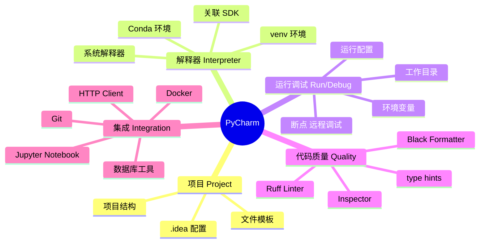
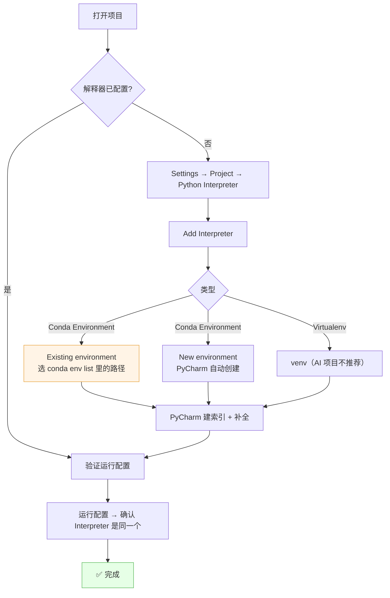
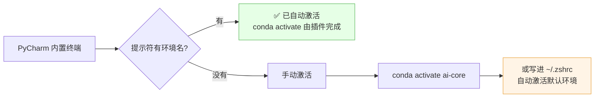

# 🧠 PyCharm 配置详解

> [!abstract] 一句话
> PyCharm 只做三件事：**绑定解释器 → 管运行调试 → 提升编码效率**。它不管环境，环境归 Conda。

## 1. 核心概念图



## 2. 解释器绑定（最核心）



### 2.1 两种添加方式对比

| 方式 | 步骤 | 评价 |
| --- | --- | --- |
| **Existing environment**（推荐） | CLI 建好环境 → PyCharm 选 `~/.../envs/ai-core/bin/python` | 版本可控、可复现、启动快 |
| New environment（PyCharm 内建） | 填名字 + Python 版本 + 包列表 | 方便，但求解器慢、包不可追溯 |

### 2.2 关键路径速查

```bash
conda env list
# base * /opt/anaconda3
# ai-core    /Users/vic/.conda/envs/ai-core
# ai-api     /Users/vic/.conda/envs/ai-api
```

| 用途 | 解释器路径 |
| --- | --- |
| AI 核心环境 | `/Users/vic/.conda/envs/ai-core/bin/python` |
| 轻量 API 环境 | `/Users/vic/.conda/envs/ai-api/bin/python` |
| conda 本体 | `/opt/anaconda3/bin/python`（**别选这个当项目解释器**） |

> [!warning] 常见错误
> 1. 把 `/opt/anaconda3/bin/python` 选成项目解释器 → 等于所有包都在 base 里。
> 2. Windows 的 `python.exe` 路径贴到 macOS → 红色报错。
> 3. 换机器后 `.idea` 里的绝对路径失效 → 需重新指定解释器（见 2.4）。

### 2.3 验证解释器是否正确

在 PyCharm 的 Python Console / Terminal 里执行：

```python
import sys
print(sys.executable)      # 应指向 .../envs/ai-core/bin/python
print(sys.prefix)
```

终端里：

```bash
which python      # 期望 .../envs/ai-core/bin/python
conda env list    # 期望 * 指向 ai-core
```

### 2.4 `.idea` 团队共享

`.idea/` 里存了**绝对路径**，换机器必然失效。两种处理：

| 方案 | 做法 | 适用 |
| --- | --- | --- |
| 不共享 `.idea` | `.gitignore` 加 `.idea/`，每人自行绑定 | 小团队（**推荐**） |
| 共享 `.idea` | 提交 `misc.xml`，但解释器路径用 `sdkName` 引用共享 SDK | 需要统一 SDK 命名时 |

```gitignore
.idea/
*.iml
```

## 3. 运行与调试

### 3.1 运行配置要点

| 配置项 | 建议 |
| --- | --- |
| Python interpreter | 必须是目标环境 |
| Working directory | 设为项目根目录（相对路径 `${PROJECT_DIR}`） |
| Environment variables | 密钥走 `.env` + 插件，**不写进 Run Config 硬编码** |
| Parameters | 脚本参数化，避免改代码 |
| Emulate terminal | 需要交互式输入时勾选 |

### 3.2 `.env` 密钥管理

```bash
# 项目根目录 .env（务必进 .gitignore）
ARK_API_KEY=xxxx
OPENAI_API_KEY=yyyy
```

安装插件：**Environment Variables**（`pip install python-dotenv` 也能手动 `load_dotenv()`）。

### 3.3 调试 AI 程序的 5 个高频断点

| 断点位置 | 看什么 |
| --- | --- |
| 请求构造前 | model / messages / temperature 是否正确 |
| 发送后 | HTTP 状态码、耗时、Token 用量 |
| 响应解析处 | 字段是否缺失、是否走了兜底分支 |
| 工具调用处 | 参数校验、是否被拒绝 |
| 重试逻辑 | 是否无限重试、是否有退避 |

> [!tip] 调试 LLM 的技巧
> 把 `temperature=0` + 固定 seed，**让输出可复现**，否则每次结果不同无法比对。

## 4. 终端与环境激活



### 4.1 让终端自动激活

在 `~/.zshrc` 末尾加（仅在 PyCharm 里生效，用环境变量判断）：

```bash
# PyCharm 终端自动激活项目环境
if [[ -n "$PYCHARM_HOST" ]]; then
    conda activate ai-core 2>/dev/null
fi
```

或改用更通用的做法：`conda init zsh` 后在 `~/.zshrc` 里写

```bash
conda activate ai-core
```

> [!note] 权衡
> 全局自动激活某个环境 = **该项目的终端行为会被污染**。更推荐上面的 `$PYCHARM_HOST` 判断，或用 PyCharm 自带的"Shell 路径 + 自动激活"。

## 5. 代码质量与效率

### 5.1 推荐工具组合

| 工具 | 作用 | 配置位置 |
| --- | --- | --- |
| **Ruff** | Lint + 格式化（快，替代 flake8+isort+black） | Settings → Tools → Ruff |
| Black（可选） | 格式化 | 若已用 Ruff format 则不需要 |
| mypy | 类型检查 | Settings → Tools → mypy |
| `.editorconfig` | 统一缩进/换行 | 项目根目录 |

`.editorconfig`：

```ini
root = true

[*]
charset = utf-8
end_of_line = lf
insert_final_newline = true
indent_style = space
indent_size = 4

[*.{yml,yaml,json}]
indent_size = 2
```

`.ruff.toml`（或 `pyproject.toml`）：

```toml
line-length = 100
target-version = "py311"

[lint]
select = ["E", "F", "I", "N", "UP", "B", "SIM", "RUF"]
ignore = ["E501"]
```

### 5.2 性能设置

| 项 | 建议 | 说明 |
| --- | --- | --- |
| Excluded folders | `venv`, `.venv`, `node_modules`, `data` | 减少索引量 |
| indexing | 首次索引大项目会卡（CPU 飙高） | 配 `.idea` exclude + 内存调大 |
| Memory | `Help → Change Memory Settings` → 2048–4096MB | 大项目/大模型代码 |
| File Watchers | 关掉不需要的（尤其 JS/前端项目混排时） | 省 CPU |
| DataSpell / 插件 | 只留必需插件 | 插件越多索引越慢 |

## 6. Jupyter Notebook


> [!important] Notebook 纪律
> Notebook 是**草稿纸**，不是代码仓库。验证过的逻辑必须落到 `.py` 文件 + 单元测试，否则无法交付。

内核列表查看：

```bash
conda activate ai-core
python -m ipykernel install --user --name ai-core --display-name "Python 3.11 (ai-core)"
jupyter kernelspec list
```

## 7. 常见问题

| 症状 | 原因 | 解决 |
| --- | --- | --- |
| 红色 "No module named torch" | 解释器选了 base | 重新 Add Interpreter → 选 ai-core |
| 导入不报错但 IDE 不提示 | 未索引该环境 | File → Invalidate Caches → Restart |
| 运行配置的 interpreter 是空的 | 项目结构变化 | Run → Edit Configurations → 重新选 |
| 终端提示符没有 `(ai-core)` | 未自动激活 | `conda activate ai-core` 或改 `~/.zshrc` |
| PyCharm 卡顿、CPU 100% | 索引 + 插件 | 排除目录、关插件、增内存 |
| conda 环境在 PyCharm 里找不到 | 解释器路径填的是 `bin/` 目录 | 选 `bin/python` 文件本身 |
| Windows 解释器路径报错 | 路径串了 | macOS 用 `bin/python`，无 `.exe` |
| Notebook 找不到 kernel | 未注册内核 | `python -m ipykernel install ...` |

## 8. 推荐快捷键与插件

**快捷键**

| 功能 | macOS |
| --- | --- |
| 快速修复 | `⌥ + Enter` |
| 重构 | `⌃ + T` |
| 运行 | `⌃ + R` |
| 调试 | `⌃ + D` |
| 全局搜索 | `Double ⇧` |
| 跳到定义 | `⌘ + B` |

**插件（少而精）**

| 插件 | 作用 |
| --- | --- |
| Ruff | Lint + 格式化 |
| Environment Variables | 读 `.env` |
| Jupyter | Notebook |
| GitToolBox | Git 增强 |
| Chinese (Simplified) Language Pack | 中文界面（可选） |
| Markdown Preview Mermaid | Markdown 内 Mermaid 预览（Obsidian 已有） |

## 🏷️ 标签

#AI #PyCharm #IDE #Python #调试

---
返回 [[README]] · 上一篇：[[02-Conda 配置详解]] · 下一篇：[[04-AI 依赖清单与镜像源]]
