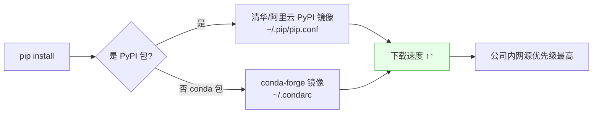

# 📦 AI 依赖清单与镜像源

> [!goal] 目标
> 用**最小环境**跑通 AI 应用开发，避免一上来就装 8GB 的 torch 拖垮进度。

## 1. 分层依赖策略

```mermaid
flowchart TB
    A["L0 基础（所有项目）"] --> A1["httpx / requests"]
    A --> A2["pydantic / pydantic-settings"]
    A --> A3["python-dotenv"]
    A --> A4["typer / rich（CLI）"]
    A --> A5["tenacity（重试）"]

    B["L1 模型 API"] --> B1["openai / anthropic SDK"]
    B --> B2["tiktoken"]
    B --> B3["langchain / langchain-core"]

    C["L2 检索 RAG"] --> C1["sentence-transformers"]
    C --> C2["faiss-cpu 或 chromadb"]
    C --> C3["rank-bm25"]
    C --> C4["FlagEmbedding（Rerank）"]

    D["L3 本地模型（重）"] --> D1["torch / torchvision"]
    D --> D2["transformers / accelerate"]
    D --> D3["peft / trl / datasets"]

    E["L4 工程化"] --> E1["fastapi / uvicorn"]
    E --> E2["langfuse（可观测）"]
    E --> E3["pytest / pytest-asyncio"]
    E --> E4["ruff / mypy"]
    E --> E5["docker / docker-compose"]

    style A fill:#eaf7ea,stroke:#5aa469
    style B fill:#e8f4ff,stroke:#4a90d9
    style C fill:#fff4e6,stroke:#e8a33d
    style D fill:#ffe6e6,stroke:#d9534f
    style E fill:#f7eaff,stroke:#9b6bc7
```



## 2. 按场景装什么

| 场景 | 环境 | 安装层级 | 体积估算 |
| --- | --- | --- | --- |
| 只调 API（LLM 应用/后端） | `ai-api` | L0 + L1 | < 300MB |
| RAG 本地检索 | `ai-rag` | L0 + L1 + L2 | ~1.5GB |
| 本地跑模型 / 微调 | `ai-core` | L0 + L1 + L3 | ~4–8GB |
| Agent 服务 | `ai-agent` | L0 + L1 + L4(+L2) | < 1GB |

> [!tip] 先 L0/L1 跑通业务，再补 L2/L3
> 大部分 AI 应用开发（Spring AI、RAG 编排、Agent 工具链）**根本不需要本地模型**。先用 API 打通链路，评测出"必须本地"再装 torch。

## 3. 安装命令

### 3.1 轻量 API 环境（推荐先建）

```bash
conda create -n ai-api python=3.11 -y
conda activate ai-api
python -m pip install -U pip
python -m pip config set global.index-url https://pypi.tuna.tsinghua.edu.cn/simple
python -m pip install \
  httpx pydantic pydantic-settings python-dotenv tenacity \
  openai tiktoken rich typer \
  fastapi "uvicorn[standard]" pytest pytest-asyncio ruff
```

### 3.2 RAG 环境

```bash
conda create -n ai-rag python=3.11 -y
conda activate ai-rag
python -m pip install -U pip
python -m pip install \
  httpx pydantic python-dotenv tenacity openai \
  sentence-transformers faiss-cpu rank-bm25 \
  langchain langchain-community langchain-text-splitters \
  numpy pandas
```

### 3.3 本地模型 / 微调环境（重）

```bash
conda create -n ai-core python=3.11 -y
conda activate ai-core
# macOS 装 CPU 版 torch（PyPI 上就是 CPU/MPS 版；CUDA 版只在 Linux 上）
python -m pip install torch torchvision
python -m pip install transformers accelerate datasets peft trl bitsandbytes
```

### 3.4 Agent 与 MCP

```bash
conda create -n ai-agent python=3.11 -y
conda activate ai-agent
python -m pip install \
  httpx pydantic python-dotenv tenacity \
  openai langchain langchain-core langgraph \
  "mcp" fastapi "uvicorn[standard]" \
  langfuse pytest ruff
```

## 4. macOS arm64 避坑

| 坑 | 现象 | 解决 |
| --- | --- | --- |
| `faiss` 无 arm64 轮子 | 装 `faiss` 失败 | 装 `faiss-cpu`（有 arm64 wheel）或改用 `chromadb` / `hnswlib` |
| 装到 x86_64 版 numpy | `numpy.dtype size changed` 或架构报错 | 检查 `python -c "import numpy; print(numpy.__file__)"` 与 `file $(which python)` 架构一致 |
| pip 源码编译很慢 | 长时间编译 | 加镜像 + 用 `--only-binary=:all:` 优先二进制 |
| MPS 不支持某些算子 | `NotImplementedError: MPS backend` | `torch.device("cpu")` 兜底，或升级 torch |
| `bitsandbytes` 无 Mac 支持 | 装不上 | Mac 上量化用 `mlx` / `llama.cpp` 路线，不用 bnb |
| onnxruntime 架构冲突 | `ImportError` | `python -m pip install --force-reinstall onnxruntime` |

架构一致性检查：

```bash
python -c "import platform, sys; print(platform.machine(), sys.executable)"
file "$(conda run -n ai-core python -c 'import sys; print(sys.executable)')"
```

## 5. 镜像源策略



```bash
# pip
python -m pip config set global.index-url https://pypi.tuna.tsinghua.edu.cn/simple
python -m pip config set global.extra-index-url https://mirrors.aliyun.com/pypi/simple/
python -m pip config set install.trusted-host mirrors.tuna.tsinghua.edu.cn

# conda
conda config --set solver libmamba
conda config --set channel_priority strict
```

## 6. 版本锁定策略

| 场景 | 做法 |
| --- | --- |
| 应用开发 | `pyproject.toml` 声明范围（`torch>=2.4,<3`），锁文件进 Git |
| 可复现交付 | `pip freeze > requirements.lock`，CI 用它安装 |
| 实验环境 | 允许漂移，但**记录**当前版本 |
| 关键大件 | torch / transformers / numpy 手动 pin，防止上游 breaking change |

```toml
# pyproject.toml
[project]
name = "ai-app"
requires-python = ">=3.11,<3.12"
dependencies = [
  "httpx>=0.27",
  "pydantic>=2.7",
  "openai>=1.40",
]

[tool.ruff]
line-length = 100
target-version = "py311"
```

## 7. 依赖体检

```bash
# 当前环境依赖树
conda list -n ai-core

# 依赖冲突检查（conda）
conda list --explicit -n ai-core > explicit.txt

# pip 依赖冲突
python -m pip check

# 找出占用最大的包
python -m pip list --format=freeze | head -50

# 清理缓存（装完 torch 可回收几个 G）
conda clean -a -y
```

## 8. 密钥管理

```bash
# .env（进 .gitignore）
ARK_API_KEY=sk-xxx
OPENAI_API_KEY=sk-yyy
```

```python
from dotenv import load_dotenv
import os

load_dotenv()
api_key = os.environ["ARK_API_KEY"]
```

```gitignore
.env
*.key
secrets/
```

> [!danger] 绝对不要
> 把 API Key 写进代码、`environment.yml`、Jupyter 输出或截图。

## 🏷️ 标签

#AI #Python #依赖管理 #镜像源 #PyTorch

---
返回 [[README]] · 上一篇：[[03-PyCharm 配置详解]] · 下一篇：[[05-常见问题排查]]
