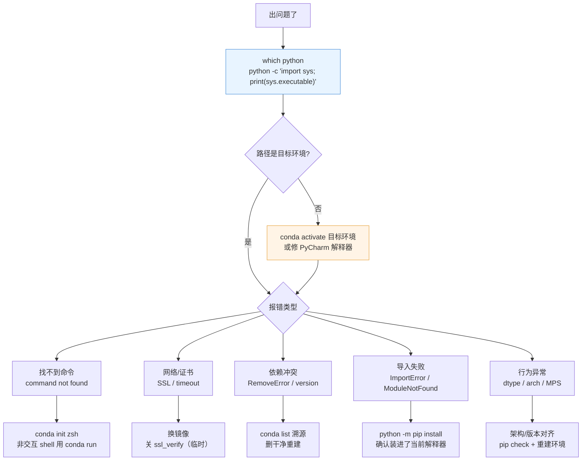

# 🧯 常见问题排查

> [!tip] 排查总原则
> **先确认"我现在到底在哪个环境里"**，再谈别的。90% 的玄学问题都是解释器/环境指错。

## 1. 排查决策树



## 2. 第一诊断命令（背下来）

```bash
which python                       # 指向哪个解释器
python -V                          # 版本
python -c "import sys; print(sys.executable, sys.prefix)"
conda env list                     # 全部环境 + 当前激活
conda info                         # 路径、solver、channels
python -m pip list | head -30      # 当前解释器实际装了啥
python -m pip check                # 依赖冲突检查
echo $CONDA_PREFIX                 # 当前环境前缀
```

## 3. 症状速查表

| # | 症状 | 根因 | 解决 |
| --- | --- | --- | --- |
| 1 | `conda: command not found` | 未 init，或脚本里非交互 | `conda init zsh`；脚本用 `conda run -n ai-core python x.py` |
| 2 | `conda activate` 报 `Your shell has not been properly configured` | `.zshrc` 被注释/未重载 | `exec zsh` 或重开终端 |
| 3 | `CondaSSLError: SSL verification failed` | 证书链/镜像握手 | 换镜像；临时 `conda config --set ssl_verify false` |
| 4 | `Solving environment: ...` 长时间不动 | classic 求解器 | `conda config --set solver libmamba` |
| 5 | `RemoveError: packages folder doesn't have packages` / 混装报错 | conda 与 pip 装同名包 | `conda list` 找到冲突 → `conda remove` → 统一用 pip |
| 6 | `PackagesNotFoundError` | channel 里没有该包 | `conda search xxx` 看来源；换 `-c conda-forge` |
| 7 | 装包极慢 / `Connection timed out` | 未配镜像 | 检查 `conda config --show channels`、`pip config list` |
| 8 | `ModuleNotFoundError: No module named 'torch'` | 装到了别的环境 | `python -m pip install torch`（在正确环境里） |
| 9 | PyCharm 报 `No module named xxx` 但终端正常 | IDE 解释器 ≠ 终端解释器 | Add Interpreter → 选 conda 环境 |
| 10 | IDE 无补全/跳转 | 索引损坏 | `File → Invalidate Caches → Restart` |
| 11 | `numpy.dtype size changed` | 混用 x86_64 / arm64 二进制 | 删干净重装；`pip install --force-reinstall numpy` |
| 12 | `Operation not permitted` / `Read-only file system` | 系统目录或 SIP 保护 | 装到环境/用户目录，勿写 `/usr/local` |
| 13 | `error: externally-managed-environment` | 装到了 Homebrew/系统 Python | 必须用 conda 环境内的 python |
| 14 | `MPS backend out of memory` | 统一内存不足 | 降 batch / `PYTORCH_MPS_HIGH_WATERMARK_RATIO=0.0` / 改 CPU |
| 15 | `FileNotFoundError: environment.yml` | 路径不对 | `cd` 到 yml 所在目录再执行 |
| 16 | 磁盘告急 | torch + pip 缓存 | `conda clean -a -y`、`python -m pip cache purge` |
| 17 | `Permission denied: '/opt/anaconda3/...'` | 目录权限 | 不要往 base 装包；在自建环境里装 |
| 18 | Python 版本与包不兼容 | 如 3.13 无部分轮子 | 固定 `python=3.11` 重建 |

## 4. 环境重建 SOP


```bash
# 一步到位（推荐）
conda env remove -n ai-core -y
conda env create -f environment.yml
conda activate ai-core
python -m pip install -r requirements.txt
```

## 5. 重建后必须复查

- [ ] `python -c "import torch; print(torch.__version__)"`
- [ ] `python -m pip check` 无冲突
- [ ] `python -c "import sys; print(sys.executable)"` 指向新环境
- [ ] PyCharm 解释器重新指定（删了环境路径就失效了）
- [ ] `~/.condarc` 镜像仍在（别在重建时清掉家目录配置）

## 6. 一键健康检查脚本

保存为 `~/bin/doctor.sh`：

```bash
#!/usr/bin/env bash
set -u
echo "=== 系统 ==="
uname -m; sw_vers 2>/dev/null | head -3
echo "=== conda ==="
which conda || { echo "conda 未安装"; exit 1; }
conda --version
conda config --show solver channel_priority 2>/dev/null
echo "=== 环境 ==="
conda env list
echo "=== 当前解释器 ==="
which python; python -V
python -c "import sys; print(sys.executable)"
echo "=== 关键包 ==="
python -m pip list 2>/dev/null | grep -Ei "torch|transformers|openai|langchain|fastapi" || echo "无关键包"
echo "=== 依赖冲突 ==="
python -m pip check || true
echo "=== 磁盘 ==="
df -h "$HOME" | tail -1
```

```bash
chmod +x ~/bin/doctor.sh && ~/bin/doctor.sh
```

## 7. 什么时候该直接重装

| 情况 | 判断 | 动作 |
| --- | --- | --- |
| 单包报错 | 依赖冲突 | 只重装该包，pin 版本 |
| 单环境诡异 | 状态污染 | 删环境重建 |
| 全局诡异 | conda 本体坏 | `conda clean --all` + 重装 Miniforge |
| 磁盘满 | `df -h` | 清缓存、删旧环境 |
| 怀疑被入侵/损坏 | 校验和异常 | 重装系统级工具 |

> [!warning] 重装前必做
> 1. `conda env export` 备份（`--from-history` + 全量各一份）
> 2. `python -m pip freeze > requirements.txt`
> 3. 记录 `conda config --show` 的配置（镜像、solver）

## 🏷️ 标签

#AI #环境搭建 #排错 #FAQ #Conda

---
返回 [[README]] · 上一篇：[[04-AI 依赖清单与镜像源]] · 下一篇：[[06-环境速查卡]]
