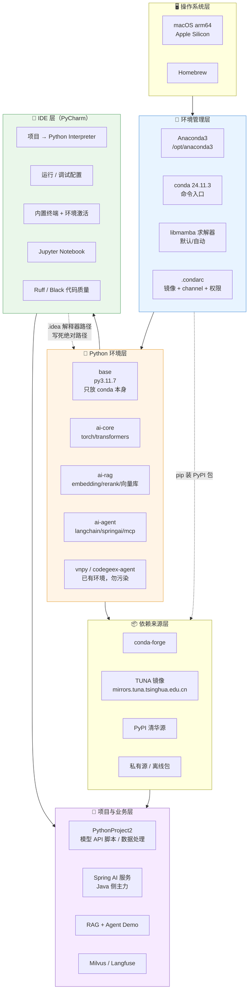

# 🧰 AI 环境搭建与开发工具链

> [!abstract] 这一组笔记解决什么
> 从"零散能跑"到"**可复现、可迁移、可交付**"的 AI 开发环境：
> **Conda 管环境与依赖 → PyCharm 管开发体验 → AI 栈管业务能力**。

## 📍 本机现状（2026-10-26 实测）

| 项 | 值 | 说明 |
| --- | --- | --- |
| 系统 | macOS · `arm64` | Apple Silicon，优先用原生 arm64 包 |
| Conda | `24.11.3` | 安装在 `/opt/anaconda3` |
| Base Python | `3.11.7` | base 环境，**不要在 base 里装业务依赖** |
| 已有环境 | `base` / `vnpy` / `codegeex-agent` | 最后一个来自 `~/.codegeex/mamba` |
| PyCharm | `/Applications/PyCharm.app` | 已安装 |
| 当前项目 | `~/PycharmProjects/PythonProject2` | PyCharm 新建的项目骨架 |

> [!warning] 当前最大缺口
> 还没有专用的 AI 环境（`ai-core` / `ai-rag` / `ai-agent`），且**未配置国内镜像**，装 torch 这类大包会非常慢甚至超时。

## 🗺️ 环境全景



## 📚 文档导航

| 笔记 | 内容 | 什么时候看 |
| --- | --- | --- |
| [[01-环境搭建总览]] | 标准 7 步搭建流程 + 验收清单 + 换机重建 | 第一次搭 / 换机器 |
| [[02-Conda 配置详解]] | `.condarc`、镜像源、环境管理命令、导出迁移 | 想加速安装 / 管多环境 |
| [[03-PyCharm 配置详解]] | 解释器绑定、运行调试、终端激活、代码质量 | 打开 IDE 就用得上 |
| [[04-AI 依赖清单与镜像源]] | 分层依赖表 + 安装顺序 + arm64 避坑 | 建 `ai-core` 环境时 |
| [[05-常见问题排查]] | 症状 → 原因 → 解决速查表 | 报错了先查这里 |
| [[06-环境速查卡]] | 一页纸命令卡片 | 忘了命令就瞄一眼 |

## ⚡ 5 分钟快速验证

```bash
# 1. conda 是否可用
conda --version                     # 期望 conda 24.11.3

# 2. 能不能创建并激活隔离环境
conda create -n ai-core python=3.11 -y
conda activate ai-core
python -V                           # 期望 Python 3.11.x
python -c "import sys; print(sys.executable)"

# 3. base 是否干净（不该出现 torch/transformers）
conda list -n base | grep -E "torch|transformers" || echo "base 干净"

# 4. PyCharm 是否绑定到了正确的解释器
conda env list                      # 记住 ai-core 的路径，PyCharm 里要选它
```

## 🧩 推荐环境矩阵

| 环境名 | Python | 职责 | 关键依赖 | 谁在用 |
| --- | --- | --- | --- | --- |
| `base` | 3.11 | 只放 conda / 工具本身 | conda, mamba | 所有环境的管理员 |
| `ai-core` | 3.11 | 模型底座 + API 调用 | torch, transformers, openai, httpx | 训练/推理/实验 |
| `ai-rag` | 3.11 | 检索链路 | sentence-transformers, faiss/chroma, rank-bm25 | RAG Demo |
| `ai-agent` | 3.11 | Agent 与编排 | langchain, mcp, fastapi, uvicorn | Agent 服务 |
| `ai-ml` | 3.11 | 模型微调 | peft, trl, datasets, accelerate | LoRA 实验 |
| `vnpy` | 保留 | 已有量化策略，**禁止混装** | vnpy 相关 | 量化 |
| `codegeex-agent` | 保留 | CodeGeeX 插件自带，**禁止混装** | mamba 管理 | 工具链 |

> [!tip] 铁律
> 1. **base 只做管理**，任何业务依赖都不进 base。
> 2. **一项目一环境**，实验环境的脏依赖不污染主线环境。
> 3. **conda 管解释器，pip 管 PyPI 包**，不要用 `conda install pip` 之外的方式混装乱升级。

## 🏷️ 标签

#AI #环境搭建 #Conda #PyCharm #Python #工程化

---
回到 [[README]]（AI 学习规划） · 关联 [[12周AI应用开发路线/README|12 周 AI 应用开发路线]] · [[01-学习路径总览]]
