# 🗺 LLM 大模型 Agent 应用开发实战课程 · 总览

> [!abstract] 这是一份什么笔记
> 把语雀课程《LLM大模型Agent应用开发实战课程 VVVIP》整理进本 vault 的**导航中枢（MOC）**。
> 原知识库：作者「大伟（AI）」，**397 篇文档 / 约 172 万字**，持续加餐中。
> 课程主线是 **Node.js / TypeScript + Vue3 + LangChain.js + LangGraph + DeepSeek**，偏前端全栈视角。

> [!warning] 当前完成度，请先读这条
> 本批笔记已核对的内容：**12 章的真实开篇导语、完整小节目录、每章源码链接、全库文档索引**——这些全部来自已登录状态下的页面实际读取，不是猜的。
> **尚未抓取的是每章正文全文**。浏览器读取工具对长正文有截断，逐屏抓取 397 篇不可行；因此每章笔记里的「核心概念速记」是**助学注解**，不是原文逐字内容，正文细节标注在 `> [!todo] 待精读清单` 里。
> 补全方式见文末「如何补全全文」。

## 🧭 学习主线

```mermaid
flowchart LR
    A[1 基础认知<br/>LLM / Token / API / SSE] --> B[2 提示词工程]
    B --> C[3 框架<br/>LangChain.js + LangGraph]
    C --> D[4 工具调用<br/>Function Call]
    D --> E[5 协议<br/>MCP]
    E --> F[6 知识<br/>RAG]
    F --> G[7 自主<br/>Agent / ReAct]
    G --> H[8 编排<br/>Workflow / HITL]
    H --> I[9 记忆<br/>短期 / 画像 / 长期]
    I --> J[10 成本<br/>缓存 / 限流 / 监控]
    J --> K[11 工程化<br/>部署 / 日志 / 安全]
    K --> L[12 架构收束<br/>测试 / 模型热切换 / A-B]
```

| 阶段 | 章节 | 解决什么问题 |
| --- | --- | --- |
| 基础 | 1–3 | 从"能调 API"到"用框架编排模型" |
| 能力 | 4–7 | 让模型能调工具、读私有知识、自主规划 |
| 编排 | 8–9 | 流程可控、状态可存、跨会话有记忆 |
| 工程 | 10–12 | 成本、稳定性、上线与整体架构 |

## 📚 十二章导航

| # | 笔记 | 主题 | 原文 |
| --- | --- | --- | --- |
| 01 | [[01-第一章-大模型应用开发概述]] | LLM 是什么、Token、上下文窗口、温度、消息角色、首个 API、SSE 流式、计费 | [语雀](https://www.yuque.com/sohucw/irt1ar/vxu3siuggmctls4g) |
| 02 | [[02-第二章-提示词工程]] | 四基础原则、Few-shot、CoT、结构化输出、模板管理 | [语雀](https://www.yuque.com/sohucw/irt1ar/xif7g2pum720whub) |
| 03 | [[03-第三章-LangChain与LangGraph]] | LangChain.js 用法、LCEL、会话记忆、StateGraph、Vue3 聊天项目 | [语雀](https://www.yuque.com/sohucw/irt1ar/ocqtyiygyhq4iz4q) |
| 04 | [[04-第四章-FunctionCall]] | Zod 定义工具、ToolNode、并行调用、幂等与权限、SSE 推状态 | [语雀](https://www.yuque.com/sohucw/irt1ar/gfdlt9cxr31ohd47) |
| 05 | [[05-第五章-MCP协议]] | 三种原语、stdio/SSE 传输、Server/Client、接入 LangChain、Claude Desktop | [语雀](https://www.yuque.com/sohucw/irt1ar/dvzlbqrgyq0rm1th) |
| 06 | [[06-第六章-RAG]] | Embedding、Chroma、Chunking、带溯源 RAG、查询改写/多路召回/Rerank | [语雀](https://www.yuque.com/sohucw/irt1ar/qxt8fo3kuz9lr84z) |
| 07 | [[07-第七章-Agent智能体]] | ReAct 循环、Reflection、Supervisor 多 Agent、评估、工程陷阱 | [语雀](https://www.yuque.com/sohucw/irt1ar/fm5yds7r3qiig8et) |
| 08 | [[08-第八章-Workflow工作流]] | 线性/条件/并行工作流、Human-in-the-Loop、状态持久化、断点恢复 | [语雀](https://www.yuque.com/sohucw/irt1ar/lr73157r07zpo9ag) |
| 09 | [[09-第九章-长期记忆]] | 记忆分类、用户画像、跨会话记忆、分层架构、Token 感知截取 | [语雀](https://www.yuque.com/sohucw/irt1ar/se2qpeaw62dm0zrp) |
| 10 | [[10-第十章-成本优化]] | 成本构成、精确/语义/分级缓存、Token 优化、限流队列、成本监控 | [语雀](https://www.yuque.com/sohucw/irt1ar/dy2nadcp83dgwqba) |
| 11 | [[11-第十一章-工程化部署]] | 容器化、错误处理、结构化日志/链路追踪、健康检查、安全防护 | [语雀](https://www.yuque.com/sohucw/irt1ar/ih7g916ezglyq9w7) |
| 12 | [[12-第十二章-总结与项目架构]] | 项目结构、Mock 测试、模型抽象层与热切换、Prompt A/B、全书技术栈 | [语雀](https://www.yuque.com/sohucw/irt1ar/gck7x4emkxo3ra1v) |

> [!question] ⚠️ 原文存在两处标题 / 正文错位（已核对，不是笔记写错）
> - **目录第 10 章**标题写「模型微调（Fine-tuning）」，但正文导语与全部小节（10.1 成本的构成 … 10.7 收益估算）讲的是**成本优化与性能**，正文里没有微调内容。
> - **目录第 11 章**标题写「性能优化与成本控制」，但正文（11.1 容器化部署 … 11.8 上线检查清单）讲的是**工程化与上线**。
> 本 vault 按**正文实际内容**命名这两篇笔记，并在各自笔记里保留了原目录标题备查。

## 🎬 实战 / 视频 / 源码

见 [[13-实战与视频模块索引]]：包含必看文档、企业级项目实战、视频教程（从0到1 / Ollama+向量化 / LangGraph 实操一~五）、NestJS + Chroma + pgvector 完整 RAG 项目，以及**每章源码链接汇总**。

## 🔗 与 vault 现有笔记的关联

- [[技术栈地图]] —— 本课程的 JS/TS 路线可与你的 Java / Spring AI 主线对照看（RAG、Agent、MCP、工程化几块几乎一一对应）
- [[03-Java开发阶段]] / [[04-高级架构阶段]] / [[05-项目与求职阶段]] —— 学习节奏与项目落点
- [[00-AI经历怎么讲与简历改写策略]] —— 对应课程「简历中如何体现」一节
- [[01-聊一聊Transformer的架构和基本原理]] —— 第 1 章「大模型是什么」的底层补充

> [!tip] 技术栈差异提醒
> 课程用 **Node/NestJS + Vue3 + LangChain.js**，你的主线是 **Spring Boot + Spring AI + Java**。概念可直接迁移，代码示例不能直接照抄；建议按「概念 → Java 侧等价实现」的方式做对照笔记。

## ✅ 如何补全全文（两条路）

> [!todo] 待补：每章正文全文
> - [ ] **路径 A（最全最快）**：在语雀知识库用「导出 / 下载为 Markdown」导出整库，把文件放到本机任意目录告诉我路径，我批量转成带 frontmatter、callouts、wikilinks 的 Obsidian 笔记，保留全文。
> - [ ] **路径 B（分批精读）**：指定章节（如「先精读第 6、7 章」），我逐章滚动读取正文并写成完整学习笔记，一次 1–3 章。
> - [ ] 无论哪条路径，完成后把各笔记 `status` 从 `骨架` 改为 `已精读`，并清掉 `> [!todo]` 清单。

---
回到 [[README]]
