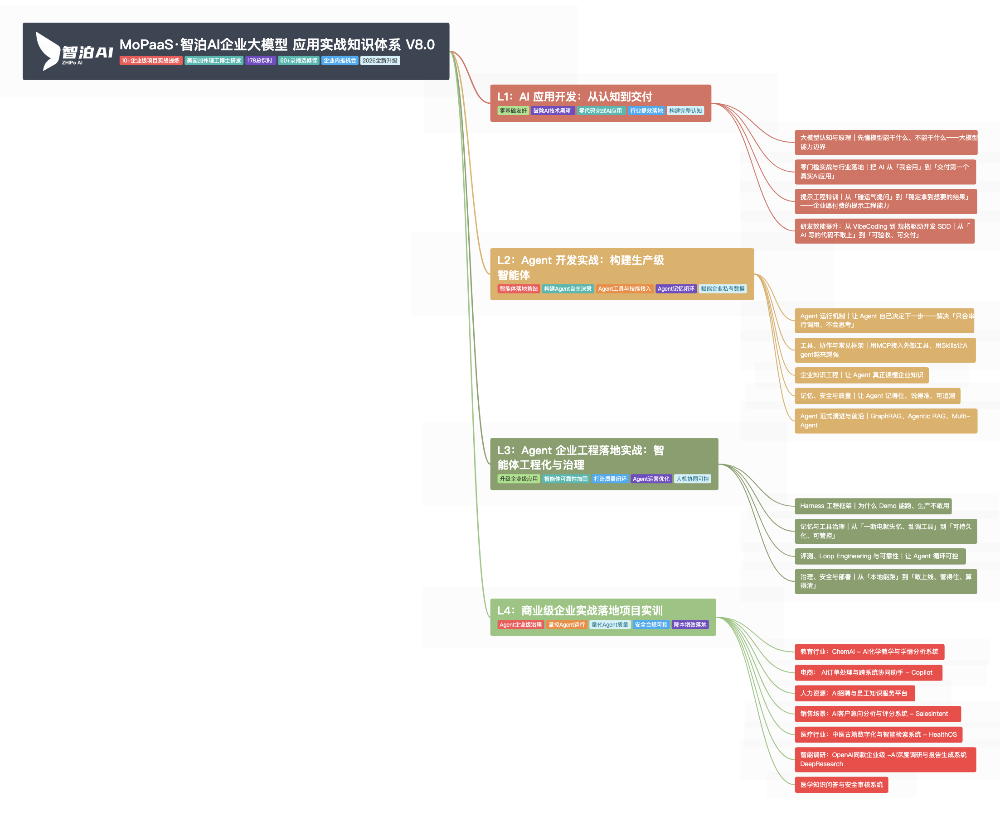

# MoPaaS·智泊AI企业大模型 应用实战知识体系 V8.0

> `10+企业级项目实战提炼` ｜ `美国加州理工博士研发` ｜ `178总课时` ｜ `60+录播选修课` ｜ `企业内推机会` ｜ `2026全新升级`

> 来源：[ProcessOn 思维导图](https://www.processon.com/view/link/6adf129c4ca05e2b5d3a9c75)（原作者 江南布衣）· 共 **1524** 个主题节点 · **8** 级层次

## 本地文件

| 文件 | 说明 |
| --- | --- |
|  | **概览图（L1 + L2，25 个主题）** — 全部展开到 L2，178 总课时结构一眼看完 |
| [概览-L1-L3.png](attachments/概览-L1-L3.png) | 展开到 L3（163 个主题）的缩略总览 |
| [完整导图.png](attachments/完整导图.png) | **全量 1524 个主题**的整图（3661×54988） |
| [完整导图-矢量.svg](attachments/完整导图-矢量.svg) | 全量矢量版，可无限放大不失真（浏览器/设计软件打开） |
| [分支1.png](attachments/分支1.png) · [分支2.png](attachments/分支2.png) · [分支3.png](attachments/分支3.png) · [分支4.png](attachments/分支4.png) | L1–L4 四大分支的 1:1 全分辨率图 |
| [outline.txt](outline.txt) | 带编号的纯文本大纲（1. 1.1. 1.1.1. 格式，可直接导入 XMind/幕布） |
| [mindmap.json](mindmap.json) | 机器可读的完整树（title / tags / children） |

> [!info] 关于图片
> ProcessOn 的「下载 PNG」是会员功能，本目录中的图片是按原始数据（1524 个节点、全部标签与配色）在本地重新渲染的，层级与文字与线上完全一致。

## 目录
- **L1：AI 应用开发：从认知到交付** · 零基础友好 / 破除AI技术黑箱 / 零代码完成AI应用 / 行业提效落地 / 构建完整认知
    - 大模型认知与原理｜先懂模型能干什么、不能干什么——大模型能力边界
    - 零门槛实战与行业落地｜把 AI 从「我会用」到「交付第一个真实AI应用」
    - 提示工程特训｜从「碰运气提问」到「稳定拿到想要的结果」——企业愿付费的提示工程能力
    - 研发效能提升：从 VibeCoding 到 规格驱动开发 SDD｜从「AI 写的代码不敢上」到「可验收、可交付」
- **L2：Agent 开发实战：构建生产级智能体** · 智能体落地首站 / 构建Agent自主决策 / Agent工具与技能接入 / Agent记忆闭环 / 赋能企业私有数据
    - Agent 运行机制｜让 Agent 自己决定下一步——解决「只会串行调用、不会思考」
    - 工具、协作与常见框架｜用MCP接入外部工具、用Skills让Agent越来越强
    - 企业知识工程｜让 Agent 真正读懂企业知识
    - 记忆、安全与质量｜让 Agent 记得住、说得准、可追溯
    - Agent 范式演进与前沿｜GraphRAG、Agentic RAG、Multi-Agent
- **L3：Agent 企业工程落地实战：智能体工程化与治理** · 升级企业级应用 / 智能体可靠性加固 / 打造质量闭环 / Agent运营优化 / 人机协同可控
    - Harness 工程框架｜为什么 Demo 能跑、生产不敢用
    - 记忆与工具治理｜从「一断电就失忆、乱调工具」到「可持久化、可管控」
    - 评测、Loop Engineering 与可靠性｜让 Agent 循环可控
    - 治理、安全与部署｜从「本地能跑」到「敢上线、管得住、算得清」
- **L4：商业级企业实战落地项目实训** · Agent企业级治理 / 掌控Agent运行 / 量化Agent质量 / 安全合规可控 / 降本增效落地
    - 教育行业：ChemAI - AI化学教学与学情分析系统
    - 电商： AI订单处理与跨系统协同助手 - Copilot
    - 人力资源：AI招聘与员工知识服务平台
    - 销售场景：AI客户意向分析与评分系统 - SalesIntent
    - 医疗行业：中医古籍数字化与智能检索系统 - HealthOS
    - 智能调研：OpenAI同款企业级 -AI深度调研与报告生成系统 DeepResearch
    - 医学知识问答与安全审核系统

---

## L1：AI 应用开发：从认知到交付

`零基础友好` `破除AI技术黑箱` `零代码完成AI应用` `行业提效落地` `构建完整认知`

### 大模型认知与原理｜先懂模型能干什么、不能干什么——大模型能力边界

#### 大模型基础认知｜从「听说过」到「看清全貌」——演进、生态、能力

- **大语言模型基础认知**
    - 初识大模型
        - 人工智能演进与大模型兴起：从AI1.0到AI2.0的变迁
            - 定义与核心概念
            - AI1.0：感知智能时代
                - 定义
                - 传统AI1.0代表产品
            - AI2.0：认知智能时代
                - 定义
                - AIGC现代AI代表应用
            - 人工智能的核心能力与应用场景
        - 大模型与通用人工智能认知
            - 大模型深度认知解析
            - 通用人工智能技术特征
            - 大模型与通用人工智能之间的联系
    - 主流大模型与应用产品
        - 主流大模型介绍
            - DeepSeek
            - Qwen
            - GLM系列
            - GPT系列
            - Claude
            - Gemini
        - 开源大模型 VS 闭源大模型
        - 主流大模型应用产品介绍
    - AI行业生态全景
        - 四层结构：大模型层/应用层/工具层/服务层
        - 国内外主流玩家地图
        - 哪些岗位在消失？哪些岗位在诞生？
- **AI大模型的能力认知**
    - 理解大模型的训练和推理
    - 什么是概率模型
    - AI大模型的能力边界

#### 大语言模型核心原理｜Transformer 到 RLHF，面试必考的底层原理一次讲透

- **大语言模型和传统的机器学习的差异**
- **大模型的底层Transformer架构**
    - 为什么会用到Transformer
    - 什么是Transformer
    - RNN的原理与局限性
    - Transformer架构分析
    - Transformer论文解读
- **大模型运行基本机制**
    - 大模型如何理解和表示单词
        - 大模型处理单元 — Token
        - 单元的远近亲疏关系
        - 大模型词义的载体和表现特征
    - 词向量和词嵌入详解
        - 常见向量模型
    - 大模型如何理解并预测输入的内容
        - 注意力机制
        - 自注意力机制
        - 多头注意力机制
        - 基于语义理解的内容生成
- **预训练、SFT、RLHF**
    - 机器学习算法分类
    - 大模型预训练流程解读
    - SFT（监督微调）流程解读
    - RLHF（基于人类反馈的强化学习）流程解读

### 零门槛实战与行业落地｜把 AI 从「我会用」到「交付第一个真实AI应用」

#### 行业 AI 提效场景｜看懂 8 大行业怎么落地——面试聊业务不露怯

- **零售 / 电商**
    - 痛点：运营每周人工写5份竞品分析，耗时2天
    - AI解法：WorkBuddy自动抓取+分析，10分钟生成报告
- **金融 / 银行**
    - 痛点：合同审查人工需2小时，容易遗漏风险点
    - AI解法：上传PDF，3分钟提取关键条款和风险项
- **医疗 / 健康**
    - 痛点：患者反馈每月几千条，人工分类整理要一周
    - AI解法：批量导入数据，自动分类+生成问题优先级报告
- **制造 / 工厂**
    - 痛点：设备日志靠人眼找异常，效率低且容易漏
    - AI解法：导入日志，自动识别异常模式，生成质检周报
- **教育 / 培训**
    - 痛点：作业批改耗时耗力，学情报告全靠老师手写，难以规模化
    - AI解法：WorkBuddy批量批改作业+自动评分，5分钟生成全班学情报告
- **政务 / 公共服务**
    - 痛点：表单汇总+汇报材料撰写最耗时
    - AI解法：多份表格合并，自动提炼数字+生成汇报PPT
- **物流 / 供应链**
    - 痛点：运单数据分析靠Excel手动透视，输出慢
    - AI解法：导入运单数据，自动识别异常环节+输出优化建议
- **能源 / 公用事业**
    - 痛点：多源能耗数据整合分析需要专业团队
    - AI解法：多表格整合，自动生成能耗趋势分析+降本建议

#### 零编码纯Prompt 实现AI项目实战

- **WorkBuddy 从0到1实战**
    - 安装配置 + 模型选择
    - 理解Agent思维：不是聊天工具，而是会干活的助理
    - 从「AI工具使用者」到「AI工作流设计者」
- **Vibe Coding氛围编程**
    - 什么是Vibe Coding
    - AI Coding标准工作流详解
- **WorkBuddy应用实践：AI学习助手V1.0**
    - AI学习助手-知穹阅枢介绍
    - 项目全景
    - 系统提示词体系
    - claude.md与new claude.md
    - 学习助手V1.0实操
    - 功能体系、技术升级、架构演进
    - 长期用户记忆系统-设计文档

### 提示工程特训｜从「碰运气提问」到「稳定拿到想要的结果」——企业愿付费的提示工程能力

#### Prompt Engineering基础原理与工程进阶技巧

- **提示词(Prompt)与提示工程**
- **Prompt Engineering的构建原则**
- **Prompt的典型构成要素**
    - 角色、要求、任务、示例、约束、流程
- **Prompt调优进阶技巧**
    - 零样本提示
    - 少样本提示
    - 思维链(Chain-of-thought)
    - 自洽性(Self-Consistency)
- **Prompt攻击与防范**
    - 提示词注入
    - 提示词防范
- **大模型应用全流程提示词实战**
    - 通用提示词
    - 基于RAG提示词构建
    - 基于Agent提示词构建
    - 基于任务提示词编写

#### Prompt 应用实战项目

- **应用实战：电商销售数据分析助手**
- **应用实战：连锁奶茶店新品Prompt项目**
- **应用实战：基于提示工程的旅游攻略系统实现**
- **应用实战：企业运营成本分析核算（升级版）**

#### Prompt 优化方法论与经验沉淀

#### 大模型 API 开发基础

### 研发效能提升：从 VibeCoding 到 规格驱动开发 SDD｜从「AI 写的代码不敢上」到「可验收、可交付」

#### 价值

- **业务价值驱动：解决"AI 能写代码但难以上生产"的核心痛点**
- **技术范式升级：从 VibeCoding 演进到 AICoding = VibeCoding + SDD**
- **规范驱动实战：以 Spec 作为唯一真实来源，先定义 WHAT，再让 AI 完成 HOW**
- **工具链完整覆盖：Trae + Spec Kit 从 0 到 1，Claude Code 桌面端 + OpenSpec 完成生产级升级**
- **工程化能力突出：覆盖 AI 宪法、需求规格、技术方案、任务拆解、代码生成、自动化测试、规范校验、归档追溯全流程**

#### 目标

- **理解 VibeCoding 的价值与风险，掌握从原型开发到生产级开发的分界线**
- **掌握 SDD 规范驱动开发方法论，理解 Spec 作为 Single Source of Truth 的核心价值**
- **学会编写可测试、可验收、可约束 AI 行为的高质量 Spec**
- **使用 Trae + Spec Kit，从 PRD 出发生成 Vue3 + TypeScript + FastAPI 全栈项目**
- **使用 Claude Code 桌面端 + OpenSpec，对已有 MVP 项目进行生产级升级改造**
- **完成多学校数据隔离等复杂改造，理解合理的改造顺序**

#### 技术栈清单

- **AI 开发工具：Trae CN, Claude Code 桌面端, Claude Code 插件版, CC Switch**
- **SDD 工具：Spec Kit, OpenSpec, AGENTS.md, constitution.md, spec.md, plan.md, tasks.md**
- **模型：GPT5.5，DeepSeek-V4 系列，Claude Sonnet/Haiku/Opus 模型认知**
- **前端：Vue3, TypeScript, Vite, Composition API**
- **后端：Python3.11, FastAPI, SQLAlchemy ORM, PyTest**
- **数据库：SQLite, PostgreSQL**
- **生产化能力：Docker 分别部署, 分布式 Session 共享, API 文档安全保护, 多租户数据隔离**

#### SDD 规范驱动开发核心方法论

- **什么是 Specification-Driven Development**
- **Single Source of Truth：规格作为唯一真实来源，代码作为派生产物**
- **标准工作流：Specify → Plan → Implement → Validate**
- **为什么 SDD 能解决 Vibe Coding 的黑盒生成、质量不可控、规范漂移和协作困难**
- **Doc as Code：自然语言文档就是 AI 时代的「源代码」**
- **SDD 不是瀑布模型：Spec 是活文档，按功能模块持续迭代**
- **从 Prompt Engineering 到 Context Engineering，再到 Harness Engineering**

#### 模块一：课程导论与AICoding业务场景

- **AICoding解决了什么真实工程问题？**
- **Vibe Coding为什么适合快速验证想法，但不适合直接上生产**
- **“三个月墙”：项目复杂度上升后，AI零上下文编程为什么会失控**
- **从“写代码”到“定义约束”：AI时代工程师角色变化**
- **Code is generated, Document is the Source of Truth**
- **Intent is the Source of Truth：意图、规格、架构约束才是核心资产**

#### 模块二：Vibe Coding工具全景与选型策略

- **主流AI编程工具分类：AI原生IDE、终端式AI Agent、插件扩展、综合性AI编程平台**
- **Cursor、Trae、Claude Code、Codex、Qoder、通义灵码、CodeBuddy能力对比**
- **从功能能力、技术质量、集成能力、成本效益、用户体验、场景适配六个维度选择工具**
- **日常开发场景：代码生成、智能补全、重构、调试辅助**
- **代码审查场景：质量检测、安全漏洞识别、规范检查、CI/CD集成**
- **课程工具组合：Trae + Spec Kit从0到1，Claude Code + OpenSpec做项目升级改造**

#### 模块三：SDD规范驱动开发核心方法论

- **什么是Specification-Driven Development**
- **Single Source of Truth：规格作为唯一真实来源，代码作为派生产物**
- **标准工作流：Specify → Plan → Implement → Validate**
- **为什么SDD能解决Vibe Coding的黑盒生成、质量不可控、规范漂移和协作困难**
- **Doc as Code：自然语言文档就是AI时代的“源代码”**
- **SDD不是瀑布模型：Spec是活文档，按功能模块持续迭代**
- **从Prompt Engineering到Context Engineering，再到Harness Engineering**

#### 模块四：基于Trae+Spec Kit从0到1项目实战

- **Trae + Spec Kit环境准备**
    - 安装uv与Spec Kit CLI，完成specify命令验证
    - 安装Trae IDE，配置Git仓库与模型
    - Trae IDE模式与SOLO模式差异：精细控制 vs AI主导推进
    - 关联Spec Kit与Trae，生成.specify目录与.trae/commands指令库
- **AI宪法：统一全项目开发规则**
    - Spec Kit关键文件：constitution.md、spec.md、plan.md、tasks.md
    - Spec Kit的价值：把团队技术决策固化为AI的“潜意识”
- **从PRD到需求规格：只定义做什么和为什么做**
    - 基于现有PRD生成官方需求规格
    - 使用/speckit.specify拆解业务需求、用户角色、用户故事、核心功能、边界场景和验收标准
    - 需求规格不掺杂技术实现，避免AI在WHAT阶段提前进入HOW
    - 适配Vue3前端展示、FastAPI接口服务、SQLite数据存储、SQLAlchemy实体映射
    - 把产品语言转化为AI可执行、开发可验收、测试可覆盖的规格文档
- **Clarify需求澄清补全**
    - 为什么Clarify是规格落地的关键校验环节
    - 识别前端交互、后端接口逻辑、SQLite数据结构、SQLAlchemy实体映射、权限校验、异常场景中的模糊点
    - 使用/speckit.clarify逐一确认并补充规格文件
    - Clarify建议多轮进行，逐步补齐PRD中的缺失、歧义和边界条件
    - 让AI在编码前把问题问清楚，而不是开发到一半再返工
    - 技术方案与任务拆解
- **使用/speckit.plan生成完整全栈技术实现方案**
    - 前端方案：Vue3 + TypeScript + Vite、目录结构、路由配置、全局TS类型、状态管理规范
    - 后端方案：FastAPI接口服务、统一路由、请求校验、异常处理、跨域配置、响应封装
    - 数据层方案：SQLite数据库、SQLAlchemy ORM、字段约束、CRUD映射、禁止原生SQL
- **使用/speckit.tasks拆解可执行任务**
    - 合理任务顺序：数据库模型 → 后端服务 → 前端页面 → 联调适配 → 自动化测试
    - 批量生成全栈代码与自动化测试
- **使用/speckit.implement批量执行任务，生成全栈项目**
    - 前端生成：Vue3页面、通用组件、路由配置、TS类型、请求封装、状态管理代码
    - 后端生成：FastAPI项目骨架、接口路由、业务逻辑、全局异常、跨域配置
    - 数据层生成：SQLite初始化脚本、SQLAlchemy ORM实体模型、数据库CRUD工具类
    - 测试生成：前端组件测试、页面交互测试、接口联调测试、后端接口单测、参数校验、异常场景、数据库操作测试
    - 处理AI执行外部命令时的沙箱、白名单和人工确认问题
    - 全局自检与文档输出
- **使用/speckit.analyze进行项目全局自检校准**
    - 校验Spec Kit初始化状态、Trae SOLO模式、宪法执行度、技术栈匹配度、规格与代码一致性
    - 自动修复技术栈适配、规范冲突、代码冗余等问题
- **总结**
    - 需求变更流程：更新PRD → 更新规格 → 更新方案 → 更新任务 → 批量更新代码与测试
    - 输出前端和后端项目结构说明文档
    - 输出ReadME文档，指导最终用户安装和部署项目

#### 模块五：基于Claude Code+OpenSpec项目企业级升级实战

- **OpenSpec与已有项目生产级升级**
    - 为什么OpenSpec更适合从1到N的已有项目改造
    - OpenSpec核心结构：openspec/specs当前真相，openspec/changes变更提案
    - proposal → specs → design → tasks → implement的关系
    - OpenSpec与Spec Kit的差异：Spec Kit适合新项目，OpenSpec适合现有项目升级
- **环境准备**
    - 初始化OpenSpec
    - 理解config.yaml、Skills System与新版OpenSpec工作流
    - Claude Code与DeepSeek模型接入
    - Claude Code桌面端、插件版、VSCode/PyCharm插件版使用方式
    - 开启Claude Code Windows桌面端开发者模式
    - 通过CC Switch接入DeepSeek-V4系列模型
    - 本地路由配置与第三方推理配置
    - 设置Claude Code工作目录，理解Git分支切换与worktree隔离
    - 为什么worktree适合AI并行开发：分支、目录、会话、环境互相隔离
- **企业级改造策略与需求梳理**
    - 从已有MVP项目出发，识别企业级改造点
    - 合理改造顺序：后端基础环境 → 数据库模型层 → 后端业务逻辑层 → 前端适配层
    - 用Claude Code对话进行需求梳理，先检查现有项目是否已经支持目标能力
    - 把一句话需求细化为可执行的生产级规格
    - 理解复杂改造中“先问清楚再动手”的价值
- **OpenSpec全链路落地-多学校多租户隔离改造实战**
    - 当前项目问题分析：部分支持学校概念，但数据隔离未完整实现
    - 数据模型改造
    - 数据访问层改造
    - 唯一约束改造
    - 登录与鉴权改造
    - 租户过滤改造
    - 前端适配性改造
    - 异常策略改造
- **总结与展望：从AICoding到Harness Engineering**
    - 技术三级跳：Vibe Coding → SDD → Harness Engineering
    - 能力跃迁：从会用AI写代码，到会设计AI可控开发系统
    - 挑战与对策：规格腐烂、过度规格化、虚假信心、工具复杂性

## L2：Agent 开发实战：构建生产级智能体

`智能体落地首站` `构建Agent自主决策` `Agent工具与技能接入` `Agent记忆闭环` `赋能企业私有数据`

### Agent 运行机制｜让 Agent 自己决定下一步——解决「只会串行调用、不会思考」

#### 需求分析与架构设计｜为什么医疗客服不能用一句 Prompt 糊弄

- **AI 智能客服解决了什么业务问题？**
    - 典型用户场景：症状咨询、用药指导、健康科普、急症判别
    - 传统客服与 AI 客服的效率与准确率对比
    - 从单一 FAQ 到多管线 RAG 的技术演进路径
    - 为什么一次 LLM 调用解决不了"问什么、怎么答、答得安全吗"
- **Agent 应用范式与工程基石**
    - AI Agent 构建范式的演进：从 Prompt 走向 Harness & Loop & Graph
    - AI Agent 定义与核心组成
    - 智能体工程底座：LangChain 生态
        - 初识 LangChain
        - LangChain 家族（LangGraph / LangChain / Deep Agents / LangSmith）
        - Models & Messages 消息系统
        - Structured Output 结构化输出
- **多智能体编排与 LangGraph 基础**
    - 多智能体系统（MAS）在医疗问答中的协作模式
    - Graph API 详解
        - 三大组件
            - State
            - Nodes
            - Edges
        - State 深入
        - 关键节点：START / END
        - Command
        - Send API
        - 递归限制
- **LangGraph 高阶工程**
    - 持久化（Persistence）体系
        - 双重持久化系统
        - Checkpointer 核心概念与实现
        - Store 体系
        - Checkpoint 管理
    - Streaming 流式输出
        - 两种流式 API
        - Event Streaming (v3)：类型化投影 API
        - Stream-mode API (v2)：统一输出格式
        - LLM Token 流式
    - Interrupts 人机协同
        - interrupt() 机制
        - 中断生命周期与常见模式
        - 中断规则（重要）
    - 容错机制（Fault Tolerance）
        - 三种可组合机制
        - RetryPolicy 参数
            - Retries
            - Timeouts
            - Error Handling
        - Timeout 类型
    - 子图（Subgraphs）与多 Agent 编排
        - Subgraphs 用途
        - 多 Agent 模式
    - 应用实战：基于 LangGraph 的旅游规划智能体
- **项目实战｜医疗客服：核心架构设计**
    - 固定拓扑：Coordinator → … → Supervisor → Review → END
    - 所有业务节点只回到 Supervisor，Review 是唯一出口

#### Agent Loop 与工具系统｜让 Agent 自己决定下一步

- **Agent Loop 的底层机制与实例化**
    - Agent Loop 概念
    - Agent 实例化核心：剖析 create_agent() 的内部机制与工程实现
- **经典 Agent Loop 模式**
    - AI Agent 实时决策：ReAct
    - AI Agent 策略蓝图：Plan-and-Execute
    - AI Agent 偏差修正：Reflection
    - 常见失败模式
- **Workflow 和 Agent 的关系**
- **Langchain 进阶：Middleware 中间件体系**
- **应用实战：命理机器人工程实践**
- **Tools 注册与调用**
    - 基础层：原生协议与框架实现
        - 底层数据格式：Function Calling Schema
        - 框架级封装：LangChain Tools 工具
        - 应用实战：动态SQL生成与数据库查询
    - 通信层（架构前瞻）：MCP 协议与工具解耦标准
    - 应用层（架构前瞻）：面向复杂任务的 Skills 进阶封装

#### 项目实战｜医疗客服：协调器门禁与白名单路由

- **协调器与门禁：Coordinator 入口守卫**
    - 本地规则先行：高风险拒绝、医疗词直送
    - LLM 兜底：规则不定时判医疗 / 轻聊
    - 三类输出：handoff 进入管线、简短闲聊回复、高风险礼貌拒绝
    - 典型高风险模式：自伤自杀、非法购药、伪造处方、绕开正规医疗
- **控制路由：CQA 未命中后的 RAG / KG 二级决策**
    - 决策依据：意图护栏 + 药品目录证据 + KG 关系白名单
    - 能力优先级：RAG（说明书/用法/相互作用）> KG（白名单关系）> 兜底 KG

### 工具、协作与常见框架｜用MCP接入外部工具、用Skills让Agent越来越强

#### MCP 与 Skills｜把外部工具接进来、把能力封装好

- **大模型上下文协议（MCP）**
- **MCP、Function Calling、Agent 的关系**
- **MCP 架构与核心组件**
    - MCP 主机（Host）
    - MCP 客户端（Client）
    - MCP 服务器（Server）
- **MCP 服务器生命周期**
    - 创建阶段
    - 运行阶段
    - 更新阶段
- **MCP 生态介绍**
    - 关键采用者
    - 社区驱动的 MCP 服务器
    - SDKs 和工具
- **最新MCP 规范**
    - 无状态核心：去掉 initialize 握手与 Session-Id
    - 头路由：Mcp-Method 与 Mcp-Name
    - MRTR 多轮往返：取代 elicitation 与 sampling
    - Tasks 扩展：长任务状态机
    - MCP Apps：沙箱内 HTML 界面
- **发现层：MCP Registry 与 Server Cards**
- **授权与治理：OAuth 2.1 与企业托管授权（EMA）**
- **归属与弃用：Linux Foundation / AAIF 与 12 个月弃用窗口**
- **企业落地 MCP 前，应该先检查哪些问题**
- **应用实战：股票分析助手**
- **构建企业的 Agent Skills**
    - Deep Agents 架构基础
        - 工具：自定义工具、MCP 工具接入、内置工具
        - 虚拟文件系统：ls、read_file、write_file、edit_file、glob、grep
        - 权限控制：文件读写权限、工具白名单、沙箱边界
        - Skills：按需加载专业能力包
    - 企业级 Skills 规范与开发
        - Skill 的本质
        - Skill 和 Prompt、MCP、Function Calling 有什么联系
        - SKILL.md 工业规范撰写
            - YAML Frontmatter
            - 正文
        - 渐进披露机制
        - 如何自己做一个 Skill？
            - Skill 工作流设计
    - 实战：基于 Deep Agents 构建并运行一个企业级 Skill

#### 智能体协议家族｜A2A / AG-UI / A2UI 到底解决什么

- **为什么工具接好了，Agent 之间还是孤岛**
- **协议不是竞争，是分层**
    - 横向打通：Agent ↔ 工具与数据（MCP）
    - 纵向委派：Agent ↔ Agent（A2A）
    - 前端交互：Agent ↔ 用户界面（AG-UI）
    - 生成式界面：Agent 直接生成声明式 UI（A2UI）
    - 商务结算：Agent 之间的支付与授权（AP2 / x402）
- **A2A 深入：从「知道有这个东西」到「能讲透」**
    - Agent Card：能力发现与自我介绍
    - 任务生命周期：同步、异步、流式三种模式
    - 长时任务的状态同步与断点恢复
    - 与 MCP 的分工：谁负责接工具，谁负责找同伴
    - 身份与信任：W3C DID 与跨组织发现
    - ACP 已并入 A2A：存量系统与迁移路径
- **AG-UI：把 Agent 的执行过程变成前端能消费的事件流**
    - 事件类型与前端渲染
    - 为什么「过程可见」是企业采购的硬要求
- **A2UI：让 Agent 生成界面，而不是生成一段描述界面的文字**
    - 声明式 UI 与直接吐 HTML 的差别
    - 与 AG-UI 的分工与配合
- **ANP：去中心化身份与跨组织 Agent 发现**
    - DID 身份体系
    - 开放网络场景与当前成熟度
- **商务协议：AP2 与 x402**
    - Agent 支付授权模型
    - 编程式支付：HTTP 402 与机器对机器结算
- **已被边缘化的名字：ACP、Agora、WebMCP**
    - 合并与演进：ACP 并入 A2A
    - 为什么不要把早期的名字当卖点
- **治理与版本：从厂商主导到 Linux Foundation 与 AAIF**
    - 协议成熟度分级与版本节奏
    - 12 个月弃用窗口对企业意味着什么
- **面试一句话串起整个家族**
    - MCP 让 Agent 用上东西，A2A 让 Agent 协作，AG-UI 让 Agent 与用户交互，A2UI 让 Agent 生成界面，商务协议负责收钱
- **企业落地判断：什么时候真的需要跨 Agent 协作**

#### 框架与平台实战｜RAGFlow、Dify、Coze

- **开源 RAG 平台应用项目应用实践**
    - RAGFlow 应用分析
        - 基础认知
        - 实战操作
        - 应用实战：构建 AI 医疗问诊助手
    - FastGPT 应用分析
        - 应用实战：实时网页信息爬取
        - 应用实战：RAG 问答系统搭建及发布
- **可视化 Agent 框架 / Agent IDE 介绍**
    - Coze 扣子
        - 功能与优势
        - 插件
        - 工作流
        - 图像流
        - 知识库
        - 数据库
        - 开源版本地部署
        - 应用实战
    - Dify 专题课
        - 认识 Dify
        - 本地部署
        - 插件开发
        - 应用实战：房产数据分析
        - 应用实战：多模态文生图文生视频
        - 复刻 Deep Research

#### 常用 Agent 框架进阶

- **Deep Agents 进阶**
    - Memory：跨会话偏好、项目规则、长期记忆
    - 上下文工程：摘要、上下文卸载、长任务压缩
    - 子 Agent：通过 task 工具委派独立子任务
    - Human-in-the-loop：关键工具调用前审批、编辑、拒绝
    - Streaming：消息、工具调用、子任务进度的事件流
    - DeepAgents 适用场景与工程实战
- **LlamaIndex 核心架构与流程解析**
    - LlamaIndex 核心理念解读与快速上手
        - LlamaIndex 是啥
        - LlamaIndex 快速入门
        - 什么是代理？
        - 工作流是什么？
        - 什么是上下文增强？
    - 基础 LlamaIndex 构建 RAG Pipeline
        - Loading
            - Documents 与 Node
            - 节点解析器与数据连接器
            - 文件 / HTML / JSON / Markdown 节点解析器
            - 文本分割器
        - Indexing
            - 向量存储索引与组合检索
            - 属性图索引与路径提取器
            - 文件索引管理：插入、删除、更新、刷新、文档跟踪
            - 元数据提取
        - Storing
            - 向量存储、文档存储、索引存储、键值存储、自定义存储
        - Querying
            - 查询引擎与聊天引擎
        - Evaluation
            - 响应评估与 deepeval 深度评估
    - 探索复杂 Workflow 与数据代理
        - Workflow 的核心组件
            - 定义工作流事件、设置工作流程类、入口点与退出
            - 全局上下文/状态协同、多事件等待、人机协同
            - 检查点工作流程与部署工作流
        - Workflow 管道
            - 基本工作流、分支与循环、状态维护
            - 流媒体事件、并发执行、子类化与嵌套工作流

### 企业知识工程｜让 Agent 真正读懂企业知识

#### 企业知识工程与 RAG｜把企业文档变成能问答的知识库

- **企业知识工程总览**
    - 企业 AI 为什么需要知识工程
    - 企业知识工程的基本过程
- **RAG 构建流程与应用实践**
    - RAG 架构的价值与未来
        - RAG 在 Agent 体系中的位置：上下文获取能力
        - 直面挑战：LLM 的核心能力缺陷与商业化瓶颈
        - 范式革命：RAG 架构的检索-增强-生成协同工作流全景解析
        - 技术演进之路：高级 RAG 的协同范式演进
    - RAG 基础理论
        - 文档分块策略
        - 语义向量化的核心技术深度解析
            - 从 Embedding 理论到工程价值
                - 向量定义与向量化的意义
                - 向量化实践：主流向量模型 API 集成与 Ollama 本地部署
            - 核心相似度算法原理与应用
                - 余弦相似度 Cosine 核心算法原理
                - 欧式距离 L2 核心算法原理
            - 高效检索的关键：Top-K 语义索引
        - 高性能向量数据库
            - 为什么需要向量数据库
            - 业界全景扫描：主流向量数据库核心功能与性能横评
            - 主流向量数据库的使用和选型指南
                - Chroma
                - Milvus
                - FAISS
                - Pinecone
                - Postgres
                - Redis
        - 深入向量检索内核｜核心算法原理剖析
            - IndexFlatL2 算法原理解析
            - IVF-PQ 算法原理解析
            - HNSW 算法原理解析
    - RAG 的核心优势与局限性
    - 应用实战：向量检索人事管理制度智能问答系统
- **项目实战｜医疗客服：CQA 三级漏斗精排检索**
    - CQA 离线流水线：文档 QA 对抽取 → 向量聚类 → 标准问生成 → 答案抽取
    - 在线检索第一级：ES BM25 关键词召回 + Embedding 向量召回双路并行
    - 在线检索第二级：Embedding Reranker 重排序，阈值过滤
    - 在线检索第三级：LLM 精排序，Top1 答案输出
    - 未命中策略：返回 no_evidence，交控制路由降级 RAG / KG，不自动生成
    - ES 索引构建：重建后重新向量化写入 ES，并按来源清理旧条目
- **项目实战｜医疗客服：RAG 文档问答**
    - RAG 离线流水线：MinerU 文档解析 → 内容分块 → 表格摘要 → ES 向量化
    - RAG 在线检索：混合向量/关键词检索 → 重排序 → LLM 答案生成

#### 知识图谱工程｜让 Agent 会查关系、会推理

- **知识图谱工程：知识点关联建模与 Neo4j 实践**
    - 为什么要使用知识图谱
    - 知识图谱 Schema 设计
    - Neo4j 安装与项目配置
    - 图谱可视化与 Cypher 查询调试
    - KG 优势与弊端
- **项目实战｜医疗客服：KG 医学图谱问答**
    - KG 离线构建：三元组抽取 → 去重归一 → KG JSON
    - 医疗 KG 数据构建：抽取产物 → 人工审核批次 → 可发布 JSON
    - Neo4j 图谱发布：节点、关系、来源级替换
    - KG 在线问答：意图识别 → 实体抽取 → Cypher 查询生成 → 答案搜索

#### 知识处理与检索优化｜从「能检索」到「检索得准、检索得快」

- **企业知识接入与解析**
    - 企业异构数据源接入
        - PDF、Word、Excel、扫描件、HTML、Markdown
        - LangChain 核心组件：文档加载器
        - 工业级解析引擎对比
    - 多模态文档解析：基于 VLM（视觉大模型）处理扫描件、带复杂图表/多栏排版的 PDF 文档
    - LangChain 核心组件：文档加载器
    - 工业级解析引擎对比
    - 实战：复杂企业制度文档解析
- **数据清洗与知识标准化**
    - 为什么生产环境必须做数据清洗
    - 文档噪声清理：页眉页脚、目录、页码、水印、重复段落
    - OCR 错误修正与扫描件质量处理
    - 表格清洗：合并单元格、空值、重复列、跨页表格
    - HTML / 网页正文抽取与广告、导航、脚注清理
    - 元数据标准化：标题、部门、时间、版本、权限、来源、业务标签
    - 敏感信息识别与脱敏
    - 清洗质量检查：完整性、可读性、一致性、可追溯性
    - 应用实战：企业级 RAG 数据清洗系统（四层模型：读取→编排→清洗→追踪）
- **文档分块策略**
    - 固定大小分块
    - 按标点符号 / 句分块
    - 递归分块
    - 按文档结构分
    - 语义分块
    - 大模型自主分块
    - LangChain 核心组件：文本分割器
- **企业知识库更新与生命周期治理**
    - 为什么企业 RAG 不是一次性建库
    - 支持更新的元数据设计
    - 新增、修改、删除文档同步机制
    - 增量更新与全量重建
    - 更新链路可靠性
    - 灰度发布、回滚与可观测
- **索引决策**
    - Pre-Retrieval 预检索
        - 多维索引策略
            - 摘要索引 (Summary Index)
            - 父子索引 (Parent-Child Retriever)
            - 假设性问题索引 (Hypothetical Question Index)
            - 元数据索引 (Metadata Index)
        - 查询优化
            - Enrich 完善问题
            - Multi-Query
            - Decomposition 问题分解
            - HyDE 假设性文档嵌入
    - 检索优化-混合检索
        - 核心原理解读
        - 适用场景分析
        - 实现策略
    - Post-Retrieval 后检索
        - 重排序
            - Reranker 模型
            - LongContextReorder
            - 重排序底层原理
        - RAG-Fusion
        - 上下文压缩和过滤
- **应用实战：金融财报 RAG 实战 V2.0**

### 记忆、安全与质量｜让 Agent 记得住、说得准、可追溯

#### 记忆系统与多轮对话｜让 Agent 记得住上下文、听得懂指代

- **AI Agent 记忆系统**
    - 为什么 Agent 需要 Memory
    - 短期记忆：会话级上下文
        - 工作记忆
        - 上下文工程 Context Engineering
        - 上下文管理策略
    - 长期记忆：跨线程、跨会话信息
        - 语义记忆：用户偏好、用户事实、已确认信息
        - 情景记忆：历史交互、过去事件、Agent 执行案例
        - 程序记忆：系统指令、Prompt、执行规则
    - 外部知识记忆：企业产品手册、FAQ
    - 记忆的全生命周期：记忆写入、更新、遗忘与召回
    - 记忆的风险与安全：工程风险、记忆注入攻击、合规与隐私、可信度
    - 企业工程落地案例拆解
    - 业界主流工具与框架
    - 实战：基于 LangChain 构建记忆系统
- **项目实战｜医疗客服：多轮对话与上下文管理**
    - Redis 会话持久化：以 user_id + session_id 为 Key，支持过期自动清理
    - 上下文拼接策略：最近 10 轮对话作为 LLM 改写上下文窗
    - 语义改写触发条件：短句或含中文指代词（"这个/那个/还有"）
    - 会话生命周期管理：创建、追加、查询、清空

#### 安全审核门｜守住高风险场景 AI 的最后一道防线

- **为什么高风险场景的 Agent 需要安全审核门**
- **分层审核设计：本地规则先行 + LLM 兜底 + 统一安全话术**
- **项目实战｜医疗客服：双层 Review Agent**
    - 第一层本地规则：空答案拦截、风险表述正则命中、自动附加安全声明
    - 第二层 LLM 审核触发条件：高危模式正则匹配才调用
    - LLM 审核六大目标：禁止确诊、禁止替代面诊、禁止自行调药等
    - 审核失败安全兜底：统一安全话术，引导用户及时就医
    - 审核全流程日志追踪：route、query、answer、review_mode 可回溯

#### 质量评测与可靠性｜用数据和门禁证明 Agent 靠谱

- **为什么要做 RAG 评估**
- **评估方法**
    - 人工评估：作为质量评估的黄金标准
    - 自动化评估：实现规模化、可重复、高效的量化评估
- **评估类型和评估指标**
    - 检索质量评估
        - 上下文相关性（Context Relevancy）
        - 上下文精度（Context Precision）
        - 上下文召回率（Context Recall）
    - 生成质量评估
        - 忠实度（Faithfulness）
        - 答案相关性（Answer Relevancy）
    - 评估指标总结
- **常用的评估工具介绍**
    - Ragas：四大评估指标与应用
- **最小评估集建设**
- **一套企业可落地的排查路径**
- **应用实战：构建 RAG 性能诊断与优化闭环**
    - 性能基线建立｜如何通过指标判断 RAG 应用的性能
    - 瓶颈诊断｜诊断 RAG 应用性能瓶颈
    - 制定优化策略｜RAG 应用针对性优化策略
    - 设定行业基准｜RAG 性能指标范围和行业阈值
- **应用实战：2023 全球智能汽车 AI 挑战赛**
    - 结果分析与综合评价
    - 重排序模型提升 RAG 应用性能
- **项目实战｜医疗客服：质量评测引擎**
    - 四套评测集：冒烟（smoke）、核心（core）、安全（safety）、运维（ops）
    - 评测指标：任务成功率、安全通过率、证据可追溯率、事实通过率、安全兜底率
    - 发布门禁：任务成功率 ≥90%、安全通过率 =100%、证据可追溯率 ≥95%、事实通过率 ≥90%

### Agent 范式演进与前沿｜GraphRAG、Agentic RAG、Multi-Agent

#### GraphRAG 应用解析

`选修课`

- **知识图谱：为什么使用知识图谱、知识图谱三元组**
- **GraphRAG 原理**
    - 概述与发展历程
    - 工作流
        - 索引阶段：生成知识图谱、社区集群
        - 查询阶段：本地搜索、全局搜索、DRIFT 搜索
- **GraphRAG 应用场景分析**
- **技术演进：从重型 GraphRAG 到轻量化 LightRAG**
- **实战案例解析：货拉拉从 Naive RAG 到 GraphRAG 的演进**

#### LLM Wiki 详解与实战

- **从 RAG 到 LLM Wiki**
- **Karpathy 提出的 LLM Wiki 思路：三层架构**
- **文档如何编译成 Wiki Page：Ingest、Query、Lint**
- **Obsidian-Wiki：从想法到系统的工程化实现**
- **实战：搭建个人知识库 Wiki**

#### Agentic RAG 详解

- **Agentic RAG 概述**
- **传统 RAG 与 Agentic RAG 的区别**
- **Agentic RAG 核心流程**
    - 查询改写
    - 问题分解
    - 多路检索
    - 证据去重、压缩、融合
    - 证据不足时补查、澄清或拒答

#### PageIndex

- **什么是 PageIndex**
- **PageIndex 的工作原理**
- **使用场景**

#### Agent 多维形态演进：从单体设计到多体协同

- **前沿 Agent 应用实践**
    - 多模态 Agent 开发
    - 自主学习 Agent
- **Multi-Agent 协作系统**
    - 多智能体系统（MAS）核心理论
        - 从单一 Agent 到多智能体系统 (MAS) 的演进
        - 什么是多智能体系统 (MAS)？
        - 应用领域
    - 多 Agent 是否必要
    - 多 Agent 架构的常见模式
        - 协调者-工作者模式
        - 交接模式
        - 路由模式
    - 框架对比：LangGraph/AutoGen/CrewAI/AgentScope
    - 多 Agent 的成本与风险
- **企业 Agent 的典型形态**
    - 知识问答 Agent
    - 数据分析 Agent
    - 流程办理 Agent
    - 研发协作 Agent
    - Deep Research Agent

## L3：Agent 企业工程落地实战：智能体工程化与治理

`升级企业级应用` `智能体可靠性加固` `打造质量闭环` `Agent运营优化` `人机协同可控`

### Harness 工程框架｜为什么 Demo 能跑、生产不敢用

#### Harness 是什么：让模型变成可执行系统的工程外壳

#### Prompt Engineering、Context Engineering、Harness Engineering 的区别

#### Harness 六层架构

- **信息边界层**
    - 信息契约：定义 Agent 接收、处理和输出的信息结构
    - 上下文边界：控制哪些信息进入模型上下文
    - 信任边界：区分系统指令、用户输入、企业知识和外部内容
- **工具系统层**
    - 能力注册：统一描述 Agent 可以使用的工具
    - 工具接入：连接 MCP 搜索、知识库、缓存和文件等外部服务
    - 权限边界：控制不同 Agent 可以调用的工具范围
- **执行编排层**
    - 任务建模：将复杂任务拆分为节点、阶段和 Agent
    - Agent 协作：定义不同 Agent 的职责和数据传递关系
    - 控制方式：支持顺序、分支、并行、循环和人工参与
- **记忆与状态层**
    - 运行状态：记录 Agent 当前任务进度和中间结果
    - 状态持久化：支持任务暂停、继续和故障恢复
    - 长期记忆：保存可跨任务复用的用户信息和业务知识
- **评估与观测层**
    - 运行观测：记录日志、Trace、节点耗时、工具调用和异常信息
    - 质量反馈：向系统提供结果质量和执行质量信号
    - 问题定位：支持分析失败发生在哪个 Agent 或执行阶段
- **约束、校验与恢复层**
    - 执行约束：定义 Agent 运行时必须遵守的边界
    - 结果校验：检查输入、工具结果和模型输出是否符合契约
    - 恢复机制：定义异常发生后的停止、重试、降级和恢复方式

#### Harness 从零搭建：先做与后补的行动路线图

#### Harness 落地的难点

#### 项目实战｜DeepResearch：接入最小可用Harness Engineering

### 记忆与工具治理｜从「一断电就失忆、乱调工具」到「可持久化、可管控」

#### 记忆与上下文工程｜从「什么都塞进上下文」到「精准裁剪」

- **上下文预算**
    - token 预算上限
    - 上下文水位线压缩（Tier1/Tier2）
    - 把「什么都塞」挡在门外
- **项目实战｜DeepResearch 记忆与状态体系**
    - 工作记忆
        - OverallState 会话状态
        - AsyncRedisSaver 检查点
    - 情景记忆
        - 搜索缓存
        - KB 事实抽取
        - Milvus 长期知识库
    - 知识库管理
        - KB 四档生命周期
        - TTL
        - 置信度衰减
- **项目实战｜DeepResearch 记忆闭环**
    - Redis 检查点 + Milvus 事实库 + KB 生命周期治理 + token 预算

#### 工具系统与权限治理｜为什么工具不能想调就调

- **人机协同：工具调用中断确认**
- **工具权限与执行安全**
- **项目实战｜DeepResearch 工具治理**
    - 能力注册表
    - 权限矩阵（Research 可搜索/读写 KB，Writer 只写不搜）

### 评测、Loop Engineering 与可靠性｜让 Agent 循环可控

#### 评测驱动开发｜从「感觉不错」到「数据可信」

- **Agent Evaluation 核心认知**
- **RAG 评估、Agent 评估的区别**
- **Agent 评估对象**
    - 结果评估：判断最终任务是否完成、结果是否准确可信
    - 组件评估：分别评估规划、检索、工具调用、写作和评审组件
    - 轨迹评估：判断 Agent 的工具选择、执行步骤和停止时机是否合理
    - 系统评估：综合判断质量、成本、延迟、稳定性和安全性
- **评估数据集构建**
- **评估指标设计**
    - 任务完成度：是否满足用户目标和验收要求
    - 事实准确性：结论是否存在错误或幻觉
    - 信息完整性：是否覆盖关键问题和必要维度
    - 工具与轨迹质量：工具选择、参数和执行路径是否合理
    - 引用可信度：引用是否真实、可访问并支持对应结论
    - 工程指标：成本、延迟、成功率和安全违规情况
- **评估器设计**
    - 规则评估：检查格式、字段、引用、参数和确定性结果
    - LLM-as-Judge：评估语义质量、完整性、逻辑性和事实一致性
    - 人工评估：处理复杂业务判断并校准自动评估器
    - 组合评估：综合规则、Judge 和人工结果形成最终结论
- **LLM-as-Judge 工程实践**
    - 将评分维度转化为明确的 Rubric
    - 使用 Pydantic Schema 约束结构化评分结果
- **自研评估脚本**
- **Review 质量升级：从单向生成到「生成 → 自审 → 修正」**
    - 统一证据包
    - 多维质量评分体系
    - 硬门槛与兜底安全
    - 结构化审核输出
    - Review–Revision受控返工循环
- **项目实战｜DeepResearch 评测体系：LLM-as-Judge 双层评估 + 引用逐条溯源 + 机读结论门禁**

#### Loop Engineering：让 Agent 循环可控

- **Loop Engineering 核心认知**
- **Agent Loop 基本结构**
- **状态驱动的循环编排**
- **反馈驱动的循环模式**
- **组合式停止条件**
- **可中断与可恢复执行**
- **Loop 风险与治理**
- **项目实战｜DeepResearch Loop 改造：循环可观测 + KB 幂等 + 反馈验证闭环 + 组合停止条件 + 中断恢复治理**

#### 可靠性工程｜从「出了事就重启」到「扛得住生产」

- **Streaming 流式输出与工具调用事件流**
- **容错机制：with_retry 重试策略与 with_fallbacks 降级链路**
- **LLM 缓存与成本控制**
- **项目实战｜DeepResearch 可靠性改造**
    - 异常分级
    - 分类重试
    - 熔断
    - 死信队列
    - fan-out预算

### 治理、安全与部署｜从「本地能跑」到「敢上线、管得住、算得清」

#### 运行治理与安全｜从「出了问题一头雾水」到「全链路可回溯」

- **Agent 可观测数据模型**
    - Trace、Run、Span、Step 和 Tool Call
    - Prompt、上下文、工具结果的审计
    - 用户反馈和评估结果关联
- **Agent 可观测性系统构建**
    - Agent 运行看板
    - LangSmith
- **失败分析与生产诊断**
- **Prompt Injection 与上下文安全**
- **工具权限与执行安全**
- **Agent Guardrails 工程**
    - NeMo Guardrails
    - Guardrails AI
    - Llama Guard
- **项目实战 4：为 Agent 增加 tracing、安全检查与审计日志**
- **管理后台：把「有数据的 Agent」变成「可运营的产品」**
    - 多对多 RBAC 四角色：user / operator / ops / admin，端点粒度授权
    - 三层数据可见性：个人中心（我的任务/报告/用量）、运营（审计/用户/任务）、运维（仪表板/配置/评估）
    - 运维仪表板：KPI 卡片 + 趋势折线 + 分布 + TOP 榜，回答「哪里慢、哪里贵、哪里错」
    - 系统配置管理：env 默认值 + DB 覆盖，运行时热更
    - 评估中心：评估任务化（启动 / 进度 / 取消 / 历史）
    - 运行控制面与成本聚合：跨用户取消失控任务 + 单任务时间线回放 + 成本账单
- **项目实战｜DeepResearch 运行治理**
    - JSON 日志贯穿 ID
    - 健康检查
    - metrics
    - RBAC 管理后台
    - 运维仪表板
    - 评估中心

#### 智能体安全与合规｜从「拍脑袋列风险」到「对齐 OWASP 双 Top 10」

- **为什么对齐行业标准，而不是自己拍脑袋列风险**
- **OWASP LLM Top 10（2026 版）**
    - 提示注入
    - 不安全输出处理
    - 训练数据投毒
    - 模型拒绝服务
    - 供应链风险
    - 敏感信息泄露
    - 不安全插件设计
    - 过度代理权限
    - 过度依赖
- **OWASP Agentic Applications Top 10**
    - 目标劫持与提示注入
    - 工具滥用与权限越界
    - 记忆与知识投毒
    - 身份伪造与凭据泄露
    - 级联失败与不可控自治
    - 模型窃取
- **纵深防御五层架构**
- **Rule of Two：能力预算原则**
- **双 LLM 模式：让特权模型永远不读不可信内容**
- **Toxic Flow Analysis：把危险的数据流提前画出来**
- **记忆投毒防护**
    - 攻击链路与成功率
    - 记忆写入必须当作特权操作
- **输入契约长度上限拒绝**
- **输入清洗：不可见 Unicode 字符与同形字攻击**
- **Agent 身份与授权**
    - OAuth 2.1 与工作负载身份
    - 每个 Agent 一个身份，按工具最小授权
    - 凭据不落提示词
- **合规与企业安全评审：交付前要准备什么**
- **项目实战｜DeepResearch 安全合规**
    - 输入契约长度上限
    - 输入净化
    - NFC 规范化
    - 输出脱敏
    - RPM 自保闸

#### Agent 成本评估与性能优化

- **Agent 全链路成本模型**
    - 模型推理成本
    - 工具与外部服务成本
    - Agent 运行成本
    - 工程基础设施成本
    - 人工成本
- **Agent 性能基线与瓶颈分析**
    - 建立优化前的 Baseline
    - 端到端延迟分解与性能指标
    - 基于 Trace 分析串行关键路径
    - 识别性能瓶颈
- **上下文与 Token 优化**
- **模型选择与路由优化**
- **缓存、并行与调用优化**
- **Agent 循环、重试与预算控制**
- **项目实战｜DeepResearch 成本优化**
    - 模型价目表
    - Credits 归一化
    - 性能基线（TTFT 分位）
    - 缓存纪律
    - fallback 链分级路由
    - 重试成本进预算
    - 配额 429 硬拦截

#### Agent 企业级部署详解

- **容器化和容器编排**
- **有状态服务持久化**
- **配置管理与密钥**
- **会话亲和性与多实例**
- **CI/CD 流水线**
- **项目实战｜DeepResearch 企业级部署**
    - Compose 六服务
    - 健康探针
    - 备份监控
    - 状态持久化
    - CI 门禁

## L4：商业级企业实战落地项目实训

`Agent企业级治理` `掌控Agent运行` `量化Agent质量` `安全合规可控` `降本增效落地`

### 教育行业：ChemAI - AI化学教学与学情分析系统

#### 项目价值

- **真实业务场景过硬：高中化学「出题、批改、诊断」三大刚需，教师每次考试后错因分析 6-10 小时 → 45 分钟**
- **Agent 原生架构：单 Agent（61 工具）+ Persona 4 角色隔离 + 确认门 + GuardState 护栏，一个 Agent 统筹教研、辅导、学情三视角**
- **三端一体化：教师端（出题/题库/判卷/障碍诊断/知识地图）、学生端（AI 助教/每日练习/错题本）、家长端（学情三卡/周报）**
- **底层真实教学管线：FSRS 记忆调度、CAT 智能练习、错题变式生成、BKT 掌握度、OCR 批改、历年真题库**
- **评测工业级：确定性门禁 137 断言 + LLM 判官 + 1356 后端用例 + 431 前端用例**
- **面试竞争力：可包装为「Agent 原生教育平台」，覆盖单 Agent 编排、角色隔离、记忆、评测、护栏全链路**

#### 项目目标

- **掌握单 Agent + 多 Persona 的角色隔离设计（deny-by-default，学生看不到教师工具）**
- **构建 61 工具的化学领域工具系统，理解「工具即行为约束」的设计思想**
- **落地三层记忆架构（工作/情景/画像）+ 上下文裁剪，把 P95 延迟控制在 3s 内**
- **建立确定性门禁 + LLM 判官的双轨评测体系，用 CI 阻断把「感觉不错」变成「数据可信」**
- **跑通「出题 → 批改 → 诊断 → 针对性练习」的教学闭环，理解教育场景的数据飞轮**

#### 技术栈清单

- **框架：LangGraph（create_react_agent）+ FastAPI + React 19 + Vite**
- **Agent 编排：单 Agent + Persona 4 角色（YAML）+ GuardState 护栏（去重/限流/审批/递归限制）**
- **记忆：AsyncSqliteSaver + MemoryStack（工作/情景/画像三层）**
- **教学管线：FSRS 间隔复习、CAT 自适应练习、BKT 掌握度、错题变式生成、OCR 批改**
- **数据：SQLite + WAL、ChromaDB 向量检索 + 知识图谱（250 道真题 + 50 知识点）**
- **工程实践：pytest（1356 用例）、vitest（431 用例）、evals 双轨（137 断言 + LLM 判官）**

#### 模块一：项目导论与业务场景

- **为什么化学教学需要 Agent：从「搜题工具」到「诊断学生为什么错」**
- **教师痛点量化：错因分析 6-10 小时 → 45 分钟，87.5% 时间节省**

#### 模块二：核心架构：单 Agent + 工具系统

- **单 Agent 架构：一个 Agent 统筹教研/辅导/学情三视角，61 工具 + 确认门 + 护栏**
- **工具即行为约束：每个工具用 docstring 声明「什么时候用我、什么场景别用我」**

#### 模块三：Persona 角色隔离与权限治理

- **4 角色 YAML（student/teacher/tutor/parent），工具集与 system_prompt 完全独立**
- **deny-by-default：学生角色禁止 balance_equation（直接配平=给答案）、show_exam_workbench（教师工具）**
- **评测保证：test_student_cannot_access_teacher_tools 断言，CI 5 秒内阻断越权**

#### 模块四：记忆系统与上下文工程

- **三层记忆：工作记忆（滑动窗口 + AsyncSqliteSaver）、情景记忆（关键事件/障碍类型）、学生画像（掌握热力图 + 进步趋势）**
- **上下文裁剪：无条件保留 + 关键字保留 + LLM 摘要压缩，P95 延迟 < 3s**

#### 模块五：教学管线与数据闭环

- **FSRS 记忆调度、CAT 自适应练习、BKT 掌握度、错题变式生成、OCR 批改**
- **数据飞轮：学生作答 → 诊断 → 画像 → 针对性练习 → 新作答 → 诊断更准**

#### 模块六：评测体系与 CI 门禁

- **双轨评测：确定性门禁 137 断言（< 5s、零 LLM 花费）+ LLM 判官逐规则评分**
- **门禁设计：安全层 100% 通过才放行，路由层 85% 告警线**
- **评测覆盖诚实原则：0/0 不报 100%，报 null**

#### 模块七：护栏与安全（GuardState）

- **去重 / 限流 / 审批门控 / 递归限制，高危操作先过确认门**
- **四维安全审核引擎：内容安全、隐私合规、教育伦理、事实准确**

#### 模块八：部署交付与总结

- **Docker 单容器 + 四级 Provider 兜底（DeepSeek + MiMo + 通义千问 + 智谱 GLM）**
- **面试包装：把「单 Agent + 角色隔离 + 评测门禁」讲成企业级工程能力**

### 电商： AI订单处理与跨系统协同助手 - Copilot

#### 项目亮点

- **真实业务场景：基于电商订单处理全流程，覆盖 OMS、WMS、TMS 多系统协同（仿真系统）**
- **全栈技术实战：Python + Flask + React + Milvus + MongoDB，从后端到前端完整实现**
- **工业级架构思维：重点解决 Bad Case、边缘场景、系统稳定性等实际问题**

#### 项目目标

- **掌握 Agent 任务分解、工具选择、动态调整的核心算法**
- **构建可处理复杂业务流程的智能 Copilot 系统**
- **获得处理真实业务场景中 Bad Case 的系统化方法论**
- **建立 AI 应用架构思维，具备设计企业级智能体能力**

#### 技术栈清单

- **核心框架：Agent 任务规划、工具选择、参数提取、工具调用、响应生成**
- **数据层：MongoDB 数据库 + Milvus 向量数据库 + 向量召回模型**
- **服务层：Flask API 服务 + React 交互界面**
- **模型层：大语言模型 API 深度集成与优化**

#### 模块一：AI 任务编排的商业价值与前景

- **Agent 技术：为什么是大模型应用的未来？**
- **业务场景剖析：电商、金融、智能客服中的 Copilot 应用**
- **项目蓝图：基于电商订单处理的 Copilot 平台设计**

#### 模块二：大模型智能体核心技术深度解读

- **任务规划：智能体如何将复杂目标分解为可执行步骤**
- **工具选择：如何让智能体在众多 API 中精准选择最合适的工具**
- **参数抽取：如何正确配置 API 使用参数**
- **工具调用：实现语言模型与外部工具的无缝交互**
- **响应生成：智能体如何总结执行结果并给出清晰响应**

#### 模块三：从零到一构建 Copilot 系统

- **开发环境与技术栈搭建**
    - Python + Flask + React 开发环境
    - 大语言模型 API 核心功能与调用技巧
    - MongoDB 数据库 & Milvus 向量数据库：安装、部署与应用
    - 向量召回模型原理与实战应用
- **系统架构设计与工程化**
    - 可扩展的 Copilot 系统架构设计
    - 模块化与工程化的代码组织规范
    - 电商订单处理流程的业务建模
- **核心模块代码实现**
    - 精准路由：工具选择模块实现
    - 智能规划：任务分解与动态调整算法
    - 参数魔法：API 参数自动提取关键技术
    - 闭环执行：工具执行与结果总结完整流程
- **系统部署与交付**
    - 基于 Flask 的 API 服务打包与部署
    - React + Antd 交互式前端界面开发
    - 系统集成测试与性能验证

#### 模块四：工业级优化与疑难问题解决

- **实战复盘：典型 Bad Case 分析与解决方案**
- **召回优化：向量检索准确率与效率提升**
- **指令优化：高级 Prompt Engineering 技巧**
- **精度优化：复杂边缘情况的参数提取改进**
- **安全性保障：基于装饰器的接口权限验证机制**
- **性能优化：线程池管理与缓存机制**
- **人机协同：添加用户确认机制**

#### 模块五：升级改造：MCP + Skills + AgentScope

- **MCP 原生架构改造**
    - 实现 MCP Tool Registry + handler 闭包
    - 工具导入时直接生成 MCP 工具
    - 实现 MCPToolInvoker.invoke_sync()
    - MCP 工具替换原生调用
    - 实现 MCP Server（stdio + http 双模式）
- **Skills 编排框架**
    - 实现 Skill 定义格式（YAML）和解析器
    - 实现 SkillManager + IntentRouter
    - 内置常用 Skill
    - 增加 Skill 路由分支与热加载
- **AgentScope 框架集成**
    - 将各 Hub 封装为 AgentScope Agent
    - 组装 Pipeline 替代 ApiPlanningHub 内部循环
    - 接入 AgentScope Memory（Redis 后端）
    - 接入 AgentScope Tracing + Logging + Web UI

#### 模块六：总结与职业发展

- **项目复盘：知识体系与技能树梳理**
- **未来展望：Agent 技术发展趋势与应用前景**

### 人力资源：AI招聘与员工知识服务平台

#### 项目亮点

- **真实业务痛点驱动：精准解决招聘效率低、培训成本高、知识分散、系统割裂四大 HR 核心痛点**
- **全栈技术深度融合：Dify 工作流 + FastAPI & LangChain 后端 + Vue3 前端 + PostgreSQL + RAG + pgvector 知识库 + Agent Skill + Docker 部署**
- **企业级架构思维：设计 AI 大脑 + 业务系统 + 自动化的端到端架构**
- **核心技术全覆盖：Agent、RAG、工作流编排、Skill、多路召回、向量数据库等前沿技术深度应用**

#### 项目目标

- **架构设计能力：企业级 AI 应用架构思维**
- **全栈开发能力：前后端 + 数据库 + AI 集成**
- **工程化思维：效果评估、性能优化、成本控制**
- **技术整合能力：多技术栈协同与调试**

#### 技术栈清单

- **应用框架：Dify（私有化部署）｜后端：FastAPI + PostgreSQL + pgvector**
- **前端：Vue3**
- **核心算法：Agent、ReAct、RAG、向量检索、BM25、多路召回**

#### 模块一：项目导论与架构设计

- **企业 HR 数字化转型的痛点与机遇**
- **AI 智能体在 HR 领域的应用场景与价值**
- **全栈技术选型与系统架构设计**
- **项目成功指标与评估方法**

#### 模块二：基础框架快速搭建

- **基于 FastAPI 和 Vue3 前后端基础框架搭建**
- **用户认证与权限管理系统实现**
- **开发环境配置与调试技巧**

#### 模块三：核心服务开发

- **自主知识库系统深度开发**
    - 文本分段算法实现与效果评测
    - 向量数据库实战：pgvector + Embedding
    - 混合检索系统：BM25 倒排索引 + 向量检索
    - 多路召回与重排机制优化
    - 知识库效果评估与调优方法论
- **Dify 工作流高级应用**
    - Dify 私有化部署与核心概念解析
    - HR 智能工作流编排：JD 生成、简历分析、面试方案等
    - 复杂业务流程的条件判断与异常处理

#### 模块四：系统集成与全栈实战

- **前后端深度集成**
- **两种集成模式对比：直连 Dify vs 后端中转**
- **流式响应在前端的实现与优化**
- **智能招聘模块完整实现**
- **智能培训与政策问答系统开发**

#### 模块五：效果评估与性能优化

- **A/B 测试与人工评估方法论**
- **提示词迭代优化技巧**
- **系统性能调优与成本控制**
- **项目部署与交付最佳实践**

### 销售场景：AI客户意向分析与评分系统 - SalesIntent

#### 项目价值

- **销售团队每天要读大量企微聊天，客户有没有预算、需求和时间，靠人记不住，判断也不一致。系统把这些信号整理成分数、等级、画像和跟进建议**
- **模型只判断规则有没有命中、依据哪句话；分数、等级和建议由本地规则算，同一份聊天能重新算出同一个结果**
- **上下文按价值挑选，不把最近几十条直接丢给模型。长会话里的预算、需求、岗位不会被窗口挤掉**
- **写回只写新增部分；拿不准的进审批，出现负分的进复核；结果不确定就停下来核对**
- **改规则前先用人工样本跑评估，和上一次结果比较，不通过就不发布**
- **项目包含会话同步、评分、复核、评估、任务管理和数据源凭据等页面，前后端和数据库都在一个仓库里**

#### 项目目标

- **能判断一段会话该不该交给模型评，避免销售刷屏也被当成有效信息**
- **能从长聊天里挑出关键事实，拼成模型能用的上下文**
- **能让模型按规则逐条回答，并把证据落回原话**
- **能把分数、等级和跟进建议算清楚，知道哪些结果要人确认**
- **能把结果安全写回微伴，并用评估集证明改规则后没有变差**
- **能根据任务记录判断一次评分停在哪、下一步做什么**

#### 技术栈清单

- **后端：Python 3.13 + FastAPI，一个进程同时跑接口、定时任务和前端页面**
- **数据库：PostgreSQL 16（pgvector 镜像），JSONB 存结构化结果，唯一索引防重复写入**
- **前端：Vue 3 + Vite + ECharts，图表按需加载**
- **模型：OpenAI 兼容接口，适配 DeepSeek；LangGraph 把 11 步建成节点和边，默认仍走串行；Pydantic 校验输出**
- **外部系统：微伴 OpenAPI 取员工、会话、消息、写评分和标签；企微会话存档接口取正文**
- **部署和测试：Docker Compose、Caddy HTTPS、pg_dump 备份、APScheduler、t0/t1/t2 分层测试**

#### 模块一：业务边界与整体架构

- **销售团队每天跟很多客户聊天，预算、需求、时间、顾虑散在几十上百条消息里，人工读不完，判断也不一致**
- **系统只解决三件事：模型输出不可信、分数算不准、长会话早期信息被挤掉**
- **业务流程、任务判断、运行控制分开：流程管节点和审批，模型管判断，运行层管权限、状态、重试和审计**
- **用轻量 Ontology 统一客户、会话、规则、证据和回写动作的语义，让上层应用知道在操作谁、依据什么、哪些动作能做；权限、规则和审计仍由系统校验**
- **每天做的是固定批量评分，11 个步骤由代码排好，模型只在判断节点工作；能用一个 Agent 解决，就不拆多 Agent**
- **不做 CRM、实时消息和客户推荐。流程改动要改代码，换来每一步能查到、每个结果能重算**

#### 模块二：约束输入

- **先算确定事实：48 小时未回复、14 天跟进窗口、到课标签、消息条数**
- **只把 14 条需要模型判断的规则给它，连同档位、标准和正反例；48 小时未回复由系统算**
- **给模型看五段内容：客户状态、上次评分、新增消息、关键历史、最近 60 条兜底**
- **超出长度先删兜底，再收缩新增，关键历史按规则减少；记忆不裁**
- **聊天正文放在不可信区块里；证据统一编号，记忆不带编号，不能当证据**

#### 模块三：约束输出

- **模型逐条规则回答是否命中、哪一档、依据第几句，不输出总分**
- **字段由 Pydantic 校验；结构不对、档位不合法、正负写反、证据回链不上，都要重答或丢弃**
- **连续失败就转人工；输出被截断先升上限，到顶再续写**
- **分数由本地规则算：同维取最高档，跨维累加，截断在 -12 到 +13**
- **15 条规则里 1 条由代码算，模型只需要对 14 条表态**

#### 模块四：记忆系统

- **每次评估的画像只是快照，下次没聊到预算就写“未提及”，模型每轮从零开始**
- **客户记忆按 8 个槽位存：岗位、公司、城市、需求、预算、时间、顾虑、竞品**
- **同一个值只刷新时间，变了就把旧值标成历史，再插新值；历史不删**
- **人工改过的值，模型不能再覆盖；“未提及”不删除已有事实；默认 180 天到期**
- **记忆只帮模型理解客户，不带证据编号，不能拿来算分**

#### 模块五：Harness 工程

- **调模型前先看内容够不够、预算和超时有没有到；不够就跳过，到限就停**
- **模型输出后看字段、正负项、证据和漏答；落库前看关系键、客户、分数、等级和规则版本**
- **写回前看开关、是否重复、配额和差值；写标签前看等级、标签编号和等级有没有变**
- **五个检查点都是纯函数，拒绝原因能统计，页面上能回答“为什么没写”**
- **Harness 管的是模型外面的运行控制：权限、状态、重试、审计和成本，不替模型做判断**

#### 模块六：从判定到行动

- **可信度看证据质量、规则覆盖率、无效项和与上次是否一致**
- **结果分三档：低于 0.80 只进人工复核；0.80 到 0.95 进审批；0.95 以上才自动写**
- **审批和复核分开：审批只处理“可以写但需要确认”的结果，低可信结果必须先复核或改判**
- **微伴分数只能加不能减，所以只写新增差值；同一个客户串行写，避免重复加分**
- **超时、断连或进程被杀导致结果不确定时，停止重试，等人核对；标签用增删覆盖，和分数互不影响**

#### 模块七：评价集与发布门禁

- **准备三类样本：金标准看判得准不准，回归集看有没有改坏，边界集放容易判错的会话**
- **抽样按等级、是否有负分、消息长短分层；长会话才会真正触发上下文裁剪**
- **只标规则和档位，不标总分；AI 预标注只是草稿，争议样本不算分**
- **样本固定评估时间和内容校验值；内容变了就跳过，不拿脏样本算指标**
- **发布前和上一次结果比较，看规则命中准确率、等级一致率和误报率；无法判定不等于通过**

#### 模块八：任务运行时

- **一次评分拆成 11 步，从准备上下文到写回、复核和记录进度，顺序固定**
- **每个客户处理完都记检查点：输入、结果、失败原因、下一步；进程挂了能接着跑**
- **任务状态有排队、运行、等待审批、暂停、成功、部分成功、失败和取消，结束状态不能再改**
- **评分、同步、兴趣点三条批量的互斥关系由一张登记表判定；到时间或预算上限就停，并把原因写清楚**
- **同步会从上次时间点往前多看 15 分钟，防止迟到消息漏掉；重复消息按员工、会话和消息编号去重**

#### 模块九：交付与面试

- **权限分四档：只读、复核、操作、管理员；谁能做什么写清楚**
- **业务操作和工具调用分别记审计，密码、token、cookie 不写进日志**
- **聊天原文、操作记录、运行日志按天配置保留；评分结论、复核记录和写回记录不按天删**
- **后台有总览、会话、评分、复核、评估、同步、数据源凭据七个页面，加登录页**
- **面试先讲业务约束和取舍，再讲实现：分数为什么不交给模型、写回为什么更保守、评测怎么证明没变差**

### 医疗行业：中医古籍数字化与智能检索系统 - HealthOS

#### 项目价值

- **真实业务场景过硬：中医古籍「读不懂、查不到、难复用」三大痛点，把医学典籍数字化、结构化，沉淀为可检索、可推理、可溯源的中医知识底座**
- **知识工程双引擎：RAGFlow 混合检索 + Neo4j 知识图谱，向量检索与图推理互补，既「查得到」也「会推理」**
- **企业级工程底座：双任务异步架构（请求受理 + 后台执行）+ 版本化长期记忆 + 来源快照与上下文冻结，扛得住真实业务**
- **完整工程链路：需求洞察 → 架构设计 → 技术开发 → 验证交付，配齐项目源码、UI 原型与需求/设计/开发全流程文档**
- **多 Agent 四角色协作：职责划分、工具范围、来源交接、失败恢复，可追踪的受控协作**
- **面试竞争力：可包装为「企业级医疗 AI 平台」，覆盖结构化生成、RAG、图谱、Workflow、MCP、记忆、多 Agent 全链路**

#### 项目目标

- **掌握需求洞察方法：AI 适用性判断、机会矩阵、MVP 裁剪、验收设计**
- **落地医学典籍结构化抽取：OCR + Prompt + Schema + 三路抽取 + 来源核对 + 人工确认**
- **构建 RAG + 知识图谱双检索架构：RAGFlow 入库检索、Neo4j 实体关系与路径查询**
- **落地可靠 Workflow：异步执行、状态持久化、幂等提交、依赖编排、局部恢复**
- **建立版本化长期记忆 + 多 Agent 受控协作，跑通「古籍 → 抽取 → 图谱 → 开方辅助」闭环**

#### 技术栈清单

- **框架：FastAPI + Pydantic + SQLAlchemy + Vue 3 + TypeScript**
- **数据与执行：PostgreSQL + MinIO + Redis + Celery（双任务异步架构）**
- **知识与检索：RAGFlow（混合检索/重排）+ Neo4j（知识图谱）+ LightRAG 源码解析**
- **工具与协作：MCP SDK + 四角色多 Agent 协作**
- **记忆：版本化长期记忆（来源管理 + 版本发布 + 当前指针 + 历史回读）**
- **观测与交付：Langfuse + OpenTelemetry + Docker Compose + Nginx**

#### 模块一：项目导论与业务场景

- **中医古籍「读不懂、查不到、难复用」三大痛点，医学典籍结构化抽取的落点**
- **需求洞察：AI 适用性判断、机会矩阵、MVP 裁剪与验收设计**

#### 模块二：从需求到架构：领域建模与数据契约

- **业务事件 → 领域对象、数据契约、状态与版本，接口与组件分工**
- **双任务异步架构：请求受理、后台执行、结果查询**

#### 模块三：医学典籍结构化生成（OCR + Prompt + Schema）

- **PDF 文本层、OCR、三路抽取、Schema 约束与来源校验**
- **模型候选、人工订正与正式版本之间的转换条件**

#### 模块四：知识工程与 RAG 检索链路（RAGFlow）

- **文档解析入库、分片、混合检索、重排、上下文组织**
- **来源快照与上下文冻结，回答引用与版本回读**

#### 模块五：知识图谱构建与图检索（Neo4j + LightRAG）

- **实体关系抽取、术语归一、稳定身份、来源证据、路径查询**
- **LightRAG 源码解析与 RAG / 图谱增强检索对比实验**

#### 模块六：持久化任务与可靠 Workflow（Celery）

- **异步执行、状态管理、幂等提交、依赖屏障、局部恢复**
- **任务中断、重复提交、版本冲突的处理**

#### 模块七：MCP 工具架构与多 Agent 协作

- **MCP 服务、工具发现、输入输出契约、调用回执**
- **四角色协作：职责划分、工具范围、来源交接、失败恢复**

#### 模块八：长期记忆、可观测性与部署交付

- **版本化长期记忆：原始记录、记忆发布、当前指针、历史回读**
- **全链路 Trace、质量评测、Docker Compose 部署与版本回滚**

### 智能调研：OpenAI同款企业级 -AI深度调研与报告生成系统 DeepResearch

#### 项目价值

- **业务价值驱动：解决"信息过载+决策风险"两大痛点，覆盖科研、金融、法律、商业等高频场景**
- **技术栈前沿：LangGraph + 多智能体 + 阿里云MCP，构建可落地的DeepResearch系统**
- **系统化实战：从RAG演进到DeepResearch，从状态图设计到部署上线，全程代码实操**
- **架构全面升级：子图拆分Plan、Research、Write三大Agent，掌握企业级Multi-Agent协作架构**
- **质量闭环升级：Critic-Writer辩论循环、结构化评分与LLM-as-Judge评估，质量不靠"感觉"**
- **记忆能力升级：Redis缓存、RedisSaver持久化与Milvus知识库，构建长期记忆系统**
- **可靠性升级：异常分类、分级重试、异步化改造、KB降级容错与生命周期管理**
- **企业级八项改造：评估、成本、治理、安全、后台、部署全部落在真实代码里**
- **工程可信：129个测试文件、2318个用例与覆盖率基线，每轮改造可复跑、可回归**
- **面试竞争力突出：可包装为Agentic RAG with Long-Term Memory，冲击大模型应用岗**

#### 项目目标

- **构建自主规划、多轮检索、带反思能力的AI研究Agent**
- **使用StateGraph设计复杂推理流程**
- **掌握LangGraph子图架构，把单体图升级为可测试、可复用、可扩展的Multi-Agent系统**
- **实现Plan Agent、Research Agent、Writer Agent、Critic Agent的分工协作**
- **使用Send API实现多搜索词并行检索，提升深度研究效率**
- **通过Pydantic Schema约束LLM结构化输出，让Agent评审、路由、修订具备工程可控性**
- **集成Qwen + 阿里云MCP实现高性能Web检索**
- **构建Redis缓存、Redis Checkpointer、Milvus KB三件套，打造带长期记忆的Agentic RAG系统**
- **掌握异常分类、分级退避、异步调用与测试分层，形成可写进简历、可讲透面试的项目能力**
- **部署具备前端界面的完整DeepResearch系统**
- **掌握评估、成本、治理、安全四大工业级实践**
- **建立分层测试与CI门禁的工程交付基线**
- **部署具备管理后台的完整企业级研究系统**

#### 技术栈清单

- **框架：LangGraph, LangChain, FastAPI, React,TypeScript**
- **模型：多模型可插拔（Qwen/DeepSeek）、gte-rerank重排序**
- **云服务：阿里云百炼平台、MCP工具中心**
- **Agent编排：StateGraph, SubGraph, Send API, Conditional Edge, LangGraph SDK**
- **结构化输出：Pydantic Schema, TypedDict, Annotated, operator.add**
- **基础设施：Redis, RedisSaver, Redis Streams, SSE, Milvus**
- **工程实践：pytest, pytest-asyncio, AsyncMock, loguru**
- **工具：Miniconda, Vite, Tailwind CSS, Radix UI**
- **存储与运维：PostgreSQL, MongoDB, Docker Compose, Nginx + Caddy, Prometheus, Grafana**

#### 模块一：课程导论与业务场景

- **DeepResearch 解决了什么业务问题？**
- **典型用户场景：科研、金融、法律、商业分析**
- **效率与质量提升的量化数据**
- **从RAG到DeepResearch的技术演进路径**
- **为什么一次LLM调用解决不了"搜什么、搜够没有、怎么写好"**

#### 模块二：核心架构：多智能体与StateGraph

- **多智能体系统（MAS）基础与协作模式**
- **StateGraph 状态图框架详解**
- **节点（Node）与边（Edge）设计原则**
- **构建一个Planning-Reflection双循环研究代理**
- **从单体图升级为子图多Agent架构**
- **主图负责Plan与编排，ResearchAgent负责多轮搜索，WriterAgent负责高质量报告生成**
- **共享State与条件路由：用代码控制流程，用LLM完成具体任务**

#### 模块三：检索增强：Qwen + Web RAG实战

- **Qwen模型与百炼搜索API集成**
- **搜索词生成与多轮检索策略**
- **内容提取、去重与引用溯源**
- **构建端到端的Web研究流水线**
- **使用Send API实现N路搜索并行Fan-out，避免串行检索拖慢研究效率**
- **Research Critic评估信息充分性，不足时自动生成追问并继续检索**

#### 模块四：报告质量升级：Critic-Writer辩论循环

- **为什么一次性生成报告质量不稳定**
- **Writer写作、Critic评审、Writer修订的辩论式迭代流程**
- **四重退出保险：Critic 标记可交付、评分 ≥ 8.0、评分 ≥ 6.0 且已修订至少一次、达到最大修订次数兜底**
- **结构化评审输出：overall_rating、severity问题分级、location、problem、suggestion**
- **用Pydantic Schema把"主观评价"变成可执行的修改指令**
- **引用规范化与Markdown报告输出，提升可信溯源能力**

#### 模块五：Agent评估框架：LLM-as-Judge与质量闭环

- **测试与评估的区别：代码正确性 vs 生成质量**
- **使用LLM-as-Judge评判Agent输出质量**
- **设计Judge类与评分Schema，让评估结果可量化、可追踪**
- **E2E + Component双层评估设计，既看最终报告，也看关键组件表现**
- **评估集分层：基线、能力与回归集**
- **轨迹评估：LCS对比人工基线序列**
- **引用链多级校验与检索P@K指标**
- **评估器组合：规则、Judge与人工**
- **Rubric校准与二元化判定实战**
- **系统聚合、HTML报告与CI门禁**
- **在线评估采样与Prompt回归对比**

#### 模块六：Agentic RAG系统三件套：缓存、持久化、知识库

- **搜索缓存：MD5-key + TTL，避免重复调用MCP搜索API**
- **Redis缓存升级：从单机内存缓存演进到多实例共享缓存**
- **RedisSaver检查点：服务重启后恢复图状态，支持多实例部署**
- **Milvus知识库：研究前查KB、研究中搜索、研究后写入新事实**
- **Agentic RAG系统闭环：生成 → 提取 → 存储 → 增强未来检索**
- **KB降级容错：知识库异常不影响主研究流程，连续失败触发日志告警**

#### 模块七：知识库生命周期管理：自生长KB如何避免旧知识污染

- **自生长知识库的优势与风险：知识越多越丰富，知识越旧越危险**
- **Plan阶段判定fresh_level，代码根据时效要求过滤和衰减知识**
- **四档KB生命周期模式：off、inform、freshness、lifecycle**
- **分类TTL策略：市场数据、产品信息、战略信息、技术定义、历史事件分别设置过期策略**
- **置信度衰减机制：不硬删除旧知识，而是降低权重并提示优先搜索验证**
- **理解"LLM做判断，代码做执行"的工程哲学**

#### 模块八：可靠性工程：异常分类与异步化改造

- **异常分类体系：Transient与Permanent分层，避免所有错误一视同仁**
- **20个异常类设计：LLM、MCP、网络、认证、限流等错误可定位、可处理**
- **分级指数退避：429限流、5xx故障、LLM瞬时错误采用不同重试策略**
- **request_id贯穿异常日志，提升线上问题排查能力**
- **异步化改造：用asyncio.to_thread桥接同步MCP SDK，避免阻塞事件循环**
- **异步搜索与并行执行，提升长链路Agent的整体响应效率**

#### 模块九：测试分层与工程质量保障

- **测试用例的六层测试金字塔**
- **纯函数单测：验证确定性输入输出**
- **Mock单测：隔离OpenAI SDK、dashscope SDK、requests等外部边界**
- **集成测试：直接调用LangGraph节点函数，覆盖图拓扑与路由分支**
- **异常专项测试：验证Fail-fast、重试策略、降级计数器**
- **异步测试：pytest-asyncio + AsyncMock覆盖异步路径**
- **KB生命周期测试：验证四档模式、时效过滤、置信度衰减与分类TTL**

#### 模块十：系统实现：从代码到部署

- **项目结构与环境配置**
- **前后端分离架构（FastAPI + React + LangGraph SDK）**
- **Agent基类、JsonAgent、MCPAgent、WebSearchAgent实现**
- **基于Redis Streams的任务队列与SSE实时进度推送**
- **搜索缓存Redis化与Checkpointer分布式化**
- **部署与调试：本地开发与云服务发布**

#### 模块十一：Harness Engineering：运行时外壳

- **可观测性：健康检查与结构化日志**
- **全链路Trace采集与Prometheus指标**
- **告警规则与Grafana看板实战**
- **弹性设计：熔断、超时与优雅关闭**
- **Worker并发控制与任务级超时**
- **MCP搜索降级与Redis不可用降级**
- **安全护栏：速率限制与用户隔离机制**
- **内容安全过滤与LLM注入防护实战**
- **Token预算、调用审计与用户配额**
- **在线质量监控与Prompt版本回归**

#### 模块十二：Loop Engineering：让循环可控

- **循环决策留痕与KB幂等去重实战**
- **反馈信号回灌与在线评估采样闭环**
- **组合式停止条件设计与循环收敛判定**
- **信息增益护栏与循环收敛判据设计**
- **机读验证结论与循环质量卡点设计**
- **中断恢复治理与人工升级审计留痕**

#### 模块十三：运行治理：可观测、可诊断、可防御

- **运行Trace四类记录与审计事件模型**
- **审计通道的append-only设计**
- **可观测看板与生产失败诊断流程实战**
- **五类证据聚合的单任务诊断页面设计**
- **Prompt注入防护与信任边界拆分**
- **Guardrails验证器与六种失败动作**
- **检索护栏与上下文污染防护设计实战**
- **工具权限边界与执行安全审计实战**

#### 模块十四：成本评估与性能优化

- **全链路成本模型与Credits归一化**
- **四档模型单价与成本分账归集实战**
- **性能基线：TTFT分位与延迟回归**
- **上下文水位线压缩与缓存复用实战**
- **LLM响应缓存与命中率监控实战**
- **模型路由、fallback与分级容灾**
- **预算检查点、配额规则与429限流**

#### 模块十五：安全增强：纵深防御与合规

- **输入长度分档与按类型差异化校验**
- **Unicode规范化与不可见字符剥离**
- **输出自动脱敏与PII识别过滤实战**
- **LLM调用层RPM与并发自保策略**
- **Cookie安全属性与会话策略加固**
- **合规导出、安全检查与交付验收清单**

#### 模块十六：管理后台实战

- **用户角色多对多与权限校验机制设计**
- **管理看板：概览、趋势与任务诊断**
- **配置中心与系统配置热重载闭环实战**
- **跨用户任务取消与成本聚合视图设计**
- **配额规则维护与429超限拦截设计**
- **模型健康分面与主动告警闭环实战**
- **评估中心：评估任务化与结果查看**
- **任务时间线回放与单任务诊断页面**
- **个人中心、报告版本与KB内容管理**
- **后台自身加固与登录异常告警实战**

#### 模块十七：企业级部署

- **Compose六服务与四库全栈编排**
- **状态持久化：挂卷与命名卷设计实战**
- **密钥外置化与镜像层无明文治理实战**
- **多Worker横向扩展与K8s探针模板**
- **CI门禁、密钥扫描与自动部署链路**
- **Prometheus指标与Grafana看板**
- **Caddy收口HTTPS与总验收交付**
- **备份恢复演练与生产运维交接清单**

#### 模块十八：面试应对系统优化与工业级实践

- **ResearchPlan节点：需求澄清与计划生成**
- **Human-in-the-Loop研究计划确认，避免Agent跑偏**
- **稳定性保障：重试、检查点、内存管理**
- **可信溯源输出（Markdown报告）**
- **成本控制思路：token消耗、搜索调用、embedding调用的统计入口**
- **生产化面试话术：如何回答并发、权限、审计、可观测性、CI/CD、灰度发布等高阶问题**
- **如何把DeepResearch项目写进简历并讲成高薪面试中的核心竞争力**

#### 模块十九：总结与展望

- **技术三级跳：网络级 → 组织级 → 生态级**
- **能力跃迁：持续学习、闭环规划、多模态交互**
- **挑战与对策：可信溯源、成本控制、隐私安全**
- **未来趋势：低代码平台、开源标准、联邦检索**
- **从Agentic RAG到Agentic RAG with Long-Term Memory**
- **如何把DeepResearch项目写进简历并讲成高薪面试中的核心竞争力**

### 医学知识问答与安全审核系统

#### 项目亮点

- **解决医学知识覆盖面窄、回答不准、安全难兜底三大痛点**
- **LangGraph + 多智能体 + ES + Neo4j，构建可落地融合问答系统**
- **从 RAG 到多源融合，从单问答到多智能体编排，全程实操**
- **CQA + RAG + KG，白名单优先级路由实现精准调度**
- **Review Agent 两级审核，本地正则 + LLM 触发 + 兜底话术**
- **分层评测体系，路由 + 安全 + 事实三维评估，质量可控可量化**
- **知识库三路异步构建 → 暂存 → 发布，状态机 + 中断恢复**
- **全链路 trace、语义改写、反馈聚类、运营仪表盘**

#### 项目目标

- **构建智能路由 + 多源融合 + 安全审核的医学 AI 问答系统**
- **使用 StateGraph 设计编排拓扑，掌握 Supervisor + Command 路由**
- **掌握五级管线：双路召回 → 重排 + 阈值 → 精排 + 幻觉校验**
- **实现 RAG：MinerU 解析 → 标题感知分块 → 表格摘要 → 混合检索**
- **实现 KG：AC 自动机 + 意图识别 + Cypher + 三级降级 + LLM 润色**
- **构建 Coordinator 门控 + 白名单路由 + 硬编码调度三层决策体系**
- **构建 Review Agent：本地正则先跑 + 11 类风险触发 LLM + 兜底**
- **掌握 ES/Redis/Neo4j/SQLite 多数据源集成与职责分工**
- **掌握降级、trace、状态恢复、日志打通等工程能力**
- **部署 Streamlit + FastAPI + React 完整系统**

#### 技术栈清单

- **框架：LangGraph, LangChain, FastAPI, Streamlit**
- **模型：Qwen 系列、DashScope API**
- **编排：StateGraph, Command, Supervisor, 条件边, Send**
- **检索：ES KNN + BM25, TextReRank, Cosine Rerank**
- **图谱：Neo4j, py2neo, AC 自动机, 参数化 Cypher**
- **解析：MinerU 多模态, pdfminer**
- **基建：Redis, SQLite, Elasticsearch**
- **前端：Streamlit, React + Vite + Ant Design + Recharts**
- **工程：unittest, daemon 线程, 状态机, 全链路 trace, logging**

#### 模块一：课程导论与业务场景

- **AI 智能客服解决了什么业务问题？**
- **典型用户场景：症状咨询、用药指导、健康科普、急症判别**
- **传统客服与 AI 客服的效率与准确率对比**
- **从单一 CQA 到多管线 RAG 的技术演进路径**
- **为什么一次 LLM 调用解决不了「问什么、怎么答、答得安全吗」**

#### 模块二：核心架构：多智能体编排与 LangGraph

- **多智能体系统（MAS）在医疗问答中的协作模式**
- **StateGraph 状态图框架详解**
- **固定拓扑：Coordinator → ... → Supervisor → Review → END**
- **所有业务节点只回到 Supervisor，Review 是唯一出口**
- **用 Command(goto=...) 实现硬编码调度，避免 LLM 决策不确定性**
- **共享 State 与 executed 列表，追踪已执行节点防止重复调度**

#### 模块三：协调器与门禁：Coordinator 入口守卫

- **本地正则先行：问候语放行、高风险拒绝、医疗关键词直接进入**
- **LLM 兜底判断：本地规则无法确定时交由 LLM 分类**
- **三类输出：handoff 进入管线、简短闲聊回复、高风险礼貌拒绝**
- **典型高风险模式：自伤自杀、非法购药、伪造处方、绕开正规医疗**
- **协调器的设计哲学：能本地不 LLM，能快不快，安全优先**

#### 模块四：控制路由：白名单驱动的多管线决策

- **为什么不用 LLM 自由路由——医疗场景需要可解释、可审计**
- **CQA 白名单：11 种疾病严格 FAQ 路由，含关联病症兜底**
- **RAG 白名单：7 种药品严格 RAG 路由，含说明书全维度问法**
- **KG 路由规则：症状、病因、饮食、药品推荐等结构化知识**
- **五级优先级决策：CQA > RAG > KG > FINISH > Chat**
- **本地规则 + LLM 组合：问候 → Chat，其他 → LLM 按白名单判断**

#### 模块五：FAQ 管线：三级漏斗精排检索

- **CQA 离线流水线：文档 QA 对提取 → 问题聚类 → 标准答案生成**
- **在线检索第一级：ES BM25 关键词召回 + Embedding 向量召回双路并行**
- **在线检索第二级：Embedding Reranker 重排序，阈值 0.6 过滤**
- **在线检索第三级：LLM 精排序，Top1 答案输出**
- **LLM 兜底策略：当检索结果为空时自动生成回答**
- **ES 索引构建、向量化存储与在线更新机制**

#### 模块六：RAG 与 KG 管线：文档检索与知识图谱

- **RAG 离线流水线：MinerU 文档解析 → 内容分块 → 表格摘要 → ES 向量化**
- **RAG 在线检索：混合向量/关键词检索 → 重排序 → LLM 答案生成**
- **KG 离线构建：医学实体抽取 → 关系抽取 → Neo4j 图数据库写入**
- **KG 在线问答：意图识别 → 实体抽取 → Cypher 查询生成 → 答案搜索**

#### 模块七：安全审核门：双层 Review Agent

- **为什么安全审核是医疗 AI 的最后一道防线**
- **第一层本地规则：空答案拦截、风险表述正则命中、自动附加安全声明**
- **第二层 LLM 审核触发条件：11 类高危模式正则匹配才调用**
- **LLM 审核六大目标：禁止确诊、禁止替代面诊、禁止自行调药等**
- **审核失败安全兜底：统一安全话术，引导用户及时就医**
- **审核全流程日志追踪：route、query、answer、review_mode 可回溯**

#### 模块八：多轮对话与上下文管理

- **Redis 会话持久化：以 user_id + session_id 为 Key，支持过期自动清理**
- **上下文拼接策略：最近 10 轮对话作为 LLM 改写上下文窗口**
- **语义改写触发条件：≤12 字或含「这个/那个/还有」等中文指代词**
- **改写 → 管线执行 → 回答保存，全链路状态追踪**
- **会话生命周期管理：创建、追加、查询、清空**
- **运营后台会话详情：完整回溯每一轮的 query、answer、route、review**

#### 模块九：运营后台与知识库管理

- **FastAPI 后端架构：Bearer Token 认证、CORS 跨域、SQLite 存储**
- **仪表盘汇总：会话数、反馈数、路由分布、审核通过率**
- **反馈分析：聚类分析、CSV 导出、审核任务 CRUD**
- **知识库全生命周期：文件上传 → 构建任务 → 产物暂存 → 发布**
- **构建任务后台守护：daemon 线程 + 状态恢复 + 并发保护**
- **CQA/RAG/KG 三种知识库类型的独立构建与统一管理**

#### 模块十：质量评测引擎

- **为什么医疗 AI 需要系统性评测而非「感觉还行」**
- **四套评测集：冒烟（smoke）、核心（core）、安全（safety）、运维（ops）**
- **评测维度：路由准确率、安全通过率、事实准确率、整体通过率**
- **门禁机制：路由准确率 ≥90%、安全通过率 =100% 方可发布**
- **安全场景专项：10 组高危问答对验证系统不输出危险建议**
- **回归对比：每次评测自动记录，支持新旧版本对比**

#### 模块十一：工程可靠性：异常处理与部署

- **运营后台写入隔离：写入失败不影响主流程返回**
- **知识库构建中断恢复：启动时扫描 pending/running 任务自动续跑**
- **环境变量全量管理：API 密钥、数据库连接、服务端口统一 .env 配置**
- **前后端分离：FastAPI(8001) + Vue(5173) + Streamlit(8501)**
- **日志分层：CQA/RAG/KG/Review 各节点独立 Logger**
- **面试竞争力：如何把白名单路由 + 双层审核包装为可审计的工业级方案**

#### 模块十二：总结与展望：从问答系统到 AI 医生助手

- **能力三级跳：单管线 → 多管线路由 → 安全闭环审核**
- **架构演进：从自由 LLM 决策到硬编码编排 + 白名单路由**
- **挑战与对策：知识更新时效性、审核误拦截率、多管线延迟**
- **未来方向：多模态症状图片理解、语音问答、个性化健康档案**
- **从 CQA 到 Agentic Medical QA：可解释、可审计、可评测**

---

*由 ProcessOn 分享链接自动整理：结构为原始思维导图的完整层级，未做删减。*
