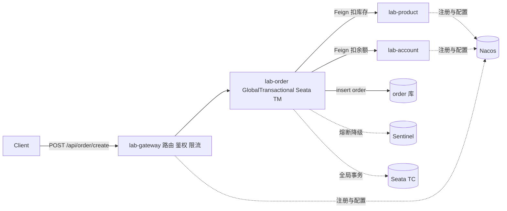

# Spring Cloud Alibaba 分布式实战项目规划

> [!info] 一句话定位
> 用一个 **下单链路**，把 **Nacos（注册+配置）、Gateway（入口）、OpenFeign（调用）、Sentinel（保命）、Seata（兜底）** 全部串起来的项目制学习路线。
> 与 [[0-分布式总览]] 互补：那个系列讲「为什么」，这篇讲「怎么把它跑起来」。

> [!note] 与其他笔记的关系
> - 理论前置 → [[2-分布式事务]]（2PC/TCC/Saga/Seata 四模式）、[[7-限流熔断降级]]（四种限流算法、熔断三态）、[[8-微服务架构与注册配置中心]]（注册中心选型 CP/AP）
> - 复用资产 → [[幂等.excalidraw]]（幂等方案，Phase 6 直接落地）、[[3-分布式锁]]（Redisson 防超卖）
> - 面试收口 → [[9-分布式面试高频题]]

---

## 一、起点盘点：我现在站在哪

> [!tip] 结论先行
> 短板不在分布式，而在「端到端链路」。你已经具备分布式意识（幂等、MQ），但缺持久层、缺事务、缺多模块 —— 这三者才是 Seata 的前置条件。

### 1.1 已有能力（来自 p2 / p3）

| 维度 | 已有证据 | 对应能力 |
|---|---|---|
| Spring Boot | Boot 4.1.1 + Java 17，单模块 Maven | 框架基础 |
| Web 层扩展 | `IdempotentInterceptor`、`ResponseBodyAdvice`、`WebMvcConfigurer`、自定义注解 | 拦截器链 |
| Redis | `StringRedisTemplate` + Lua `SET NX EX` 抢锁、`__PROCESSING__` 占位区分进行中/已完成 | 幂等 |
| MQ | `KafkaTemplate` + `@KafkaListener` | 异步解耦 |
| 统一响应 / i18n | `MessageSource`、`AcceptHeaderLocaleResolver`、`ResponseResult` | 网关响应底座 |
| 环境习惯 | 中间件指向外部机 `192.168.0.106` | 愿连真实中间件 |

### 1.2 明确缺口

| 缺口 | 为什么会卡住后面的学习 |
|---|---|
| 零 Spring Cloud | Nacos / Gateway / Feign / LoadBalancer 全空白，无法做服务发现 |
| 零持久层 | 无 MySQL、无 ORM、无 `@Transactional`，Seata 无从谈起（AT 依赖本地事务 + undo_log） |
| 零熔断限流 | Sentinel / Resilience4j 未接触 |
| 零拆分经验 | 只有单块应用，没有跨服务调用、分布式 ID、链路追踪 |

> [!warning] 顺手修掉两个技术债
> - `p2` 的 `KafkaController.java:48-54` 在 `@PostConstruct` 里写了 `while(true)` 死循环发消息，会卡死应用启动
> - `p3` 的 `ResponseResult.java:14-19` 用 `@Autowired` 注入 static 字段，迁移到 common-core 时必须改掉

---

## 二、版本选型：这一步决定成败

> [!danger] 最重要的警告：不要把学习项目搭在 Spring Boot 4.1.1 上
> `p2`/`p3` 用 Boot 4.1.1，但 Spring Cloud Alibaba 主线 `2025.1.0.0` 对齐的是 **Boot 4.0.x / Spring Cloud 2025.1.x**；Boot 4.1 这条线上 Seata/Sentinel 适配与社区资料都很薄。
> 结论：学习项目单独降一个稳定台阶，不要复用 4.1.1。

### 2.1 两套可行组合

| | A（推荐） | B（追新·慎选） |
|---|---|---|
| Spring Boot | **3.5.14** | 4.0.6 |
| Spring Cloud | **2025.0.2** | 2025.1.1 |
| Spring Cloud Alibaba | **2025.0.0.0** | 2025.1.0.0 |
| Nacos Client / Server | 2.5.x / 2.4.6+ | 3.1.x / 2.5.0+ |
| Sentinel | 1.8.6 | 1.8.8+ |
| Seata Server | 2.x 稳定版 | 2.x（需先验证） |
| JDK | 17 | 17（部分资料建议 21） |

### 2.2 版本命名规律（记住就不再迷路）

```text
Spring Cloud 2025.1.1  →  MINOR=1 即 Boot 4.x 线
Spring Cloud 2025.0.2  →  MINOR=0 即 Boot 3.5 线
Spring Cloud Alibaba   =  Cloud 版本号 + 第 4 位
    2025.1.1  → 2025.1.0.0
    2025.0.2  → 2025.0.0.0
```

> [!important] 版本铁律
> 父 POM 中用 `<dependencyManagement>` 同时导入 `spring-cloud-dependencies` 与 `spring-cloud-alibaba-dependencies`，任何 starter 都不许手写 `<version>`。
> 违反这条 = 90% 的「服务起不来 / 事务不生效 / 注册不上」的根因。

---

## 三、项目骨架 sca-lab

```text
sca-lab/
├── pom.xml                      # 父 POM：packaging=pom，只做版本仲裁
├── sql/
│   ├── order.sql / product.sql / account.sql   # 三个 schema（单实例模拟分库）
│   ├── seata-server.sql         # global_table / branch_table / lock_table
│   └── undo_log.sql             # 每个业务库都要建
├── lab-common/
│   ├── lab-common-core          # 迁移自 p3：Result / 状态码 / i18n / 全局异常
│   └── lab-common-idempotent    # 迁移自 p2：@Idempotent + Lua 幂等
├── lab-gateway/                 # Spring Cloud Gateway（WebFlux）
├── lab-product/                 # 商品 + 库存库
├── lab-account/                 # 用户 + 账户余额库
├── lab-order/                   # 订单库，编排者（Seata 的 TM 角色）
└── deploy/docker-compose.yml    # Nacos / MySQL / Redis / Seata / Sentinel
```

> [!tip] 为什么拆三个业务库
> Seata 解决的问题只在跨库时才有意义。同一个 MySQL 实例建三个 schema，既能复现分布式事务，又不用真起三台数据库。

### 3.1 业务主线：一条下单链路串起全部组件



---

## 四、八阶段路线图

> [!abstract] 使用方式
> 每个 Phase 都有验收标准。没通过就不要进下一阶段 —— 分布式里的「半懂」会在后续阶段指数级放大成排查地狱。

| # | Phase | 核心组件 | 预估 | 状态 |
|---|---|---|---|---|
| 0 | 环境与地基 | 父 POM、Docker 全家桶 | 0.5 天 | 待开始 |
| 1 | 服务注册与配置 | Nacos Discovery / Config | 1-2 天 | 待开始 |
| 2 | 服务拆分与调用 | OpenFeign / LoadBalancer / MyBatis | 2 天 | 待开始 |
| 3 | 统一入口 | Spring Cloud Gateway | 2 天 | 待开始 |
| 4 | 稳定性保障 | Sentinel | 2-3 天 | 待开始 |
| 5 | 分布式事务 | Seata AT（可选 TCC） | 2-3 天 | 待开始 |
| 6 | 可靠性加固 | 幂等 / 分布式锁 / MQ 最终一致 | 2 天 | 待开始 |
| 7 | 可观测性 | Micrometer Tracing / Prometheus | 1-2 天 | 待开始 |

### Phase 0 · 环境与地基（0.5 天）

- `docker-compose` 起：Nacos（8848 / 9848）、MySQL、Redis、Sentinel Dashboard；Seata 留到 Phase 5
- 父 POM 搭好，验证依赖仲裁生效
- `lab-common-core`：把 p3 的 `ResponseResult` / i18n 搬过来，同时修掉 static 注入
- `lab-common-idempotent`：把 p2 的幂等拦截器抽成 starter 形态

**验收**：`mvn dependency:tree` 无版本冲突；`mvn install` 全绿；common 可被其他模块引用。

### Phase 1 · Nacos 注册 + 配置中心（1-2 天）

- `lab-product` 接入 `nacos-discovery`，用 `lb://product-service` 调通
- Nacos Config 三要素：namespace / group / dataId；拆 `common.yaml`（共享）+ `product.yaml`（私有）
- `@RefreshScope` + `@ConfigurationProperties` 动态刷新

> [!warning] Boot 3+ 已废弃 bootstrap.yml
> 必须改用 `spring.config.import: nacos:xxx.yaml`。照抄旧教程的一上来就卡在这。

**验收**
- [ ] 控制台手动下线实例，请求立刻不再打到它
- [ ] 改 Nacos 配置，不重启服务接口返回值已变化

### Phase 2 · 服务拆分 + OpenFeign + LoadBalancer（2 天）

- 补持久层：MyBatis-Plus（或 MyBatis）+ MySQL
- **先把单机 `@Transactional` 跑通，再谈分布式事务**
- 三服务 + 三库就位；order 通过 `@FeignClient` 调 product / account
- Feign：超时、重试、日志级别、`RequestInterceptor` 透传 `userId` / `traceId`
- 起两个 product 实例，观察 LoadBalancer 轮询

**验收**
- [ ] 下单接口成功，三库都有数据
- [ ] 故意让某一步失败，观察到数据不一致（这是 Seata 要解决的痛点，先亲手制造它）

### Phase 3 · Spring Cloud Gateway（2 天）

- 路由断言 + `StripPrefix` + `lb://` 服务发现
- 自定义 `GlobalFilter`：鉴权（简单 JWT / header 校验）、耗时统计、注入 `traceId`
- 网关层限流：`RequestRateLimiter`（Redis 令牌桶，对应 [[7-限流熔断降级]]）

> [!danger] Gateway 是 WebFlux 响应式模型
> - 禁止在 filter 里写阻塞的 JDBC 调用
> - `ThreadLocal` 会失效，上下文传递必须换成 Reactor Context
> - p2/p3 里基于 `ThreadLocal` 的写法（如 `LocaleContextHolder`）在这里一律不可直接复用

**验收**
- [ ] 只走 `9000` 可访问，直连 `8081` 应被拒
- [ ] 连续快速请求触发 429

### Phase 4 · Sentinel 熔断降级限流（2-3 天）

- `@SentinelResource(value, blockHandler, fallback)`：分清限流异常 vs 业务异常
- `fallbackFactory` 给 Feign 配降级，下游挂了返回兜底而非 500
- Dashboard 配四类规则：流控 / 熔断（慢调用比例）/ 热点参数 / 系统保护

> [!important] 必做：Sentinel 规则默认存内存，重启即丢
> 生产必须配 Nacos 数据源做规则持久化。这是 Sentinel 落地的核心难点，也是面试高频追问点。

**验收**
- [ ] 手动停掉 `lab-account`，下单返回「系统繁忙，请稍后」而非堆栈
- [ ] 重启 Sentinel Dashboard，规则仍在

### Phase 5 · Seata 分布式事务（2-3 天）· 本项目最高潮

- Seata Server 用 DB 模式部署，注册 / 配置均挂到 Nacos
- 三个业务库各建 `undo_log` 表
- AT 模式：`order-service.createOrder` 打 `@GlobalTransactional`
- 在 account 侧人为抛异常，观察三库全部回滚、`branch_table` 分支注册、undo_log 生成与清理

> [!warning] 提前知道这 4 个坑，能省一整天
> 1. 必须启用 Seata 数据源代理（`seata.enable-auto-data-source-proxy`），否则事务静默失效
> 2. `@GlobalTransactional` 只加在 TM（lab-order）侧；RM 侧用普通 `@Transactional`
> 3. XID 靠 Feign 拦截器跨服务传递，自定义 `RequestInterceptor` 别把 header 覆盖掉
> 4. 注意 TM 的超时 / 重试与幂等防悬挂，参见 [[2-分布式事务]] 的 TCC 三坑

**验收**
- [ ] 异常注入后查询三库，库存、余额、订单三者一致
- [ ] `undo_log` 已被清理，`global_table` 会话已结束

**进阶（可选）**：用 TCC 重写账户扣款（Try 冻结 / Confirm / Cancel），体会与 AT 的取舍。

### Phase 6 · 可靠性：幂等、防超卖、最终一致性（2 天）

- 把 p2 的 `@Idempotent` 用在下单接口防重复点击，对照 [[幂等.excalidraw]]
- 防超卖两套方案对比：Redisson 分布式锁（见 [[3-分布式锁]]） vs 乐观锁 `UPDATE stock SET stock=stock-1 WHERE id=? AND stock>=?`
- MQ 最终一致性：本地消息表 或 RocketMQ 事务消息
- 思考题：为什么很多真实场景选 MQ 而不选 Seata AT？（答案见 [[2-分布式事务]] 选型章节）

### Phase 7 · 可观测性与收尾（1-2 天）

- Micrometer Tracing + Zipkin：一次下单把 Gateway → Order → Product → Account 的 traceId 串起来
- Actuator + Prometheus + Grafana
- 网关统一异常兜底，保证全链路无裸返回

---

## 五、端口地图（避免和现有环境打架）

| 组件 | 端口 | 备注 |
|---|---|---|
| Nacos | 8848 / 9848 / 9849 | 9848（gRPC）没放行 = 注册成功但发现不了 |
| Seata TC | 8091 / 7091 | Phase 5 引入 |
| Sentinel Dashboard | 8858 | 懒加载，需先访问一次服务才出菜单 |
| MySQL / Redis | 3306 / 6379 | Redis 可继续复用 192.168.0.106 |
| Gateway / order / product / account | 9000 / 8081 / 8082 / 8083 | |

> [!tip] 环境隔离建议
> 整套中间件用 Docker Compose 起，与 p2 / p3 完全隔离，互不污染；出错可整体 down 了重来。

---

## 六、坑位清单（开工前先扫一眼）

| # | 坑 | 症状 | 规避 |
|---|---|---|---|
| 1 | 手写 starter 版本号 | `ClassNotFound` / Bean 注入失败 | 只用 dependencyManagement 仲裁 |
| 2 | 沿用 bootstrap.yml | Boot 3+ 配置不生效 | 改 `spring.config.import` |
| 3 | Nacos 9848 未开 | 服务列表有实例但调用 503 | Docker 放行 gRPC 端口 |
| 4 | Seata 缺 undo_log | 分支回滚报错 | 每个业务库都要建 |
| 5 | 忘了数据源代理 | `@GlobalTransactional` 静默失效 | 开启 auto-data-source-proxy |
| 6 | TM / RM 注解加错 | 只有部分回滚 | 全局注解只在 TM 侧 |
| 7 | Gateway 里写阻塞代码 | 吞吐雪崩 / 死锁 | 换 WebFlux 思维，见 Phase 3 |
| 8 | Sentinel 规则不持久 | 重启 Dashboard 规则全丢 | 配 Nacos 数据源 |
| 9 | 全局事务与本地事务混用不清 | 长事务、锁等待 | 分清边界，见 [[2-分布式事务]] |
| 10 | Boot 版本与 SCA 不对齐 | 启动直接失败或事务不生效 | 严格遵守第二节版本矩阵 |

---

## 七、学习方法论

> [!quote] 不要按组件名学，按问题学
> 单机事务够不够？ → 拆库
> 服务之间怎么调用？ → **OpenFeign**
> 地址怎么管？ → **Nacos**
> 入口怎么统一收敛？ → **Gateway**
> 下游挂了怎么办？ → **Sentinel**
> 数据不一致了怎么办？ → **Seata**
> 还是太慢怎么办？ → **MQ 最终一致性**

**每学一个组件，只逼自己回答三个问题：**

| 问题 | 例子（以 Seata AT 为例） |
|---|---|
| 它解决什么问题？ | 跨库数据不一致 |
| 没它会怎样？ | 扣了库存没扣余额，超卖 / 资金错账 |
| 它的代价是什么？ | 全局锁降低并发、依赖 TC 高可用、undo_log 写放大 |

> 面试和实际落地考的都是这三问，尤其是第三问「代价」—— 那是区分「用过」和「懂」的分水岭。

---

## 八、下一步清单

- [ ] 确认走方案 A（Boot 3.5.14 + SCA 2025.0.0.0）还是方案 B
- [ ] 敲定 `sca-lab` 仓库落盘位置
- [ ] 写 `deploy/docker-compose.yml` 与父 POM（Phase 0 开工）
- [ ] 从 `p2` / `p3` 迁移幂等拦截器与统一响应到 `lab-common`
- [ ] 每完成一个 Phase 回来更新本篇上方的状态表

> [!success] 完成标准
> Phase 0 - 7 全绿后，你应该能独立回答：一次请求从浏览器到四个服务，**经过了哪些组件、哪一步会失败、失败后数据怎么兜底**。这三件事能讲清楚，这套技术栈就算真正拿下了。
