# 🛠️ 手写一个迷你 Spring Boot（详细整理版）

> 本篇是对 [B 站视频《面试官问手写Spring Boot？7大核心模块+避坑指南》](https://www.bilibili.com/video/BV1boTc6BE7Z/)（约 7.5 分钟）的**逐段深度整理**。
> 场景：面试被问"**手写一个迷你 Spring Boot，你会怎么设计？**"——视频给出的答案是 **7 大核心模块 + 11 个坑**。
> 定位：**实现视角**——不满足于"读懂现有实现"，而是回答"**如果从零造，每个模块要实现什么、坑在哪**"。
> 原始字幕稿：[[面试官问手写Spring Boot？7大核心模块+避坑指南，彻底搞透底层原理！]]（ASR 把 `@Conditional` 识别成 "at conditional"、`BeanPostProcessor` 识别成 "been post processor"、静默失败识别成"寂寞失败"，见 [附录 A](#附录-a语音转写asr勘误对照)）。
>
> **相关笔记**：[[6-SpringBoot自动装配]]（★ 现有实现的源码级详解，本篇的"参考答案"）、[[2-Bean生命周期与依赖注入]]（模块 4 的展开）、[[1-Spring架构与IoC容器]]（三级缓存与循环依赖）、[[3-AOP原理与实战]]（AOP 织入时机）、[[5-SpringMVC请求全流程]]（DispatcherServlet）、[[9-Spring面试高频题]]。

> [!important] 一处与视频口播不一致的地方
> 视频开头说"手写 Spring Boot 其实就是要实现这**五个**核心模块"，但**标题写的是 7 个，正文实际也讲了 7 个**：
> ① SPI 自动配置发现 ② 内嵌容器 ③ 条件注解 ④ Bean 生命周期 ⑤ 配置绑定 ⑥ Starter 设计 ⑦ 事件机制。
> 本篇按**实际讲到的 7 个**整理——**面试时能把 7 个模块说全，比说 5 个更像真动手写过**。

---

## 〇、先想清楚：Spring Boot 到底帮你省掉了什么

> 视频开场（这是全片最重要的"第一问"）：
> "**Spring Boot 到底帮你省掉了什么？说白了它把那些 XML 配置、依赖管理、容器部署给自动化了**——手写 Spring Boot，本质上就是**手写这三件事的自动化**。"

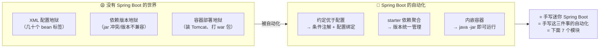

| 省掉什么 | 靠什么实现 | 对应模块 |
| --- | --- | --- |
| **XML 配置** | 自动配置 + 条件注解 + 配置绑定 | 模块 1、3、5 |
| **依赖管理** | starter（依赖聚合） | 模块 6 |
| **容器部署** | 内嵌容器 | 模块 2 |
| （把启动流程串起来） | 事件机制 | 模块 7 |
| （Bean 的创建与增强） | Bean 生命周期 | 模块 4 |

---

## 一、总览：7 大模块、难度分级与实现顺序

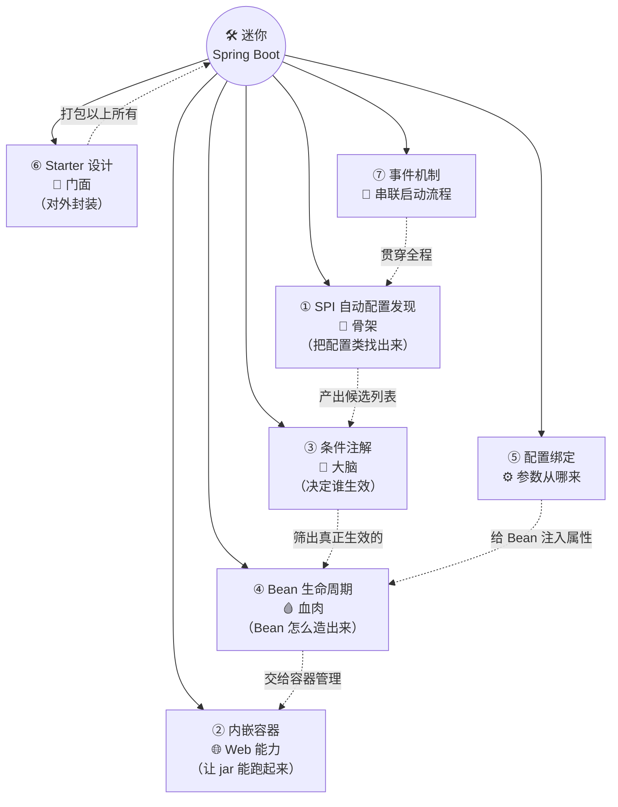

| # | 模块 | 类比 | 职责 | 难度 |
| --- | --- | --- | --- | --- |
| 1 | **SPI 自动配置发现** | 📎 **骨架** | 从清单文件读出自动配置类并反射实例化 | ⭐⭐ |
| 2 | **内嵌容器** | 🌐 Web 能力 | 启动 Tomcat，注册 DispatcherServlet | ⭐⭐⭐ |
| 3 | **条件注解** | 🧠 **大脑** | 决定哪些自动配置真正生效 | ⭐⭐⭐⭐ **最易写错** |
| 4 | **Bean 生命周期** | 🩸 **血肉** | 实例化 → 注入 → 初始化 → 增强 | ⭐⭐⭐ |
| 5 | **配置绑定** | ⚙️ 参数来源 | YAML/Properties → Java 字段（含类型转换） | ⭐⭐⭐ |
| 6 | **Starter 设计** | 🎁 门面 | 依赖聚合 + 指向自动配置模块 | ⭐ |
| 7 | **事件机制** | 🔗 串联 | 启动各阶段发事件、监听器响应 | ⭐⭐ |

> [!tip] 视频点名的"最容易写错"两个模块
> "**其中自动配置引擎和条件注解是最容易写错的**"——所以 [模块 1](#二模块-1spi-自动配置发现骨架) 和 [模块 3](#四模块-3条件注解大脑) 是重点，下面的坑也集中在这两处。

### 推荐的实现顺序（视频总结的路径）

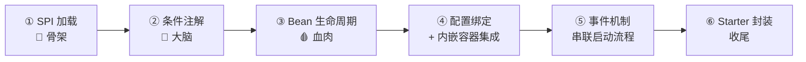

> 视频原话："**先搞定 SPI 加载，这是骨架；再实现条件注解，这是大脑；然后把 Bean 生命周期跑通，这是血肉；接着做配置绑定和内嵌容器集成；最后用事件机制把启动流程串起来，用 starter 封装收尾。**"

---

## 二、模块 1：SPI 自动配置发现（骨架）

### 2.1 机制：不是魔法，是 Java 标准 SPI

> 视频对话："自动配置总感觉像魔法，点一下就能用，底层到底怎么找到那些配置类的？—— **根本不是魔法，是 Java 标准的 SPI 机制：ServiceLoader**。Spring Boot 在 `META-INF/spring.factories` 里声明了自动配置类的全限定名，**启动时用 ClassLoader 读出来，然后反射实例化**。"

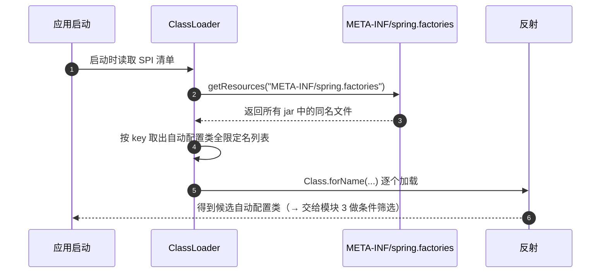

### 2.2 ⚠️ 坑 1：key 拼错 = **静默失败**（连报错都没有）

> 视频对话（这是全片第一个坑，也是最坑的）：
> "手写时第一个坑就来了：**这个文件的路径和 key 名一个字都不能错**，错了一个字母就**静默失败，连报错都没有**！"
> "（追问）拼错了居然不报错？—— **对，这就是最坑的地方**：`spring.factories` 本质就是个 **properties 文件**，**key 不匹配只会返回空集合，不会抛异常**。你的自动配置类写得好好的，就是不生效，**排查半天才发现是 key 打错了**。"

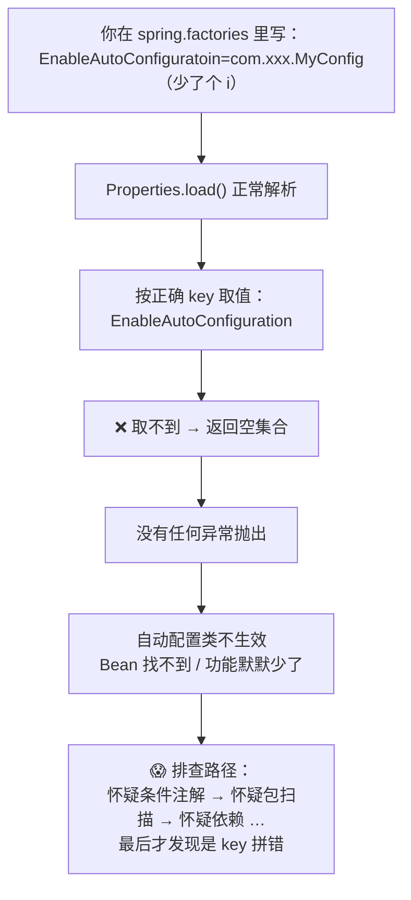

| 现象 | 根因 | 对策 |
| --- | --- | --- |
| 自动配置**完全不生效**且**无任何报错** | `spring.factories` 是 **properties 解析**，**key 不匹配返回空集合，不抛异常** | ⭐ **把 key 定义成常量**，绝不手搓字符串 |
| 文件路径写错（如 `META-INF/spring.factories` 拼错） | ClassLoader 找不到资源，同样静默 | 用**常量**声明路径；写单测断言资源能读到 |

> [!important] 视频的解法（值得照抄）
> "手写的时候**一定要把 key 定义成常量**，千万别手搓字符串。"
> ```java
> public final class AutoConfigurationKeys {
>     // ⭐ 常量，避免手搓字符串拼错后静默失败
>     public static final String ENABLE_AUTO_CONFIGURATION =
>             "org.springframework.boot.autoconfigure.EnableAutoConfiguration";
>     public static final String SPI_LOCATION = "META-INF/spring.factories";
> }
> ```

### 2.3 ⭐ 版本校正：2.7+ 已换用专用清单文件

> ⚠️ 视频讲的是 **Spring Boot ≤ 2.6 的方式**（`spring.factories`）。**新版本已经变了**：

| 版本 | 清单文件 | 说明 |
| --- | --- | --- |
| **≤ 2.6** | `META-INF/spring.factories`<br/>key = `EnableAutoConfiguration` | 自动配置与**其他 SPI 混在一个文件**里 |
| **2.7+** | `META-INF/spring/org.springframework.boot.autoconfigure.AutoConfiguration.imports` | ⭐ **新增专用文件**，**每行一个全限定类名**；2.7 同时支持两种（过渡期告警） |
| ⭐ **3.0+** | 同上，**仅此一种** | **`spring.factories` 里的自动配置 key 被彻底移除**——还这么写的第三方 starter **会静默失效** |

```
# AutoConfiguration.imports 的格式（比 properties 更简单）
# 每行一个全限定类名，# 开头是注释，空行忽略
com.example.autoconfig.ExampleAutoConfiguration
com.example.autoconfig.AnotherAutoConfiguration
```

> [!danger] 面试时的加分回答
> 被问"自动配置怎么发现的"，答完 `spring.factories` **一定要补一句**："**Spring Boot 2.7 起改成了 `AutoConfiguration.imports` 专用文件，3.0 起彻底移除了 `spring.factories` 里的自动配置 key**——迁移后自动配置成了独立、可工具化、可版本化管理的契约。"
> 详见 [[6-SpringBoot自动装配]] §3.2 环节 2（那里有完整的版本差异表和 3.0 升级 checklist）。

---

## 三、模块 2：内嵌容器（让 jar 能跑起来）

### 3.1 ⚠️ 坑 2：时序错了就白屏——**Spring 容器先行，Web 容器后置**

> 视频对话："很多人以为**直接 new 一个 Tomcat 就完了**，但**时序是关键**：**必须先让 Spring 容器把所有 Bean 初始化完**（特别是 `DispatcherServlet` 这样的 Servlet），**然后才能启动 Web 容器**。顺序反了，**Servlet 拿不到 Spring 上下文，直接白屏**。"

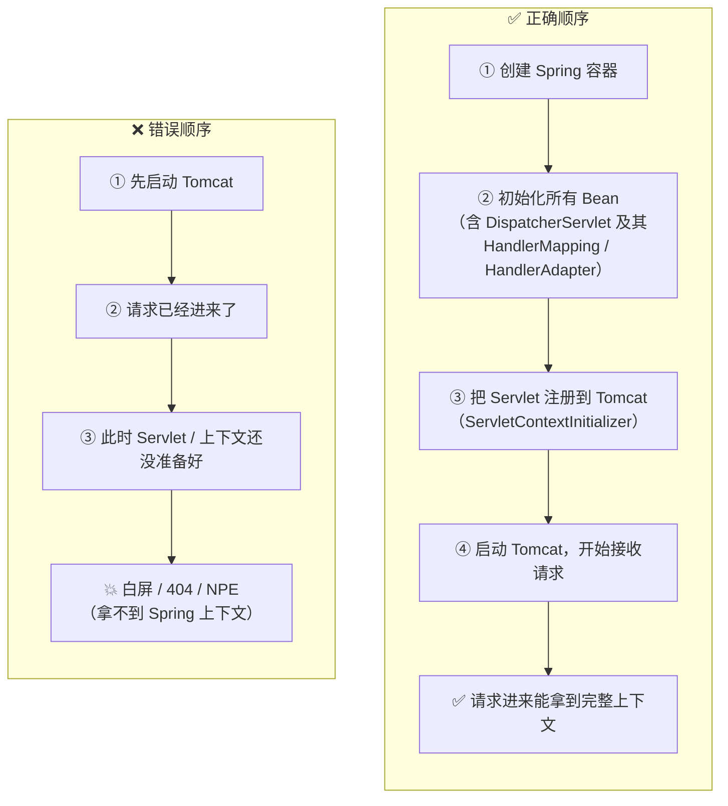

> [!important] 一句话口诀
> **"Spring 容器先行，Web 容器后置，不能反过来。"**
> 本质原因：**Tomcat 只是个"Servlet 运行宿主"，它需要 Spring 把 Servlet 和依赖准备好之后才能对外服务**。

### 3.2 ⚠️ 坑 3（更隐蔽）：类加载器隔离

> 视频对话："更隐蔽的坑是**类加载器**——内嵌 Tomcat 需要**自己的 WebappClassLoader** 来隔离**应用类和容器类**。手写时如果忘了这一层，**直接用 AppClassLoader 加载所有东西**，Tomcat 内部的 **JSP 编译、Servlet 规范类**就会和你的应用类**冲突**，爆出的错误**完全看不出是类加载器的问题**。"

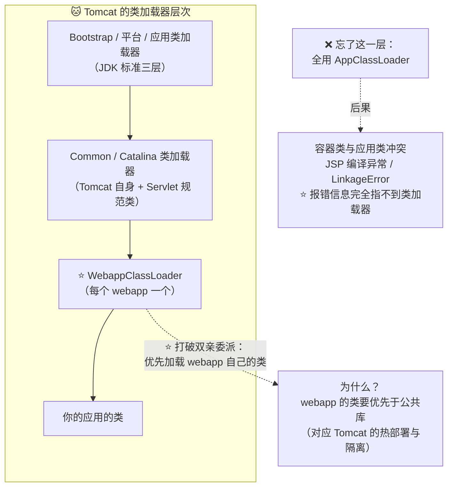

| 层级 | 加载什么 | 若缺失会怎样 |
| --- | --- | --- |
| **Common/Catalina** | Tomcat 自身、Servlet 规范类 | — |
| ⭐ **WebappClassLoader** | 你的应用类（**优先自己加载**） | ⚠️ 应用类与容器类冲突、JSP 编译失败、`LinkageError` |
| 特性 | **打破双亲委派**（优先加载 webapp 自己的类） | 这是 **webapp 隔离与热部署**的基础 |

> 深读：双亲委派模型为何被打破、Tomcat 的类加载器层次，见 [[3-类加载机制与字节码]]；请求如何进入 `DispatcherServlet`，见 [[5-SpringMVC请求全流程]]。

---

## 四、模块 3：条件注解（大脑）—— 最容易写错的模块

### 4.1 `@Conditional` 家族

> 视频对话："自动配置类被加载进来之后，难道全部都会生效吗？—— **当然不是，这就是条件注解的活**。`@Conditional` 是**所有条件注解的原注解**，它的子类就是各种开关类。"

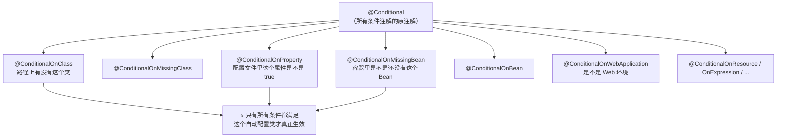

| 条件注解 | 判断什么 | 典型用途 |
| --- | --- | --- |
| `@ConditionalOnClass` | classpath 上**有没有某个类** | 引了 Redis 依赖才加载 Redis 自动配置 |
| `@ConditionalOnMissingBean` | 容器里**还没有**这个 Bean | ⭐ **用户自定义优先**（允许覆盖默认实现） |
| `@ConditionalOnProperty` | 配置项**是否为某值 / 是否开启** | `spring.redis.enabled=true` |
| `@ConditionalOnWebApplication` | 是否 Web 环境 | 只在 Web 应用装配 MVC 相关 Bean |
| `@ConditionalOnResource` | 某个资源文件是否存在 | 有 `logback.xml` 才启用某配置 |

### 4.2 ⚠️ 坑 4：只写了加载逻辑，忘了加条件判断

> 视频对话："手写时最容易犯的错是——**只写了加载逻辑，忘了加条件判断结果**，**不管什么环境都一股脑全加载了**。"

| 症状 | 后果 |
| --- | --- |
| 所有自动配置类无差别生效 | ① 缺依赖时直接 `ClassNotFoundException` / `NoClassDefFoundError`；② 用户想覆盖默认 Bean 时被框架抢先注册（`BeanDefinitionOverrideException`）；③ 启动变慢、内存浪费 |

### 4.3 ⚠️ 坑 5：条件之间是"与"，且有**短路**——顺序有讲究

> 视频对话："还有一个细节：**条件注解之间是『与』的关系，而且有短路逻辑**——**第一个条件不满足，后面的根本不会判断**。手写的时候要注意：**把最可能不满足、判断成本最低的条件放前面**，避免做无用的 ClassLoader 检查——就像 `if` 的短路求值一样，**把最快能判断失败的放前面**。"

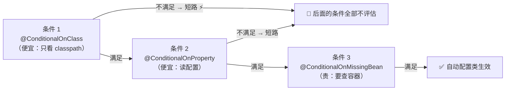

> [!tip] 为什么这个顺序很重要？
> `@ConditionalOnMissingBean` 需要**查询容器的 Bean 定义**（相对昂贵），而 `@ConditionalOnClass` 只看类路径（便宜）。
> **把便宜且最可能失败的放前面**，就能在大多数情况下**用一次 classpath 检查早早短路**，省掉昂贵的容器查询——这正是 Spring Boot 内部 `AutoConfigurationImportFilter`（`OnClassCondition` 快速预过滤）的设计思路，详见 [[6-SpringBoot自动装配]] §3.2 环节 3⑤。

### 4.4 ⚠️ 坑 6（"特别阴"）：忘了 `@Retention(RUNTIME)`，元注解就丢了

> 视频对话："手写条件注解时有个**特别阴的坑**：元注解传递——你自定义 `@MyConditional` 上面加了 `@Conditional`，但**如果你的 `@MyConditional` 忘了加 `@Retention(RUNTIME)`**，那**在运行时通过反射去读注解时，`@Conditional` 就丢了**，**你的条件逻辑根本不会被执行**。这种 bug **排查起来能让人崩溃，因为代码看着完全没问题**。"
> "（追问）`@Retention(RUNTIME)` 确实太容易忘了？—— **对，编译时又不会报错**。"

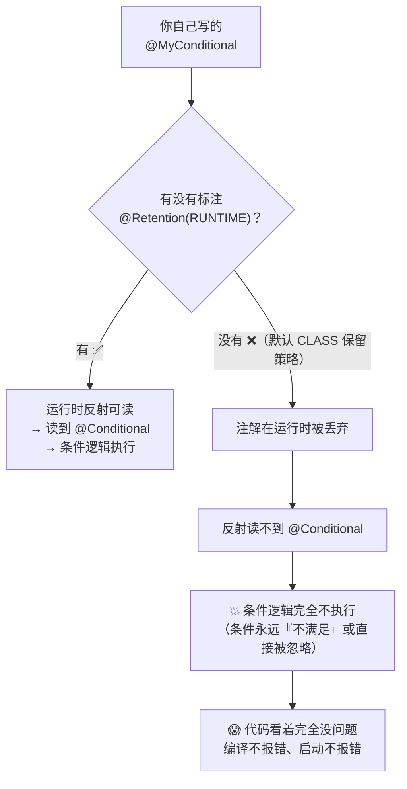

**正确写法**：

```java
@Target({ElementType.TYPE, ElementType.METHOD})
@Retention(RetentionPolicy.RUNTIME)   // ⭐ 少这一行 = 条件永远不生效
@Conditional(OnCustomCondition.class) // 元注解传递
public @interface MyConditional {
}
```

> [!warning] 为什么这个坑"特别阴"？
> 因为 Java 的注解**保留策略默认是 `CLASS`**（写进字节码但运行时不保留）——不是 `RUNTIME`。
> 一旦漏写，**编译通过、启动通过、功能静默失效**，属于典型的"**三不报错但就是不工作**"问题。
> 同类坑还有：自定义注解忘了 `@Target`、忘了 `@Documented`（无功能影响）、`@Inherited`（影响子类是否继承）。

---

## 五、模块 4：Bean 生命周期（血肉）

### 5.1 完整钩子链

> 视频对话："自动配置类里的 Bean 是怎么创建的？这就涉及 Bean 生命周期了。**手写时最容易漏的是中间那些扩展点**。"

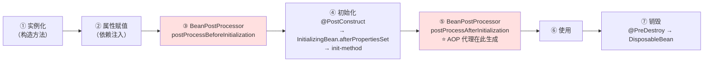

### 5.2 ⚠️ 坑 7：漏掉扩展点，链路就断一环

> 视频对话："**你漏了 `afterPropertiesSet`，依赖注入完的 Bean 就没机会做初始化校验**；**漏了 `postProcessBeforeInitialization`，AOP 代理就织不进去**。**每个扩展点都有它的职责，少一个链路就断一环。**"
> "（总结）所以**不是只要能 new 出来就行，中间的钩子一个都不能少**。"

| 扩展点 | 职责 | 漏掉的后果 |
| --- | --- | --- |
| `postProcessBeforeInitialization` | 初始化前的统一增强 | ⚠️ **AOP 相关的处理时机错乱**、属性校验钩子缺失 |
| `InitializingBean.afterPropertiesSet` / `@PostConstruct` | **依赖注入完成后的初始化校验** | ⚠️ **Bean 带着非法状态进入使用期**（如必填配置为空却没人校验） |
| `postProcessAfterInitialization` | ⭐ **AOP 代理生成**的地方 | ⚠️ **`@Transactional`/`@Async` 全部失效**（没有代理就没有拦截） |
| `DisposableBean.destroy` / `@PreDestroy` | 释放资源 | ⚠️ 连接池/线程池不优雅关闭 |

> [!important] 为什么"能 new 出来"远远不够
> 手写时很容易满足于"Bean 能创建、能注入"，但**框架的价值恰恰在那些钩子里**：
> **AOP、事务、`@Async`、`@Scheduled`、参数校验，全都依赖 `BeanPostProcessor` 在正确的时机介入**。
> 少一个钩子 → 对应的能力**静默失效**（同样是"不报错但不工作"）。

> 深读：完整生命周期与三级缓存如何配合，见 [[2-Bean生命周期与依赖注入]]、[[3-AOP原理与实战]]。

---

## 六、模块 5：配置绑定（类型转换是重灾区）

### 6.1 绑定流程

> 视频对话："配置绑定看着简单，**但类型转换是重灾区**。"

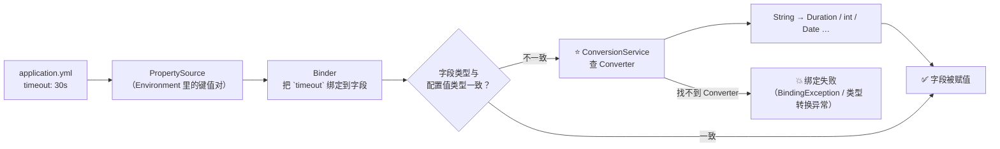

### 6.2 ⚠️ 坑 8：`timeout: 30s` 配 `int` 字段 → 直接炸

> 视频对话："**YAML 里写 `timeout: 30s`，如果你的 Java 字段是 `int` 类型，直接炸**。手写的时候**必须实现一套 Converter 体系**，至少要能处理这三种常见转换……**别想着偷懒只支持 String，那跟没用配置绑定没啥区别**。"

| 必须支持的转换 | 例子 |
| --- | --- |
| **String → 基本类型/包装类** | `"8080"` → `int port` |
| ⭐ **String → Duration** | `"30s"` / `"5m"` / `"2h"` → `Duration`（**视频点名的坑**） |
| ⭐ **String → Date/时间类型** | `"2026-06-30"` → `LocalDate` |
| String → Enum | `"DEBUG"` → `LogLevel.DEBUG` |
| String → List/Map（**分隔符/索引**） | `"a,b,c"` → `List<String>`；`list[0]` / `map.key` |

```java
// 手写 Converter 体系的最小骨架
public interface Converter<S, T> {
    T convert(S source);
}

public class StringToDurationConverter implements Converter<String, Duration> {
    @Override
    public Duration convert(String source) {
        // 支持 "30s" / "5m" / "2h" / "500ms" 等写法
        return DurationParser.parse(source);
    }
}
// 绑定前统一走 ConversionService：找不到对应 Converter 就抛绑定异常
```

> [!tip] 为什么"只支持 String"等于没做配置绑定
> 因为真实项目的配置**几乎全是带语义的字符串**：`30s`、`1GB`、`true`、`com.mysql.Driver`、`a,b,c`。
> **配置绑定的核心价值就是把这些字符串"翻译"成类型安全的 Java 对象**——只支持 String 就等于把类型转换的锅甩给了使用者。

> 深读：`@Value` vs `@ConfigurationProperties` 的差别、松散绑定（relaxed binding）规则，见 [[6-SpringBoot自动装配]] §6。

---

## 七、模块 6：Starter 设计（门面与大脑分离）

### 7.1 设计哲学：**空壳 + 引用**

> 视频对话："**Starter 的设计哲学是『空壳 + 引用』**——**starter 本身不写任何业务逻辑**，它只是一个 **pom 文件**，把依赖聚合起来，加上一个清单文件指向真正的自动配置模块。"

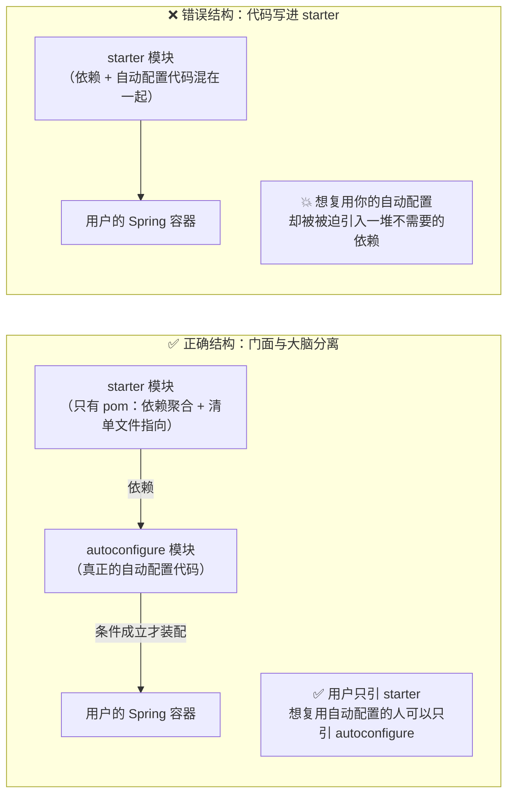

| 结构 | starter 里放什么 | autoconfigure 里放什么 | 结果 |
| --- | --- | --- | --- |
| ⭐ **正确** | 只有一个 `pom.xml`（依赖聚合）+ 一行清单声明 | 自动配置类、条件注解、`@ConfigurationProperties` | 门面与实现解耦，**可分别复用** |
| ❌ 错误 | 依赖 + **自动配置代码全写在这里** | 无 | ⚠️ **依赖污染**：想复用的人被迫拉进一堆无关依赖 |

### 7.2 ⚠️ 坑 9：把自动配置代码直接写在 starter 里

> 视频对话："手写时常见的错误是——**把自动配置代码直接写在 starter 里**，这会导致**别的模块想复用你的自动配置，却被迫引入一堆不需要的依赖**。所以 **starter 只是门面，真正的『脑子』在自动配置模块里**。"

```xml
<!-- ✅ 正确的 starter：真的只是一个 pom -->
<project>
  <artifactId>my-spring-boot-starter</artifactId>
  <dependencies>
    <!-- ① 聚合依赖（版本由 BOM 统一管理） -->
    <dependency>
      <groupId>com.example</groupId>
      <artifactId>my-spring-boot-autoconfigure</artifactId>
    </dependency>
    <dependency>
      <groupId>com.example</groupId>
      <artifactId>my-core</artifactId>
    </dependency>
  </dependencies>
  <!-- ② 没有任何 Java 代码 -->
</project>
```

> [!note] 现实中的命名约定
> 官方 starter 命名：`spring-boot-starter-xxx`（如 `spring-boot-starter-data-redis`）；
> 第三方 starter 约定：`xxx-spring-boot-starter`（如 `mybatis-spring-boot-starter`）——**避免和官方命名空间冲突**。

---

## 八、模块 7：事件机制（把启动流程串起来）

### 8.1 Spring Boot 的启动就是一条事件链

> 视频对话："**Spring Boot 的启动过程就是一条事件链**——每个阶段发布一个事件，监听器响应事件做对应的事。就像前端的 **event emitter（on start / on ready）**，一步一步来。"

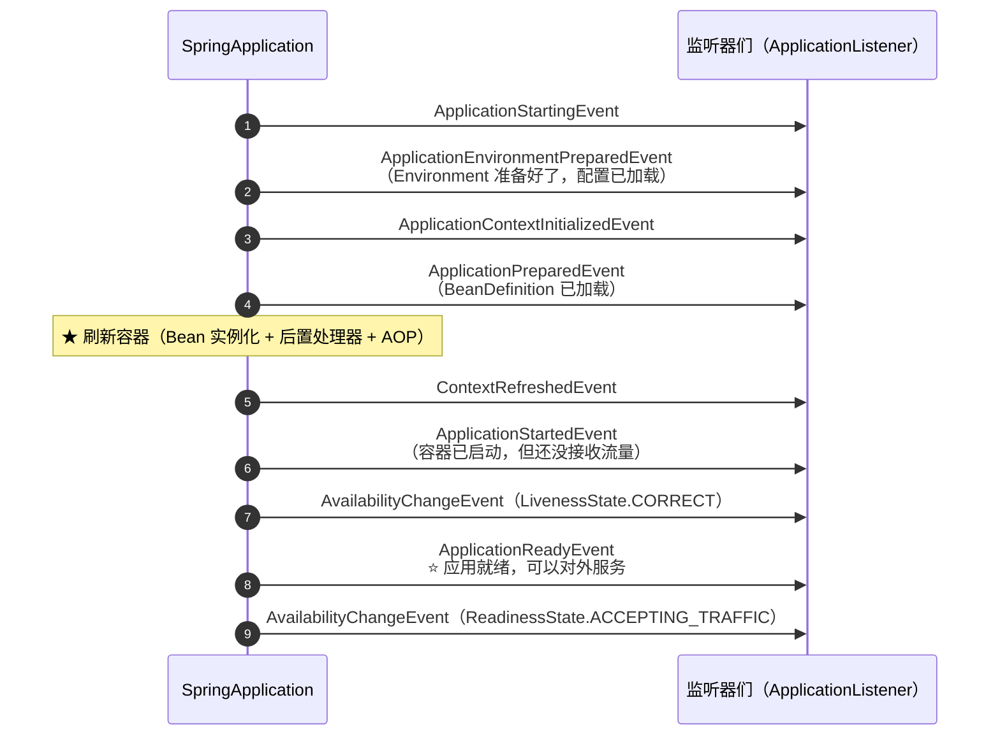

### 8.2 ⚠️ 坑 10：发布顺序必须严格，监听器顺序要可控

> 视频对话："手写时注意两点：**第一，事件的发布顺序必须严格遵循，生命周期不能乱；第二，监听器的执行顺序要可控，可以用 `@Order` 来排优先级**。"

| 要点 | 说明 | 踩坑后果 |
| --- | --- | --- |
| **事件发布顺序** | 严格按生命周期（Starting → EnvironmentPrepared → Prepared → Started → Ready） | ⚠️ 顺序乱了，监听器拿到的上下文状态不对（如 Environment 还没加载就读配置） |
| **监听器顺序** | 用 `@Order` / `Ordered` 控制 | ⚠️ 多个监听器互相依赖时行为不确定 |
| **异常处理** | Ready 之前的失败要能优雅退出；Ready 之后失败**不该让应用退出**（已在服务中） | ⚠️ 就绪后崩溃 → 流量已经进来，直接故障 |

> [!tip] 一个高频考点
> **`ApplicationReadyEvent` 与 `ApplicationStartedEvent` 的区别**：
> `Started` 表示**容器已启动但还没开始接收流量**（可做最后的自检）；`Ready` 表示**已准备好对外服务**（适合做预热、注册到注册中心、打印启动完成日志）。
> 详见 [[6-SpringBoot自动装配]] §五（`SpringApplication.run` 启动全流程）。

---

## 九、额外四个高频坑（视频单列的"避坑指南"）

### 9.1 循环依赖：没有三级缓存就直接死循环

> 视频对话："手写的时候是不是特别容易碰到循环依赖？—— **太容易了，因为你没有 Spring 原生的三级缓存机制**。这三层到手写时，**如果只搞一层缓存，A 创建时发现需要 B，B 又需要 A，直接死循环**。"

```mermaid
flowchart LR
    subgraph BAD["❌ 只有一层缓存（成品缓存）"]
        direction TB
        A1["创建 A → 需要 B"] --> A2["创建 B → 需要 A"]
        A2 --> A3["A 还没创建完，缓存里没有 A"]
        A3 --> A4["💥 死循环 / 抛 BeanCurrentlyInCreationException"]
    end
    subgraph GOOD["✅ 至少有"早期引用"这一层"]
        direction TB
        B1["实例化 A（属性未填充）"] --> B2["⭐ 把 A 的早期引用/工厂放入缓存"]
        B2 --> B3["注入 B → 创建 B → B 需要 A"]
        B3 --> B4["从缓存拿到 A 的早期引用 → 注入成功"]
        B4 --> B5["B 创建完 → 回填到 A → A 完成"]
    end
```

| 缓存层 | 名字 | 存什么 |
| --- | --- | --- |
| 三级 | `singletonFactories` | **ObjectFactory**（能提前产出早期引用/AOP 代理） |
| 二级 | `earlySingletonObjects` | **早期 Bean**（属性未填充完） |
| 一级 | `singletonObjects` | **成品 Bean** |

> [!important] 手写最小可行方案
> 视频的结论："**最少要实现『早期引用』这一层**，让 A 能拿到 B 的一个早期代理对象先注入进去，等 B 创建完再回填。"
> ⚠️ 补充（视频未提）：**构造器注入的循环依赖无法靠缓存解决**（实例化阶段就需要依赖，此时还没进缓存）——必须用 setter/字段注入。
> 深读：三级缓存如何与 AOP 代理协同，见 [[1-Spring架构与IoC容器]]、[[2-Bean生命周期与依赖注入]]。

### 9.2 自动配置类的加载顺序：`@Order` **不一定生效**

> 视频对话："自动配置类的加载顺序也是个坑。比如 **JPA 的自动配置依赖 DataSource**，如果 DataSource 还没配好就先跑了 JPA 的配置，**直接报错**。手写时必须给每个自动配置类加 `@Order`，或者用 `@AutoConfigureBefore` / `@AutoConfigureAfter` 注解来控制顺序。"
> "**注意 `@Order` 在自动配置场景下不一定生效**，更推荐用后面这两个注解。"
> "（追问）`@Order` 不一定能用？—— **对，`@Order` 对 Bean 的加载顺序有效，但对自动配置类的加载顺序不一定靠谱，因为自动配置类的加载走的是清单文件的读取逻辑，不是 BeanFactory 的排序逻辑。这个细节面试经常考。**"

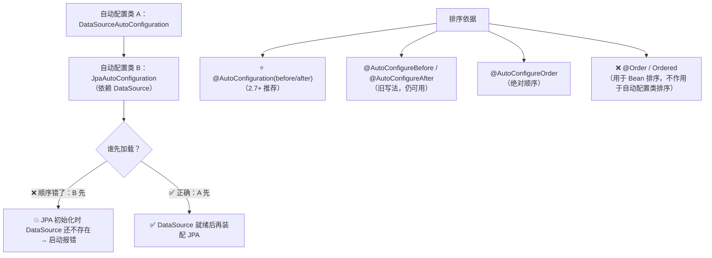

| 方式 | 是否作用于自动配置类 | 说明 |
| --- | --- | --- |
| ⭐ `@AutoConfiguration(before = X.class, after = Y.class)` | ✅ **推荐**（2.7+） | 自动配置类专用 |
| `@AutoConfigureBefore` / `@AutoConfigureAfter` | ✅ 仍可用 | 旧写法，与上者等价 |
| `@AutoConfigureOrder` | ✅ | **绝对顺序**（数值） |
| ❌ `@Order` / `Ordered` | ⚠️ **不作用于自动配置排序** | ⭐ **这就是视频说的"面试经常考"的点** |

> [!important] 为什么 `@Order` 不生效？
> **因为两者的排序发生在不同阶段、由不同组件负责**：
> - **自动配置类**的排序由 `AutoConfigurationSorter` 负责——它读清单文件，依据 **`@AutoConfigureOrder` + before/after 关系**（同级再按类名字典序）排序；
> - **`@Order` / `Ordered`** 是给 **Bean/组件/`BeanPostProcessor`** 排序用的，走的是 `BeanFactory` 的排序逻辑。
> 一个是"**清单文件的读取逻辑**"，一个是"**BeanFactory 的排序逻辑**"——**不是同一套机制**，所以 `@Order` 管不到自动配置类。

### 9.3 优雅停机：直接 kill 进程会断请求

> 视频对话："内嵌容器关闭还有什么讲究吗？**直接 kill 进程不行吗？**—— **硬杀进程，正在处理的请求直接断掉，客户端收到连接重置**。
> 手写的时候至少要实现：**收到关闭信号后，先停止接收新请求，然后设一个超时时间（比如 30 秒）等已有的请求处理完，超时了才强制关闭**。Spring Boot 里用的是 **Tomcat 的 graceful shutdown 机制**，底层就是在 **Connector 层面**做这件事。"

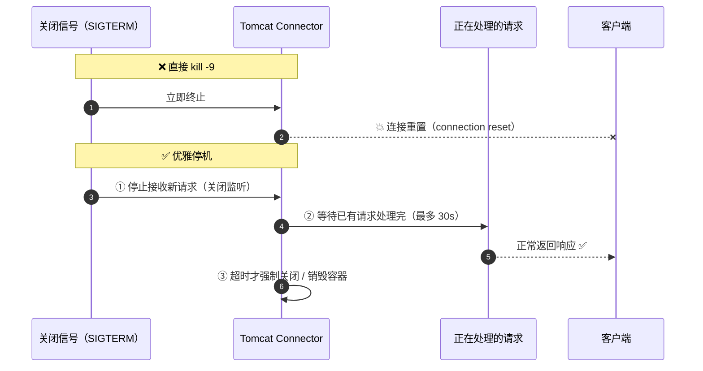

```properties
# Spring Boot 2.3+ 开启优雅停机
server.shutdown=graceful
spring.lifecycle.timeout-per-shutdown-phase=30s
```

| 方式 | 客户端体验 | 说明 |
| --- | --- | --- |
| ❌ `kill -9` | **连接重置**（请求直接失败） | 硬杀，不给处理时间 |
| ✅ **优雅停机** | 请求正常返回 | ① 停止接收新请求 ② 等待在途请求（超时 30s）③ 再退出 |
| 实现层 | — | Tomcat 的 `Connector` 层 + Spring 的 `Lifecycle`/`SmartLifecycle` 停止阶段 |

> [!tip] K8s 场景的配合
> 优雅停机必须和 K8s 的 `terminationGracePeriodSeconds` **协调**：**应用侧的等待时间要小于 K8s 的宽限期**，否则 K8s 会在应用还没关完时 `SIGKILL`。

### 9.4 坑 11（汇总）：那些"不报错但不工作"的坑

视频里散落了多个"**静默失效**"型的坑，这里汇总成一张表——**这类坑最耗时，因为它们不报错**：

| 坑 | 静默表现 | 根因 |
| --- | --- | --- |
| 清单文件 **key 拼错** | 自动配置不生效 | properties 取值失败**返回空集合，不抛异常** |
| 自定义条件注解**漏 `@Retention(RUNTIME)`** | 条件逻辑不执行 | 注解运行时被丢弃，**反射读不到元注解** |
| 漏 `postProcessAfterInitialization` | **AOP/事务/@Async 失效** | 代理没生成，**但代码看起来完全正常** |
| `@Order` 给自动配置类排序 | 顺序不符合预期 | **走错了排序机制**（应为 `@AutoConfigureOrder` 系列） |
| 3.0 升级后第三方 starter 仍用 `spring.factories` | 该库自动配置**悄悄失效** | Boot 3.0 **移除了 `spring.factories` 的自动配置 key** |

> [!danger] 排查这类问题的通用手法
> ① **打开条件评估报告**：`--debug` 启动（或 `logging.level.org.springframework.boot.autoconfigure=DEBUG`），会打印 **ConditionEvaluationReport**，直接告诉你"哪个自动配置为什么没生效"；
> ② 用 `ApplicationContext.getBeanDefinitionNames()` 确认 Bean 到底有没有被注册；
> ③ 对 SPI 清单文件**写单测**（断言能读到非空列表）——把"静默失败"变成"测试失败"。

---

## 十、手写路线图与验收清单

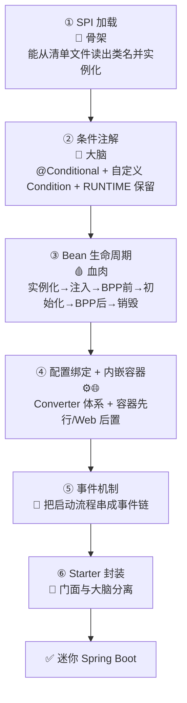

| # | 模块 | 验收标准（怎么证明写对了） |
| --- | --- | --- |
| 1 | SPI 加载 | 能在**多个 jar** 中读到清单并去重；key 用**常量**；有单测防拼错 |
| 2 | 条件注解 | 支持 `OnClass` / `OnMissingBean` / `OnProperty`；**条件有短路**；自定义注解有 `@Retention(RUNTIME)` |
| 3 | Bean 生命周期 | 打印日志验证**7 个阶段**都执行；AOP 代理**确实生成**（对比 `getClass()`） |
| 4 | 配置绑定 | `30s`→`Duration`、`"8080"`→`int`、`a,b,c`→`List` 全部成功；缺 Converter 时**报明确异常** |
| 5 | 内嵌容器 | 顺序为**容器先行**；有 **WebappClassLoader** 隔离；请求能拿到上下文 |
| 6 | 事件机制 | 事件顺序正确；`@Order` 控制监听器；`Ready` 与 `Started` 语义正确 |
| 7 | Starter | starter **零 Java 代码**；只引 starter 即可用；可单独引 autoconfigure |

> [!important] 视频的收尾（全片最重要的一句）
> "**手写 Spring Boot 的价值不在于真的要造个轮子，而在于通过造轮子搞清楚『为什么这样设计』——这就够了。**"
> "每一步都有坑，但**每踩一个坑，你对 Spring Boot 的理解就深一层**。"

---

## 附录 A：语音转写（ASR）勘误对照

| 原始转写 | 应为 |
| --- | --- |
| 包的 **mti inf spring factories** | **`META-INF/spring.factories`** |
| 错了一个字母就**寂寞失败** | 就**静默失败** |
| 文件**批**不匹配 | **key** 不匹配 |
| **T 名**打错了 | **key 名**打错了 |
| 直接**溜**一个 **tom cat** | 直接 **new** 一个 **Tomcat** |
| **dispatch survey** 这样的 **server let** | **DispatcherServlet** 这样的 **Servlet** |
| **内建 tom cat** / 内嵌 tomcat | **内嵌 Tomcat** |
| **web app class loader** | **WebappClassLoader** |
| **serve light** 规范类 | **Servlet** 规范类 |
| **at conditional** | **`@Conditional`** |
| 容器里是不是还没有这个 **B** | 还没有这个 **Bean** |
| 条件注解之间是**雨**的关系 | 是**与**的关系 |
| **been post processor** | **`BeanPostProcessor`** |
| **after properties set** | **`afterPropertiesSet`** |
| 做出**石化校验** | 做**初始化校验** |
| **AP 代理**就**支**不进去 | **AOP 代理**就**织**不进去 |
| YAML 里写 **time out30S** | **`timeout: 30s`** |
| 直接**炸手** | 直接**炸** |
| **converter 体系** | **Converter** 体系 |
| **at order** / **at otto configure before/after** | **`@Order`** / **`@AutoConfigureBefore/@AutoConfigureAfter`** |
| **evventimeter on start on ready** | **event emitter**（on start / on ready） |
| **Singleton factories / Early Singleton objects / Singleton objects** | 三级缓存：**singletonFactories / earlySingletonObjects / singletonObjects** |
| 对 **ban** 的加载顺序有效 / 不是 **bing factory** 的排序逻辑 | 对 **Bean** 的加载顺序有效 / 不是 **BeanFactory** 的排序逻辑 |
| 直接 **Q** 进程 | 直接 **kill** 进程 |
| **at my conditional** | **`@MyConditional`**（自定义条件注解） |
| **at retention run time** | **`@Retention(RUNTIME)`** |
| 把 **being in** 生命周期跑通 | 把 **Bean** 生命周期跑通 |
| 手写 spring boot 要实现这**五个**核心模块 | ⚠️ 与标题（7 大模块）及正文实际内容不符，**正文讲了 7 个** |

> [!note] 一处内容层面的观察
> 视频正文实际讲了 **7 个模块**（SPI 发现、内嵌容器、条件注解、Bean 生命周期、配置绑定、Starter、事件机制），与标题一致；
> 只有开头那句口播说了"**五个**"。**面试时按 7 个说更完整**。

## 附录 B：面试速答模板 + 速查

### B.1 "手写一个迷你 Spring Boot 你会怎么设计"——30 秒回答模板

> **"我会先明确 Spring Boot 帮我们省掉的是三件事：XML 配置、依赖管理、容器部署，所以要实现的自动化拆成 7 个模块。**
> **① SPI 自动配置发现**——从清单文件（`spring.factories`，2.7+ 是 `AutoConfiguration.imports`）读出候选配置类并反射实例化，这是**骨架**；这里最大的坑是 **key 拼错会静默失败**，所以 key 必须用常量。
> **② 条件注解**——`@Conditional` 及其子类决定谁真正生效，这是**大脑**；要注意条件之间是**与关系且有短路**，还要给自定义注解加 **`@Retention(RUNTIME)`**，否则元注解丢失、条件根本不执行。
> **③ Bean 生命周期**——实例化、属性注入、`BeanPostProcessor` 前后置、初始化、销毁，这是**血肉**；漏掉 `postProcessAfterInitialization` 会导致 **AOP/事务直接失效**。
> **④ 配置绑定**——必须有 **Converter 体系**，否则 `timeout: 30s` 绑到 `int` 字段直接炸。
> **⑤ 内嵌容器**——顺序必须是 **Spring 容器先行、Web 容器后置**，还要有 **WebappClassLoader 做隔离**。
> **⑥ 事件机制**——把启动流程串成事件链，顺序必须严格、监听器顺序用 `@Order` 控制。
> **⑦ Starter**——坚持**门面与大脑分离**，starter 只做依赖聚合。
> 另外三个高频坑：**循环依赖至少要实现早期引用这一层**；**自动配置类排序要用 `@AutoConfigureOrder`/`@AutoConfiguration(before/after)`，`@Order` 不管用**（因为走的是清单读取逻辑而不是 BeanFactory 排序）；**关闭要优雅停机**，不能直接 kill。"

### B.2 一页速查

| 问题 | 一句话答案 |
| --- | --- |
| Spring Boot 省掉了什么 | **XML 配置、依赖管理、容器部署**三件事的自动化 |
| 手写要实现几个模块 | **7 个**：SPI 发现、内嵌容器、条件注解、Bean 生命周期、配置绑定、Starter、事件机制 |
| 哪两个模块最容易写错 | ⭐ **自动配置引擎（SPI）和条件注解** |
| 自动配置怎么发现的 | **Java SPI**：读清单文件 → ClassLoader → 反射实例化 |
| 清单文件在哪 | ≤2.6：`META-INF/spring.factories`；**2.7+：`META-INF/spring/…AutoConfiguration.imports`**；**3.0 移除旧 key** |
| 拼错 key 为什么没报错 | 它是 **properties 解析**，**key 不匹配返回空集合，不抛异常** → 静默失败 |
| 内嵌容器的顺序 | ⭐ **Spring 容器先行，Web 容器后置**（否则 Servlet 拿不到上下文 → 白屏） |
| 为什么要 WebappClassLoader | **隔离应用类与容器类**（避免 Servlet 规范类/JSP 编译冲突），并支持热部署 |
| 条件注解怎么组合 | 条件之间是**与**，且**短路**；**把便宜且最可能失败的放前面** |
| 条件注解最阴的坑 | 自定义注解**漏 `@Retention(RUNTIME)`** → 元注解运行时不保留 → 条件不执行 |
| Bean 生命周期最关键的两个钩子 | `postProcessBeforeInitialization` / ⭐ **`postProcessAfterInitialization`（AOP 代理在此生成）** |
| 漏了 `afterPropertiesSet` 会怎样 | **依赖注入完成后没机会做初始化校验**，非法状态进入使用期 |
| 配置绑定的重灾区 | ⭐ **类型转换**：`30s` → `Duration`、`"8080"` → `int`、`"a,b,c"` → `List` |
| Starter 的设计哲学 | ⭐ **空壳 + 引用**：只有 pom（依赖聚合）+ 清单声明，**代码放 autoconfigure 模块** |
| 启动事件顺序 | Starting → EnvironmentPrepared → Prepared → Started → ⭐ **Ready** |
| `Started` vs `Ready` | `Started` 容器已启动未收流量；**`Ready` 才可对外服务** |
| 循环依赖怎么解 | ⭐ **至少实现"早期引用"这一层**（三级缓存的最小版本）；**构造器注入无解** |
| 自动配置类怎么排序 | ⭐ **`@AutoConfiguration(before/after)` / `@AutoConfigureOrder`**；**`@Order` 不生效** |
| `@Order` 为什么不生效 | 自动配置排序走**清单文件读取逻辑**（`AutoConfigurationSorter`），不是 **BeanFactory 排序逻辑** |
| 怎么优雅停机 | `server.shutdown=graceful` + `timeout-per-shutdown-phase=30s`：**停止收新请求 → 等在途 → 超时强制关** |
| 怎么排查"静默失效" | ⭐ **`--debug` 看 ConditionEvaluationReport** + 查 BeanDefinitionNames + 给清单文件写单测 |

> [!note] 全片主旨
> "**手写 Spring Boot 的价值不在于真的要造个轮子，而在于通过造轮子搞清楚『为什么这样设计』。**"
