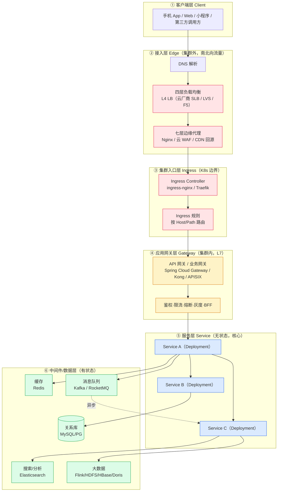
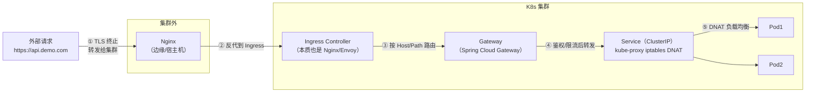
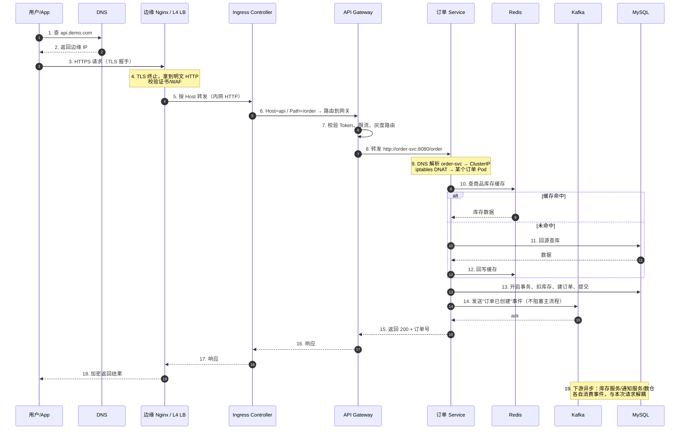
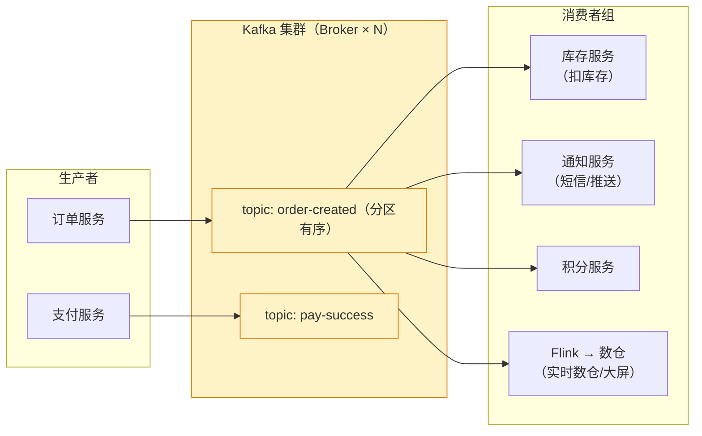
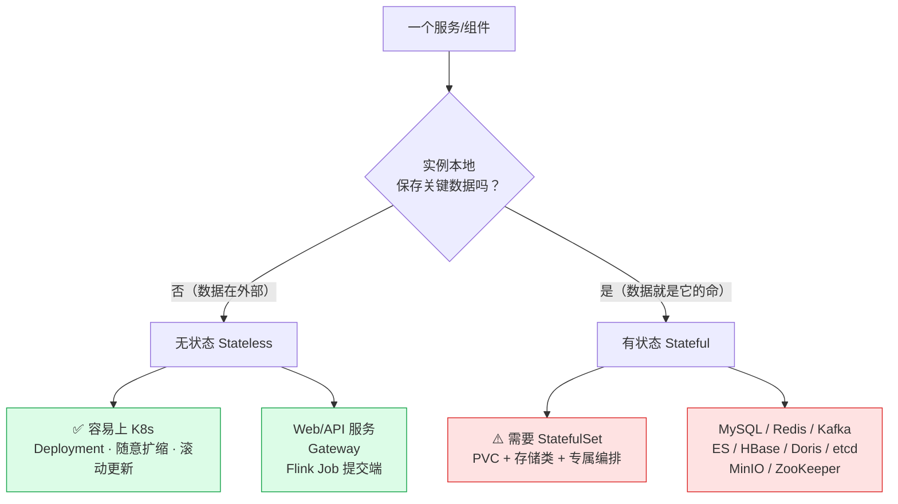
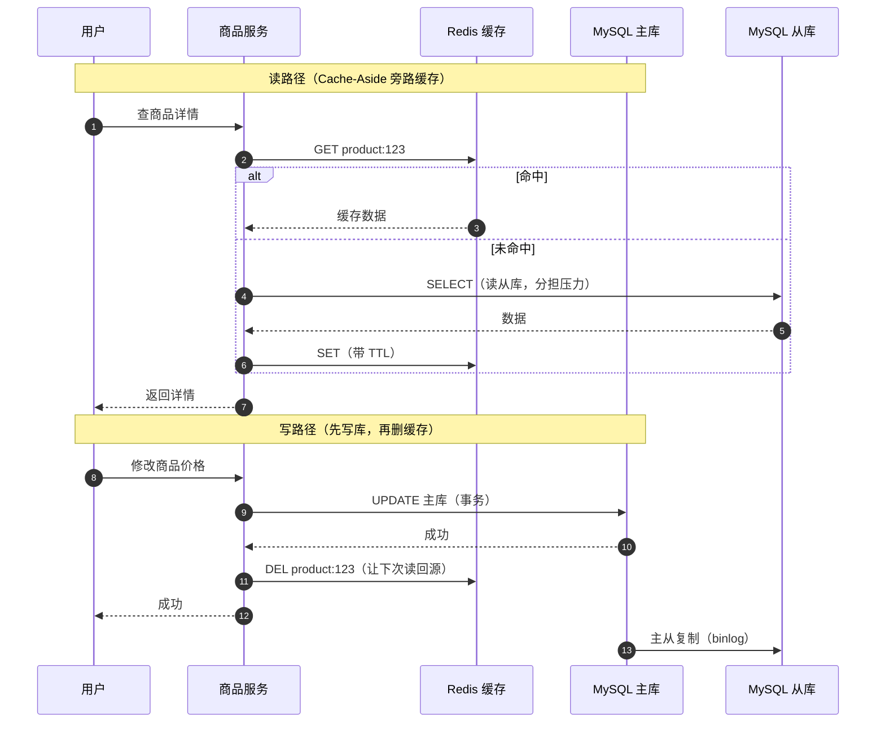
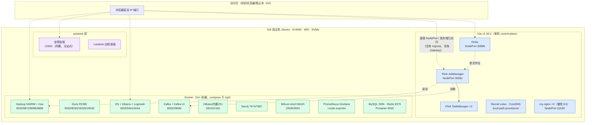
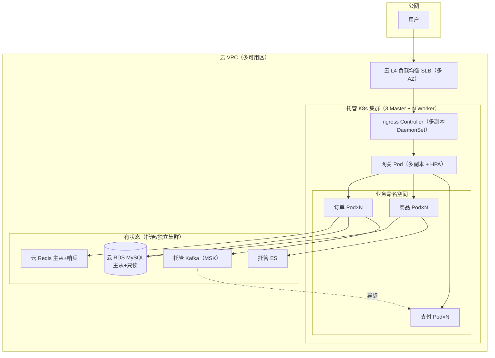
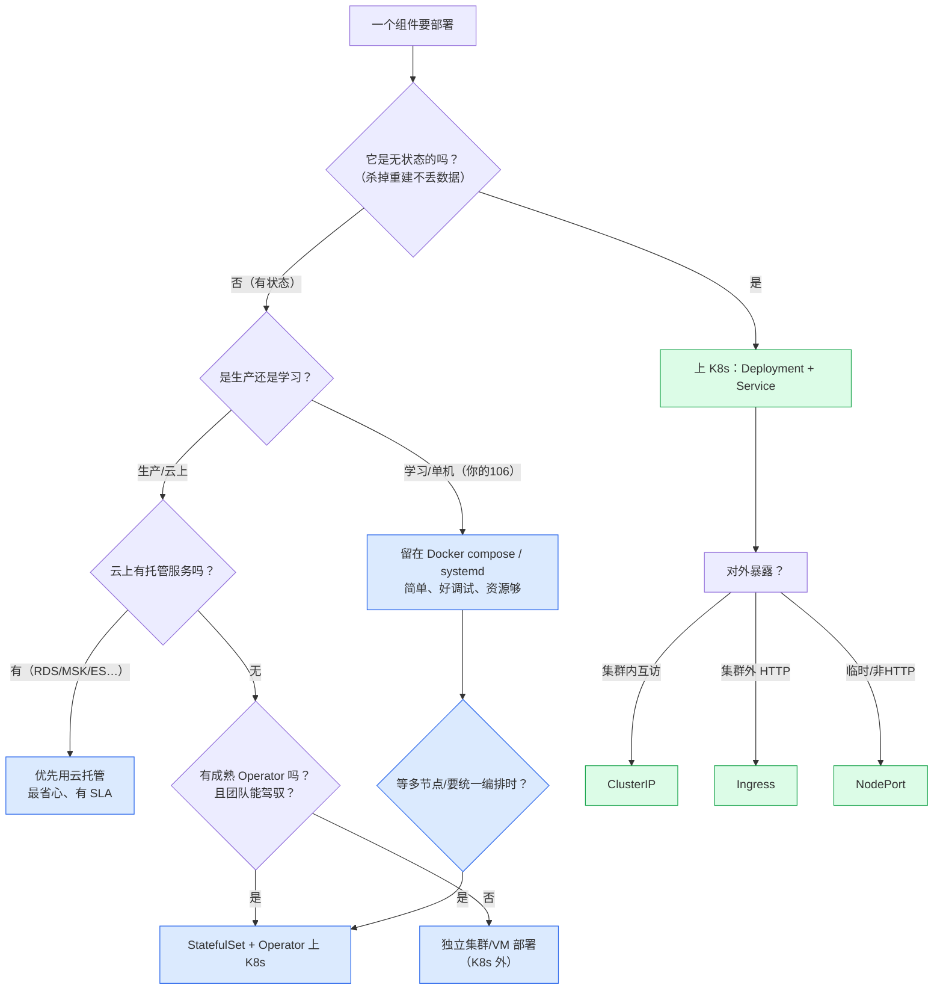

# 系统架构总览：从流量入口到存储底座

> [!info] 本文解决一个核心困惑
> 很多人学了一堆名词——**Nginx、Ingress、Ingress Controller、Service、Spring Cloud Gateway、API 网关、负载均衡、缓存、消息队列**——但脑子里是散的：
> 它们**各自在哪一层？谁先谁后？为什么都在"转发"却不能互相替代？哪些该进 K8s，哪些不该？**
>
> 本文用一套**分层心智模型**把它们串成一条线，并用 mermaid 画出完整请求路径。配套的深入文档：
> - 入口层细节（Nginx / Ingress / Gateway）→ [[3-入口层-Nginx-Ingress-Gateway]]
> - 中间件上不上 K8s → [[4-状态型中间件上不上K8s]]
> - 你 106 机器的具体规划 → [[5-106服务梳理与K8s迁移规划]]
> - 请求在 K8s 内部的包级流转（iptables/vxlan）→ [[0-K8s网络请求全过程]]

---

## 〇、一张总图：现代后端的六层架构

先建立整体观，后面每一节都是这张图的局部放大。

> [!tip] 一句话记忆
> **从外到内：DNS → 四层 LB → 边缘 Nginx → Ingress Controller → API 网关 → Service → 中间件。**
> 越往左越"通用基础设施"（谁都能用），越往右越"懂业务"。
> 单机/学习环境会把左边好几层**折叠**成一个 Nginx（你 106 现在甚至没有标准入口，直接用 NodePort）。

---

## 一、每一层"是什么、负责什么、不负责什么"

> 这是全文最重要的一张表。判断一个组件该放哪、能不能替代另一个，先看它属于哪一层。

| 层 | 典型组件 | OSI 层 | 核心职责 | **不负责**（边界） | 是否懂业务 |
|---|---|---|---|---|---|
| 客户端 | App / 浏览器 | — | 发起请求、TLS、重试 | 路由、负载 | — |
| 四层 LB | LVS / 云 SLB | L4（TCP/UDP） | 按 IP:Port 转发、高可用、海量连接 | 看 HTTP 内容、域名路由 | ❌ |
| 边缘 Nginx | Nginx / OpenResty | L7（HTTP/HTTPS） | TLS 终止、虚拟主机、静态资源、反向代理、基础 WAF | 业务鉴权、服务发现 | ❌（半通用） |
| **Ingress Controller** | ingress-nginx / Traefik | L7 | K8s 内的 HTTP 路由入口，监听 Ingress 资源动态生效 | 业务规则、复杂鉴权 | ❌（只懂 K8s） |
| **API 网关** | Spring Cloud Gateway / Kong / APISIX | L7 | 统一鉴权、限流、熔断、灰度、协议转换、BFF | 转发到具体 Pod（交给 Service） | ✅ 懂业务 |
| **Service** | kube-proxy（iptables/ipvs） | L4 | 给一组 Pod 稳定 VIP、服务发现、负载均衡 | HTTP 路由、TLS、鉴权 | ❌ |
| 业务服务 | Spring Boot Deployment | L7 | 真正的业务逻辑 | 网络转发、数据持久化 | ✅✅ |
| 缓存 | Redis | L7 协议 | 抗读、降延迟、分布式锁 | 持久主存、复杂查询 | — |
| 消息队列 | Kafka / RocketMQ | L7 协议/TCP | 削峰、解耦、异步、广播、顺序 | 同步返回业务结果 | — |
| 数据库 | MySQL / PG | — | 事务、强一致、持久化 | 高并发直连、缓存 | — |

> [!note] 为什么"转发"这件事要拆成这么多层？
> 因为关注点不同：
> - **L4** 只看端口，快、稳、便宜，负责把流量送进集群；
> - **边缘/Ingress** 看 HTTP 头，负责"哪个域名/路径给哪个服务"；
> - **Gateway** 不仅看 HTTP，还要"懂业务"（这个 token 是谁、有没有权限、要不要限流）；
> - **Service** 不看 HTTP，只负责"在一堆 Pod 里挑一个"。
>
> 把它们混在一个组件里（比如用 Spring Cloud Gateway 直接暴露公网、又当内部 LB）在小规模能跑，但会丢掉分层带来的**独立伸缩、故障隔离、安全纵深**。

---

## 二、四个最容易混的"转发者"：Nginx vs Ingress vs Gateway vs Service

这是本文要重点澄清的。它们**不是竞争关系，而是上下游**。

### 2.1 逐一说清

| 维度 | **Nginx** | **Ingress (+Controller)** | **Spring Cloud Gateway** | **Service** |
|---|---|---|---|---|
| 本质 | 一个通用 Web 服务器/反向代理 | K8s 的一个**资源对象** + 一个在跑的 Controller 程序 | 一个**跑在 JVM 里的微服务** | K8s 的一条 **iptables/ipvs 规则**（ClusterIP） |
| 谁在运行它 | 系统进程 / 容器 | K8s 里的 Pod（ingress-nginx） | K8s 里的普通业务 Pod | 不是程序，是 kube-proxy 维护的内核规则 |
| 工作层 | L7（也能 stream 做 L4） | L7 | L7 | **L4**（TCP） |
| 路由依据 | 配置文件 `server_name/location` | K8s 资源 `host`/`path`，**声明式动态生效** | 代码/配置里的 `Route`（谓词+过滤器） | Label Selector |
| 服务发现 | 静态 upstream 或 DNS | **自动**发现 Service/Pod | 注册中心 / K8s Service DNS | Label，自动 |
| 典型动作 | TLS、静态页、反代、压缩 | 把域名/路径映射到 Service | 鉴权、限流、熔断、改报文、灰度 | 稳定 VIP、轮询 Pod |
| 改配置方式 | 改 conf + reload | `kubectl apply` Ingress | 改代码/配置，重启或刷新 | 改 Deployment 自动更新 Endpoint |
| 在你 106 | 宝塔自带 Nginx（10591，闲置）+ K8s 里 my-nginx（31539，僵死） | **未安装**（现在直接用 NodePort） | 未部署（学习环境暂无业务服务） | Flink/Dinky 都有 Service |

### 2.2 三句话区分

1. **Nginx 是"程序"，Ingress 是"规则"**：Ingress 自己不干活，真正转发的是 Ingress Controller（它内部**常常就是一个 Nginx**，如 ingress-nginx）。Ingress 的价值是"用 K8s 声明式配置去管理这个 Nginx"。
2. **Gateway 是"懂业务的 Nginx"**：它是一个微服务，能连注册中心、能写 Java/Kotlin 过滤逻辑、能做用户级鉴权；Ingress/Nginx 通常不懂你业务里的"会员等级、租户隔离"。
3. **Service 是"四层 VIP"，不碰 HTTP**：它不区分 `/api` 和 `/web`，只负责把到 ClusterIP:Port 的包 DNAT 到某个 Pod。详见 [[0-K8s网络请求全过程]]。

> [!warning] 常见误区
> - ❌"装了 Ingress 就不需要 Nginx 了"——云上通常**两者都有**：外层云 SLB/Nginx 负责 TLS 和高可用，Ingress 负责集群内路由。
> - ❌"Service 能做域名路由"——Service 是 L4，做不了基于 Host/Path 的路由，那是 Ingress 的活。
> - ❌"Gateway 可以替代 Service"——Gateway 转发时仍然写 `http://service-a:8080`，底层还是走 Service。
> - ✅ 小团队/单体：Nginx 一层全包（TLS+路由+反代），根本不需要 Gateway。

---

## 三、一次同步请求的完整生命周期（带 mermaid 时序）

把上面的分层串成一条真实的时间线。以"用户下单"为例。

**关键观察**：
- 步骤 1–7 是"找对人 + 安检"（基础设施 + 网关），步骤 8–9 是"K8s 内路由"，步骤 10–14 才是"业务"。
- 同步链路里 MQ 只是"发一条就走"（步骤 14），真正的重活在**异步链路**。

---

## 四、异步请求：消息中间件在架构中的位置

MQ 不是"另一个数据库"，它解决的是**时间上的解耦**。三个经典价值：**削峰、解耦、异步**。

| 模式 | 说明 | 对应你的组件 |
|---|---|---|
| 异步 | 下单后发短信/推送，不让用户等 | Kafka → 通知服务 |
| 解耦 | 订单服务不需要知道有多少下游 | 新增"积分服务"只需订阅同一 topic |
| 削峰 | 秒杀瞬间 10w QPS 写入消息，下游按能力消费 | Kafka 抗住峰值，MySQL 不被打垮 |
| 广播（发布订阅） | 一条事件多个消费者组各自独立消费 | 同 topic 被库存/通知/Flink 分别消费 |

> [!tip] 同步 vs 异步的架构直觉
> - 要"**立刻拿到结果**"的走同步：网关 → 服务 → 缓存/库。
> - 要"**通知别人去做、我不等**"的走异步：服务 → MQ → 多个消费者。
> - 你 106 上已经有真实链路：**Kafka → Flink → Hive/HDFS**（见 `服务器巡检-192.168.0.106/Kafka入湖标准流程与方案选型.md`），这就是典型的异步数据管道。

---

## 五、无状态 vs 有状态：决定"能不能轻松上 K8s"的分水岭

这是 [[4-状态型中间件上不上K8s]] 的总纲，先建立分类直觉。

| 判据 | 无状态 | 有状态 |
|---|---|---|
| 杀掉一个 Pod 换台机器重启，丢东西吗？ | 不丢 | **会丢数据/起不来** |
| 扩缩容 | 随便加副本 | 加节点要同步数据、rebalance |
| 更新 | 滚动替换即可 | 要考虑主从、分区、数据迁移 |
| K8s 工作负载 | **Deployment** | **StatefulSet**（稳定网络名 + PVC） |
| 存储 | 不需要持久卷 | 必须 PVC + StorageClass |
| 典型 | Spring Boot、Gateway、Flink JobManager 客户端 | MySQL、Redis、Kafka、ES、HBase、Doris |

> [!important] 核心结论（先记住，细节看专篇）
> - **业务服务（无状态）→ 一定要上 K8s**，这是 K8s 的主场。
> - **中间件（有状态）→ 单机学习环境建议留在 Docker/systemd**；上 K8s 是"可以但有成本"，需要 StatefulSet/Operator，生产中也常常托管在集群外（云 RDS/MSK）或用 Operator。
> - **大数据组件（Hadoop/HBase/Kafka on 重型存储）→ 更推荐独立部署或专用 Operator**，因为它们自己已经有一整套集群/存储管理机制，K8s 反而多一层。
> - 详细逐项判定见 [[4-状态型中间件上不上K8s]]，针对 106 的逐项结论见 [[5-106服务梳理与K8s迁移规划]]。

---

## 六、缓存、消息、数据库在架构中的协作（一张"读写时序"）

以"读多写少的商品详情 + 写后失效缓存"为例，看清 Redis 和 MySQL 的分工。

**分工记忆**：
- **MySQL**：权威数据源，负责事务和强一致；主库写、从库读。
- **Redis**：MySQL 前面的"挡浪墙"，存热点、降延迟、抗 QPS；数据可丢（能回源重建）。
- **Kafka**：跨服务/跨系统的"传送带"，负责异步和削峰。
- 三者**不是替代关系**，而是各自补位：Redis 补"快"、Kafka 补"解耦/吞吐"、MySQL 保"正确"。

---

## 七、映射到你的 106：现在的真实架构长什么样

把前面的"理想六层"对照到单机学习环境。结论：**它更像"一筐子中间件"，而不是一套有入口分层的业务系统**——因为现在上面跑的几乎全是基础设施，还没有自己的业务服务。

### 7.1 现状 vs 理想分层的差距

| 理想分层 | 106 现状 | 差距 / 说明 |
|---|---|---|
| DNS / L4 LB | 无 | 单机不需要，直接用 IP |
| 边缘 Nginx | 宝塔自带 Nginx（10591）但**无站点闲置**；80/443 无监听 | 没有对外网站 |
| Ingress Controller | **未安装**，用 NodePort（30081/30888/31539） | 学习阶段可接受；服务变多后建议上 ingress-nginx |
| API 网关 | 无业务服务，故无 Gateway | 等你部署 Spring Cloud 微服务时再加 |
| 业务 Service | **没有自己的业务服务**（跑的都是平台） | 这是当前最大"空缺" |
| 缓存 | Redis 6379（Docker） | ✅ 有 |
| 消息 | Kafka 9092（Docker） | ✅ 有，且已接 Flink |
| 数据库 | MySQL（Docker）+ HBase + Doris + ES + Neo4j + Milvus | 全家桶，主要用于学习 |
| 大数据 | Hadoop + Flink（K8s）+ Hive + HBase + Doris | 最完整的一块 |

> [!note] 关于 8888 与宝塔（顺带澄清上一个问题）
> - **宝塔面板实际端口是 `10591`**（`bt.service`），且开启了**安全入口**——直接访问根路径返回 Nginx 404 是正常的，要带入口路径。查看入口：在机器上执行 `bt default` 或 `cat /www/server/panel/data/admin_path.pl`。
> - **8888 是 Hue**（Hadoop 部署后占用，gunicorn 服务）。两者默认都想用 8888，所以你之前在 8888 看到的是 Hue 而不是宝塔。
> - 详见 [[5-106服务梳理与K8s迁移规划#三、端口与访问入口对照表]]。

---

## 八、生产环境的参考架构（学习的"目的地"）

单机是简化版，生产（云上、多节点、高可用）大致长这样：

**从你的单机能推演到生产的 5 个升级点**：
1. **入口**：NodePort → 云 SLB + Ingress Controller（多副本）。
2. **网关**：裸调用 → 独立网关层（鉴权/限流/灰度）。
3. **业务**：手工起 Pod → Deployment + HPA（按 CPU/QPS 自动扩缩）+ 多 AZ。
4. **数据**：Docker 单点 → 托管/集群化（RDS、MSK、Redis 哨兵）。
5. **可观测**：你已有 Prometheus/Grafana 雏形，生产再补 日志（Loki/ELK）+ 链路追踪（Tempo/Jaeger）+ 告警。

---

## 九、"该放哪 / 上不上 K8s"决策树

一张图回答"我这个组件该放哪、用什么方式部署"。

---

## 十、延伸阅读地图（本目录与相关目录）

### 9-k8s 目录
- [[0-K8s网络请求全过程]] —— 请求在集群内的**包级**真相（veth/iptables/vxlan/conntrack）
- [[1-SpringBoot上K8s与入口证书管理]] —— 把一个 Spring Boot 应用**真正部署**上 K8s 的八步 + 证书
- [[3-入口层-Nginx-Ingress-Gateway]] —— 本文第二节的**深入版**（含三者协作模式、ingress-nginx 安装）
- [[4-状态型中间件上不上K8s]] —— 本文第五节的**逐项深入**（Redis/Kafka/MySQL/ES/HBase/Doris…）
- [[5-106服务梳理与K8s迁移规划]] —— 把决策落到**你这台机器**的全服务清单和迁移路线

### 相关目录
- `11-高并发高可用/2-单机被打爆后，我才读懂 Nginx.md` —— Nginx 调优与高并发
- `2-redis/`、`3-mq/`（含 `2-Kafka`）、`4-db/` —— 各中间件的原理深挖
- `8-spring/`、`服务器巡检-192.168.0.106/` —— 微服务与这台机器的实操记录
- `服务器巡检-192.168.0.106/Kafka入湖标准流程与方案选型.md` —— 真实的 Kafka→Flink→湖仓链路

---

> [!summary] 一页纸总结
> 1. **六层从外到内**：DNS → L4 LB → 边缘 Nginx → Ingress → API 网关 → Service → 中间件。
> 2. **Nginx 是程序、Ingress 是规则（靠 Controller 执行）、Gateway 是懂业务的微服务、Service 是四层 iptables 规则**——上下游，不互替。
> 3. **同步链**路拿结果（缓存挡读、数据库兜底）；**异步链路**靠 MQ 做削峰/解耦。
> 4. **无状态上 K8s（Deployment），有状态要 StatefulSet/Operator；单机学习环境中间件优先 Docker/systemd。**
> 5. 你的 106 = **完整大数据全家桶（Docker）+ k3s 跑 Flink/Dinky + 宝塔闲置**，目前**没有业务服务、没有 Ingress/Gateway**——下一步是写一个无状态业务服务部署上去，把入口层补齐。
