# 入口层详解：Nginx、Ingress、Controller、网关到底怎么分工

> [!info] 本文回答的问题
> - Nginx、Ingress、Ingress Controller、Spring Cloud Gateway **名字都带"转发/入口"，它们到底是什么关系？**
> - 一个请求从公网到 Pod，**依次穿过它们时各自做了什么**？
> - 我的 106 现在用 NodePort，**什么时候该上 Ingress？什么时候还需要外面再套一层 Nginx？什么时候才需要业务网关？**
>
> 实操（怎么装 ingress-nginx、怎么写 Ingress、证书怎么挂）在 [[1-SpringBoot上K8s与入口证书管理]]；本文专注**架构与边界**。

---

## 〇、先破除最大的误解：Ingress 不是一个程序

很多人以为"装了 Ingress 就能转发"，这是错的。

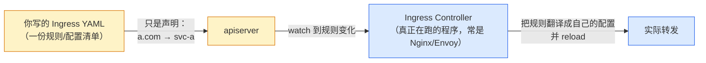

- **Ingress**：K8s 的一种**资源对象（Resource）**，就是一段 YAML，描述"哪个域名/路径转发给哪个 Service"。它本身**不会转发任何流量**。
- **Ingress Controller**：一个**监听 apiserver 的程序**，不断读取 Ingress 资源，把规则翻译成自己的配置并加载。ingress-nginx 的 Controller **内部就是一个 Nginx**；Traefik 是自己写的 Go 代理；还有 Envoy 系（Contour/Gateway API）。
- 类比：**Ingress 是"菜单"，Ingress Controller 是"厨房"**。菜单不会自己变成菜。

> [!tip] 为什么 K8s 要搞这么绕？
> K8s 核心只定义"**期望状态**"（声明式），不绑定具体实现。转发用 Nginx 还是 Envoy 还是 HAProxy，是可插拔的——所以它只定义 Ingress 这个"接口"，让各家去写 Controller。

---

## 一、四个角色的定位（一张表说透）

| 角色                     | 是什么                                | 跑在哪                             | OSI      | 谁来配置                 | 典型实现                                 |
| ---------------------- | ---------------------------------- | ------------------------------- | -------- | -------------------- | ------------------------------------ |
| **Nginx（边缘）**          | 通用 Web 服务器/反向代理                    | K8s **外**（宿主机/独立机器）             | L7（可 L4） | 改 `.conf` + reload   | Nginx / OpenResty / Tengine          |
| **Ingress**            | K8s **资源对象**（规则清单）                 | etcd 里的一条数据                     | L7 语义    | `kubectl apply` YAML | —                                    |
| **Ingress Controller** | 监听 Ingress 并执行转发的**程序**            | K8s **内**（DaemonSet/Deployment） | L7       | 由 Ingress 资源驱动       | ingress-nginx / Traefik              |
| **API/业务网关**           | 一个**懂业务的微服务**                      | K8s **内**（普通 Pod）               | L7       | 代码 / 配置中心            | Spring Cloud Gateway / Kong / APISIX |
| **Service**            | K8s 的 **L4 稳定 VIP**（iptables/ipvs） | 内核规则                            | **L4**   | 由 Endpoints 自动维护     | kube-proxy                           |

### 1.1 它们各自的"转发依据"

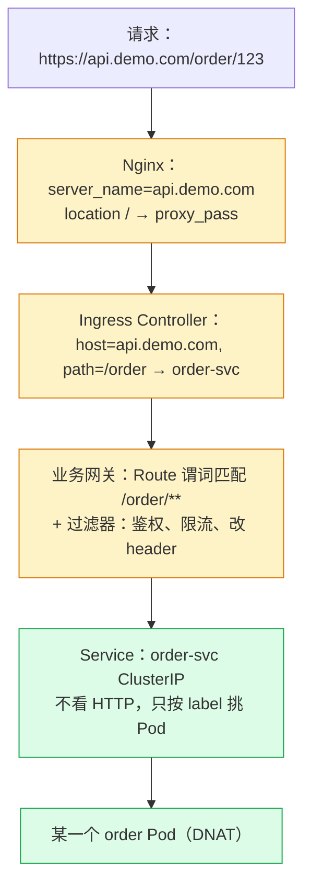

越往后，"看的东西越贴近业务"；但最终落到 Pod 一定经过 L4 的 Service。

---

## 二、Nginx 在架构中的三重身份

Nginx 出现在三个完全不同的位置，容易混：

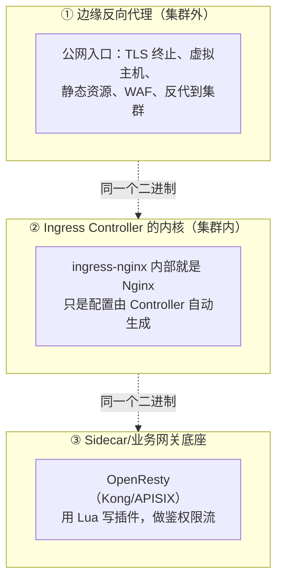

| 身份 | 位置 | 配置来源 | 你的环境 |
|---|---|---|---|
| ① 边缘代理 | 宿主机/独立服务器 | 手写 `nginx.conf` | 宝塔自带 Nginx（10591，闲置） |
| ② Controller 内核 | K8s Pod 内 | 自动生成（来自 Ingress 资源） | 未安装 ingress-nginx |
| ③ 网关底座 | K8s Pod 内 | 声明式 + Lua 插件 | 无（Kong/APISIX 未部署） |

### 2.1 边缘 Nginx 典型配置（长什么样）

```nginx
# /etc/nginx/conf.d/api.conf
server {
    listen 443 ssl http2;
    server_name api.demo.com;

    ssl_certificate     /etc/nginx/ssl/demo.crt;
    ssl_certificate_key /etc/nginx/ssl/demo.key;

    # 安全 / 性能头
    add_header Strict-Transport-Security "max-age=31536000" always;

    location /order/ {
        proxy_pass http://order-upstream;      # 反代到集群入口
        proxy_set_header Host              $host;
        proxy_set_header X-Real-IP         $remote_addr;
        proxy_set_header X-Forwarded-For  $proxy_add_x_forwarded_for;
        proxy_set_header X-Forwarded-Proto $scheme;
        proxy_connect_timeout 3s;
    }

    location /static/ {
        root /var/www;                         # 静态资源直接由 Nginx 返回
        expires 7d;
    }
}

upstream order-upstream {
    # 指向 Ingress Controller 的 NodePort，或 L4 LB
    server 192.168.0.106:30080;
    keepalive 32;
}
```

**边缘 Nginx 的核心职责**：TLS 终止、虚拟主机（一个 IP 多域名）、静态资源、连接管理（keepalive/缓冲）、基础访问控制。它**不懂你的业务**（不知道谁是 VIP 用户）。

---

## 三、Ingress / Controller：K8s 的标准入口

### 3.1 一份 Ingress YAML 在表达什么

```yaml
apiVersion: networking.k8s.io/v1
kind: Ingress
metadata:
  name: api-ingress
  namespace: prod
  annotations:
    # 告诉 ingress-nginx 的额外指令（注解是各家 Controller 私有的）
    nginx.ingress.kubernetes.io/rewrite-target: /$2
    nginx.ingress.kubernetes.io/proxy-body-size: "10m"
spec:
  ingressClassName: nginx            # 交给哪个 Controller
  tls:
    - hosts: ["api.demo.com"]
      secretName: demo-tls           # 证书放 Secret
  rules:
    - host: api.demo.com
      http:
        paths:
          - path: /order(/|$)(.*)
            pathType: Prefix
            backend:
              service:
                name: order-svc
                port:
                  number: 8080
          - path: /pay(/|$)(.*)
            pathType: Prefix
            backend:
              service:
                name: pay-svc
                port:
                  number: 8080
```

它只声明了三件事：**域名（host）→ 路径（path）→ Service（backend）**，外加 TLS。

### 3.2 Ingress Controller 如何把 YAML 变成可转发

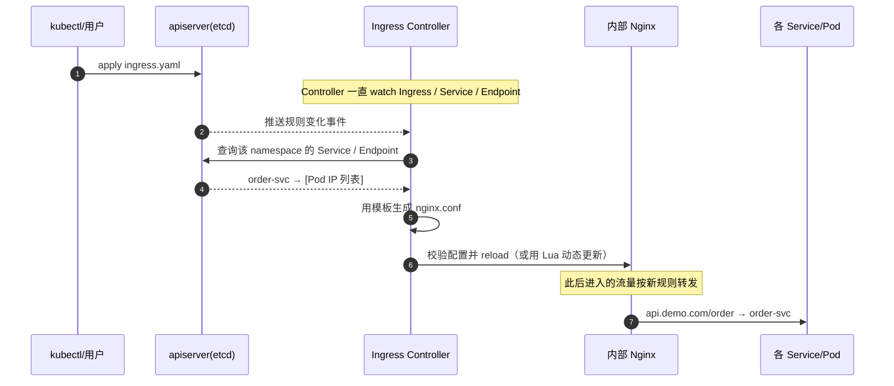

**关键点**：
- 服务扩缩容时，Endpoint 变了，ingress-nginx 多数情况下能**动态感知**（Lua balancer），不必每次 reload Nginx。
- Ingress 只解决 **HTTP/HTTPS（L7）** 的路由。**TCP/UDP（如 MySQL、gRPC 裸端口）不是标准 Ingress 的活**，要么用 NodePort/LoadBalancer，要么用各家的扩展配置。

### 3.3 Ingress Controller 在裸机/bare-metal 上怎么被访问

云上：给 Controller 一个 `LoadBalancer` 类型 Service，云厂商自动分配公网 SLB。
**裸机（你的 k3s）没有云 LB**，三种办法：

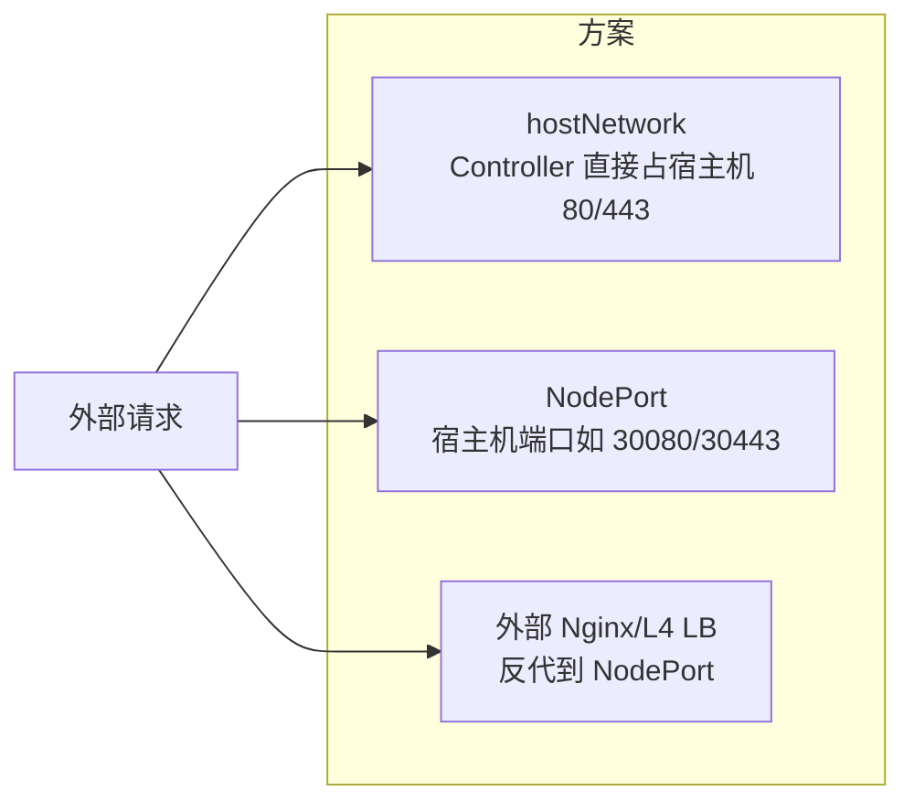

| 方式 | 优点 | 缺点 | 适合 |
|---|---|---|---|
| hostNetwork | 直接占 80/443，性能最好，URL 最干净 | 端口独占，单机 | 单机/学习（**推荐你用**） |
| NodePort | 不挑环境 | 端口要带 :30080，不优雅 | 临时、内部 |
| 外部 Nginx → NodePort | TLS/多机/老设备复用 | 多一跳 | 已有边缘 Nginx / 多节点 |

> 你的现状是**直接用业务的 NodePort**（Flink 30081、Dinky 30888）。等你部署 2~3 个 HTTP 服务、想用域名统一入口时，就到了该装 ingress-nginx 的时候（hostNetwork 模式最省事）。

---

## 四、Service：为什么 Ingress 之后还要经过它

Ingress/Gateway 的 backend 写的都是 **Service 名字**，而不是 Pod IP。因为 Pod 是"牲口"，会生老病死：

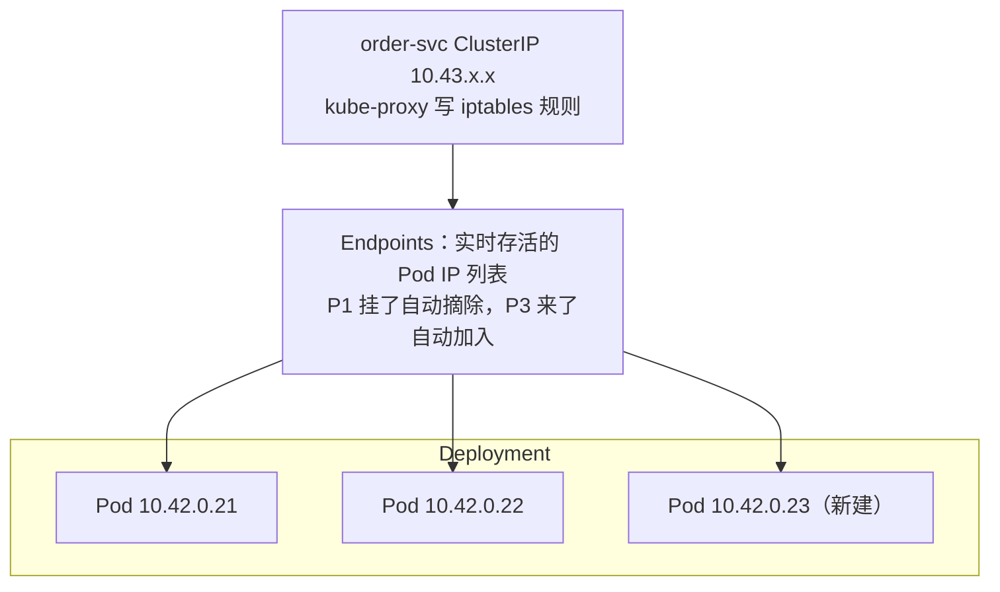

- Service 提供一个**固定的 ClusterIP + DNS 名**（`order-svc.prod.svc.cluster.local`）。
- 它是 **L4**：不解析 HTTP，只做 DNAT + 负载均衡（iptables 随机/ipvs rr）。
- Pod 重启换 IP 对调用方完全透明。
- 包在内核里怎么从 ClusterIP DNAT 到 Pod、跨节点怎么封 vxlan，见 [[0-K8s网络请求全过程]]（你环境的 iptables 规则都在里面）。

---

## 五、业务/API 网关：Ingress 之上的"懂业务层"

Ingress/Nginx 做的是**通用路由**；一旦需要"这个请求能不能过、该给哪个版本、要做什么加工"，就到了业务网关。

### 5.1 业务网关的核心能力

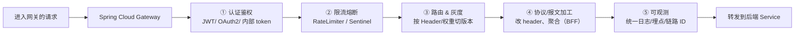

### 5.2 Spring Cloud Gateway 长什么样（一个 Route）

```yaml
spring:
  cloud:
    gateway:
      routes:
        - id: order-route
          uri: lb://order-svc          # lb:// 走服务发现 / 或直接写 http://order-svc:8080
          predicates:
            - Path=/api/orders/**
            - Header=X-Client, app     # 只接受带特定头的请求
          filters:
            - StripPrefix=1
            - name: RequestRateLimiter
              args:
                redis-rate-limiter.replenishRate: 100
                redis-rate-limiter.burstCapacity: 200
        - id: order-canary
          uri: lb://order-svc-v2
          predicates:
            - Path=/api/orders/**
            - Header=X-Canary, true    # 带灰度头的走 v2
```

一个 Route = **谓词（Predicate，什么时候匹配）+ 过滤器（Filter，匹配后做什么）+ URI（转到哪）**。

### 5.3 Ingress Controller（Kong/APISIX）也能做这些，怎么选

| 能力 | ingress-nginx | 云 ALB Ingress | Kong / APISIX | Spring Cloud Gateway |
|---|---|---|---|---|
| 基础路由/TLS | ✅ | ✅ | ✅ | ✅ |
| 鉴权/限流/灰度插件 | 弱（注解有限） | 中 | **强（Lua 插件生态）** | **强（写 Java 逻辑）** |
| 与 Spring 生态整合 | 无 | 无 | 一般 | **最好** |
| 性能 | 高 | 高 | 高 | 中（JVM） |
| 运维成本 | 低 | 极低（托管） | 中 | 要会写代码/维护 |
| 语言 | nginx.conf/Lua | 配置 | Lua | Java/Kotlin |

**经验法则**：
- 只需要"域名/路径 + TLS + 简单限流" → **Ingress 就够，别上业务网关**。
- 需要大量**业务规则、和 Spring Cloud（注册中心/配置中心）深度绑定** → Spring Cloud Gateway。
- 想要网关插件化、语言无关、高性能 → Kong/APISIX（它们本身也常作为 Ingress Controller）。

---

## 六、职责边界：哪些事该谁干（★ 高频踩坑）

| 需求 | 边缘 Nginx | Ingress | 业务网关 | 业务服务自己 |
|---|---|---|---|---|
| TLS 终止（公网证书） | ✅ **最合适** | ✅ 可以 | ❌ 一般不做 | ❌ |
| 按域名/路径分流 | ✅ | ✅ **最合适** | ✅ 但更靠后 | ❌ |
| 静态资源/下载 | ✅ **最合适** | △ | ❌ | ❌ |
| 校验用户 Token / 登录态 | ❌ | ❌ | ✅ **最合适** | 兜底 |
| 按用户/租户做细粒度限流 | ❌ | △ 粗粒度 | ✅ | ✅ |
| 灰度发布（按 Header/权重） | △ | △（注解） | ✅ **最合适** | — |
| 调用注册中心、服务发现 | ❌ | ✅ K8s DNS | ✅ | ✅ |
| 业务参数校验、事务 | ❌ | ❌ | ❌ | ✅ **唯一** |
| 直连数据库 | ❌ | ❌ | ❌（原则上） | ✅ |

> [!warning] 三条边界红线
> 1. **不要让网关直连数据库写业务**——网关是"门卫"不是"会计"，业务逻辑下沉到服务，否则网关变成新的巨石。
> 2. **不要在 Nginx 里堆业务鉴权**——if/lua 写多了无法维护，业务鉴权交给网关/服务。
> 3. **不要让 Service 去做 HTTP 路由**——它是 L4，做不到，别白费力气找"Service 路径转发"。

---

## 七、四种典型组合模式（从简单到复杂）

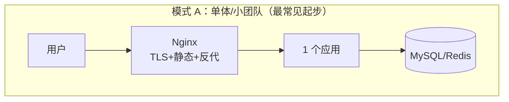

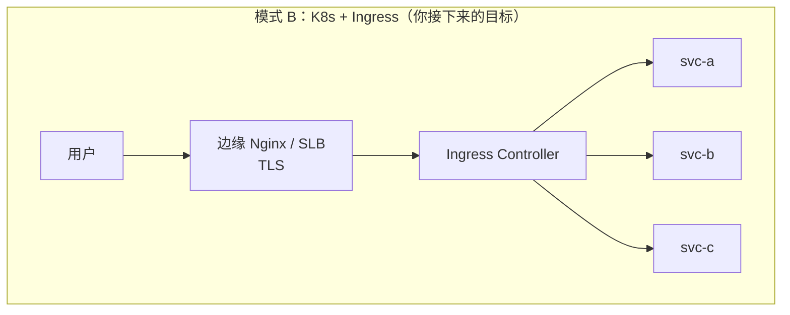

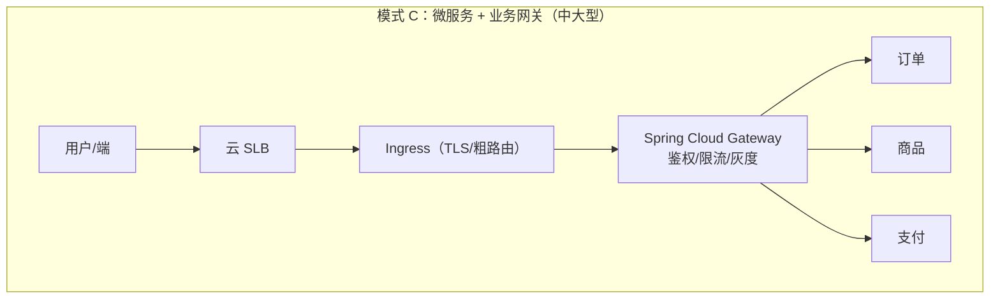

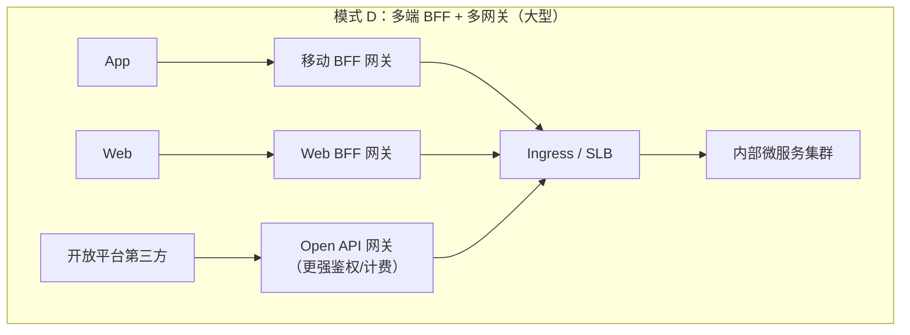

| 模式 | 层数 | 什么时候选 |
|---|---|---|
| A：Nginx + 单体 | 1 层入口 | 一个应用、一两个后端 |
| B：SLB + Ingress | 2 层 | K8s 上 2+ 个 HTTP 服务，想用域名统一入口 |
| C：+ 业务网关 | 3 层 | 微服务多了，要统一鉴权/限流/灰度 |
| D：多端 BFF/多网关 | 3+ 层 | 不同端差异大、有对外开放 API |

> [!note] 你 106 的定位
> 现在处于"**模式 B 的前夜**"：k3s 里有 Flink/Dinky，但用 NodePort 直连，**还没有自己的 HTTP 业务服务**。
> 建议路径：先部署第一个无状态 Spring Boot（用 NodePort 调通）→ 装 ingress-nginx（hostNetwork）→ 用域名+自签证书访问 → 等有 3 个以上微服务且要鉴权时，再考虑 Spring Cloud Gateway。不要一上来就堆齐三层。

---

## 八、在 106 上落地 ingress-nginx（要点，完整步骤见姊妹篇）

只列**架构决策要点**，可直接复制的完整 YAML 在 [[1-SpringBoot上K8s与入口证书管理#三、入口三方案（NodePort / Ingress / 外部 Nginx）]]。

1. **安装方式**：bare-metal 用 `hostNetwork: true` + `kind: DaemonSet`，让 Controller 直接占宿主机 80/443，避免 NodePort 那层。
2. **镜像**：国内拉 `registry.k8s.io` 可能失败，提前 `docker pull` 国内镜像后导入 k3s containerd（你姊妹篇里有具体命令）。
3. **证书**：内网用自签 + SAN（`openssl` 一条命令），放 Secret，Ingress 引用；正式了上 cert-manager。
4. **与现有端口冲突排查**：装之前确认 80/443 空闲——你 106 上 **80/443 现在无监听**（宝塔 Nginx 只听 10591），所以不冲突。
5. **不要和宝塔 Nginx 抢 80/443**：若将来宝塔要建站，二选一，或让宝塔只做面板（现状如此）。

部署后入口链路会从：

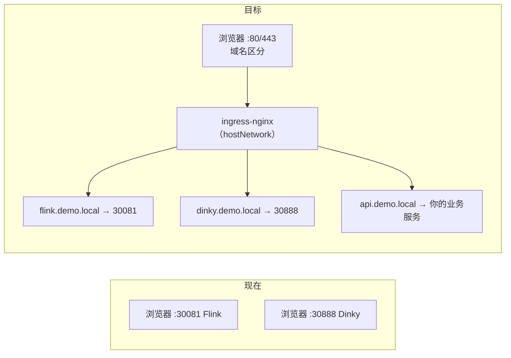

---

## 九、高频面试 / 自测问答

**Q1：Nginx 和 Ingress 是什么关系，是替代吗？**
不是。Ingress 是规则，靠 Ingress Controller（常常就是 Nginx）执行。集群外还常有一层 Nginx/SLB 做 TLS 和高可用。是**协作**不是替代。

**Q2：为什么有了 Ingress 还要 Spring Cloud Gateway？**
Ingress 做通用 L7 路由和 TLS；业务网关做**鉴权、限流、灰度、BFF** 等业务策略。前者不懂业务，后者懂。规模小可以只有 Ingress。

**Q3：Ingress 能转发 MySQL 流量吗？**
标准 Ingress 只管 HTTP/HTTPS。裸 TCP/UDP 要用 Service（NodePort/LoadBalancer）或 Controller 的 TCP 扩展配置，不是正道。

**Q4：Service、Ingress、Gateway 的 backend 为什么都写服务名而不是 Pod IP？**
Pod IP 会变（重启/扩缩容），Service 提供稳定 VIP 和 DNS，靠 Endpoints 实时跟踪存活 Pod。

**Q5：ingress-nginx 每次加规则都要 reload Nginx 吗？**
路由类配置变更需要生成配置并 reload；但后端 Endpoint 变化（Pod 扩缩容）多数通过 Lua 动态更新，不必 reload。

**Q6：裸机 k3s 怎么让外网访问 Ingress？**
hostNetwork 直接占 80/443（单机推荐）、NodePort、或外部 L4 LB/Nginx 反代三选一。

**Q7：证书一般在哪一层终止？为什么？**
通常在最外层（边缘 Nginx / SLB / Ingress），内部走 HTTP，减少每跳的 TLS 开销并集中管理证书。安全要求极高时内部也可 mTLS。

---

## 十、延伸

- 实操部署/证书/域名四方案：[[1-SpringBoot上K8s与入口证书管理]]
- 包进入集群后怎么到 Pod（iptables/vxlan/conntrack）：[[0-K8s网络请求全过程]]
- 全局架构定位：[[2-系统架构总览]]
- 106 具体规划与端口表：[[5-106服务梳理与K8s迁移规划]]

> [!summary] 一句话收束
> **边缘 Nginx 管"TLS 与公网门面"，Ingress（+Controller）管"K8s 内域名/路径到 Service"，业务网关管"能不能过、给谁、怎么加工"，Service 管"在 Pod 里四层负载均衡"。** 它们是一条链上的四道关，规模小时可以折叠，规模大时必须分层。
