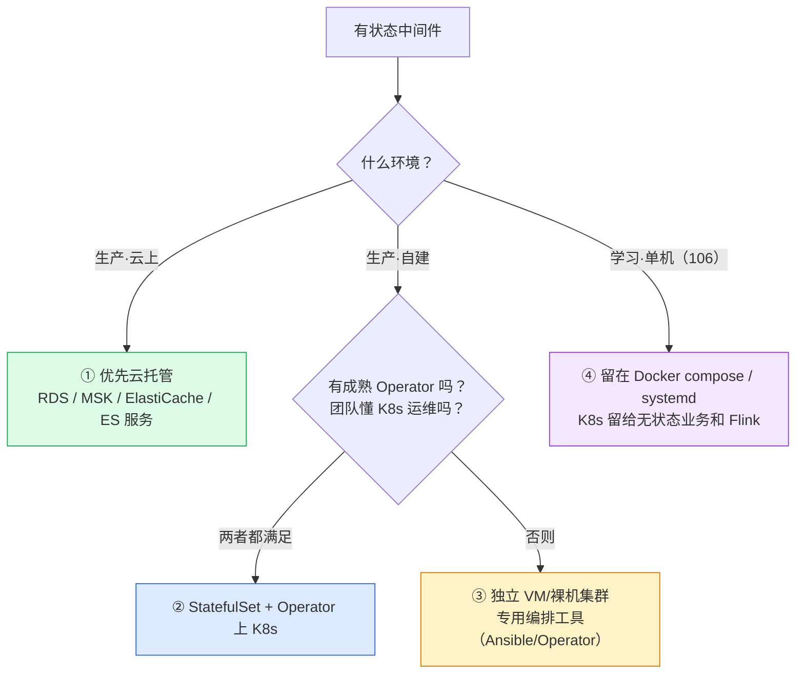
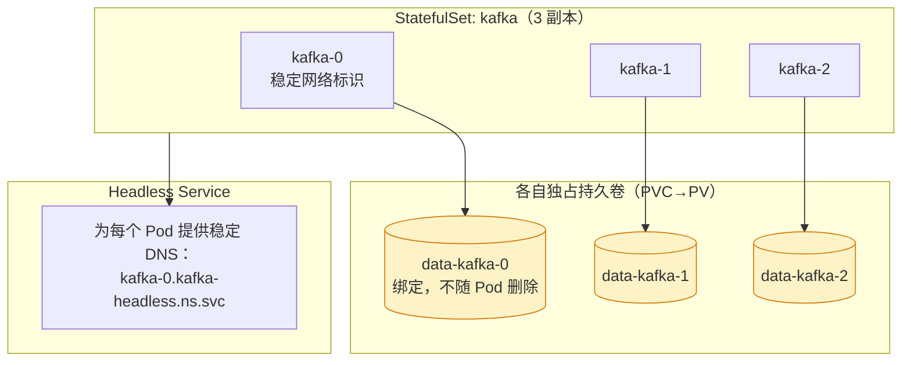
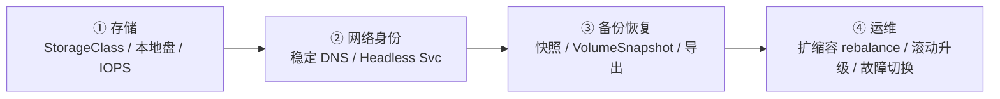
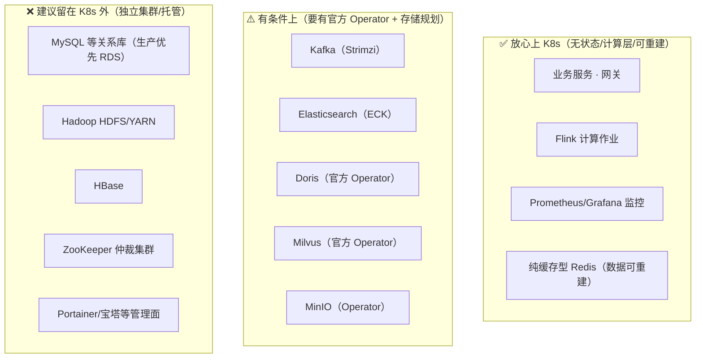
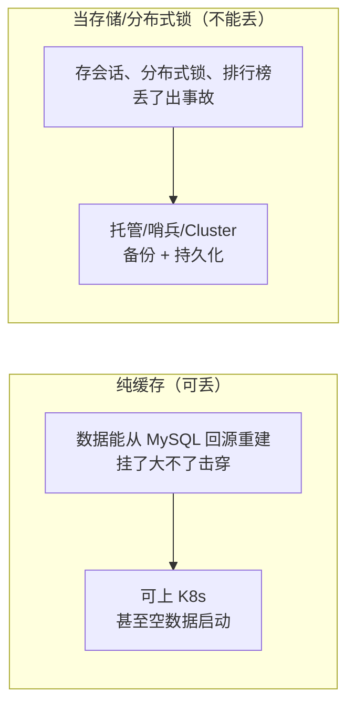
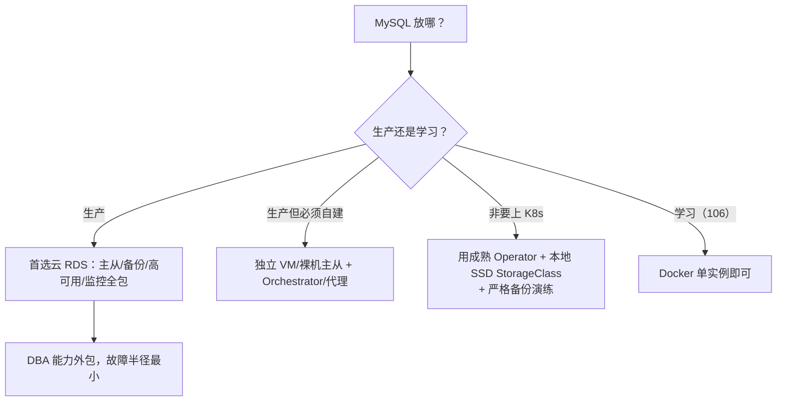
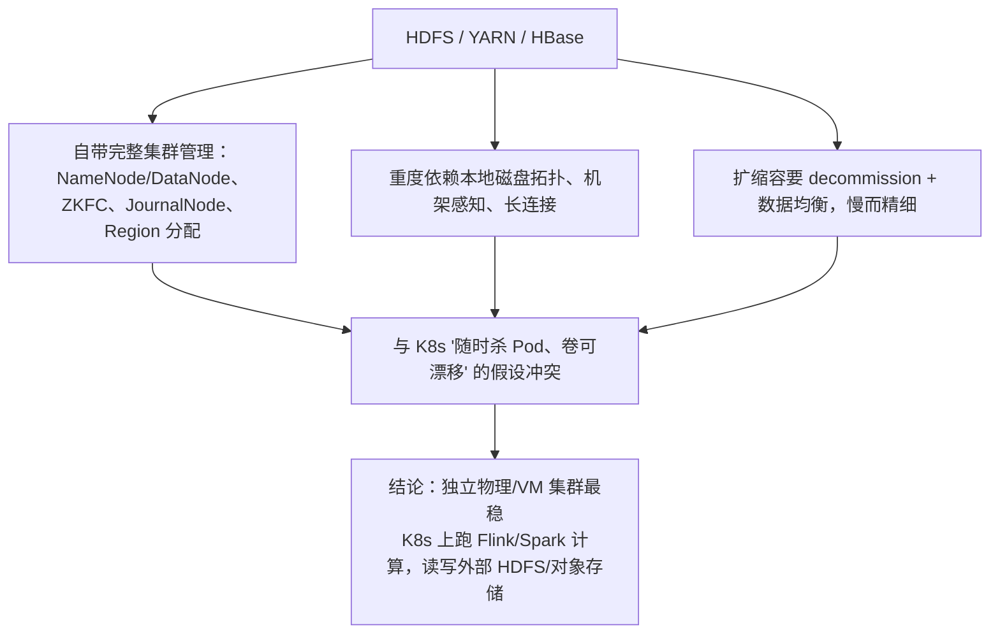
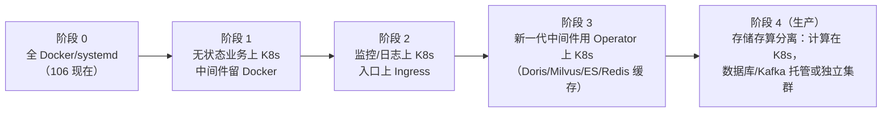

# 状态型中间件上不上 K8s：一个被争论烂了的问题

> [!info] 本文回答
> "无状态服务上 K8s"几乎没有争议；真正让人纠结的是**有状态中间件**：
> Redis、Kafka、RocketMQ、MySQL、Elasticsearch、HBase、Doris、Hadoop……**到底该不该塞进 K8s？**
> 网上有人说"全都能上"，有人说"数据库上 K8s 是找死"。本文给一套**可复用的决策框架**，再对你 106 上的每个组件逐项下结论。

---

## 〇、先给结论（TL;DR）



**一句话**：上不上 K8s 不是技术信仰，而是一道**成本题**——K8s 给你"统一编排、弹性、声明式"，但有状态组件上 K8s 要额外解决**存储、网络身份、备份、升级顺序**四件事，代价不小。**生产优先托管，自建看 Operator 成熟度，单机学习就老老实实 Docker。**

---

## 一、为什么无状态轻松、有状态难

### 1.1 K8s 为"牲口"设计，中间件是"宠物"

| | 无状态（Deployment） | 有状态（StatefulSet） |
|---|---|---|
| Pod 名字 | 随机（`order-7d9f-xk2`） | **固定有序**（`kafka-0, kafka-1, kafka-2`） |
| Pod IP | 随便变 | 希望稳定（集群成员靠它互相发现） |
| 存储 | 不需要 | **每个实例独占一块持久卷（PVC）** |
| 杀掉重建 | 没事，起来一样 | 可能丢数据/脑裂/起不来 |
| 扩缩容 | 随便加 | 加节点要 rebalance、迁移分区 |
| 升级 | 滚动替换 | 有严格顺序（先 follower 后 leader） |
| 网络身份 | 不需要 | 需要稳定 DNS（`kafka-0.kafka-headless`） |

### 1.2 StatefulSet 提供了什么



- **稳定、有序的网络名**：`kafka-0/1/2`，配合 Headless Service 做服务发现。
- **稳定的持久存储**：`volumeClaimTemplates` 给每个副本建独立 PVC，Pod 调度到哪卷跟到哪。
- **有序部署/伸缩/更新**：0→1→2 启动，2→1→0 终止。

> [!warning] StatefulSet 只解决"脚手架"，不解决"数据系统本身的复杂性"
> 它能给你稳定名字和卷，但**分区选主、数据 rebalance、脑裂防护、备份恢复、版本兼容**这些仍然是中间件自己的事。这才是难点，不是写个 StatefulSet YAML 就完事。

### 1.3 上 K8s 的四道坎（有状态四件套）



| 坎 | 问题 | 单机 k3s 的现实 |
|---|---|---|
| ① 存储 | 数据放哪？网络盘有延迟，本地盘 Pod 漂移会丢绑定 | k3s 自带 **local-path-provisioner**，只做本机目录绑定，**无多节点冗余** |
| ② 网络身份 | 成员要互相用稳定名字发现 | StatefulSet + Headless 能解决 |
| ③ 备份 | PVC 快照、数据导出、定时备份 | local-path 不支持快照，要自己 cron + 导出 |
| ④ 运维 | 升级顺序、加节点迁移、节点坏了 | 单机没有"漂移到别的节点"，节点挂=全挂 |

> 你单机 k3s 用 local-path 存储，**Pod 用的卷就是宿主机上的一个目录**。这对学习足够，但它和你直接用 Docker `-v` 挂宿主机目录**本质上没有区别**——多了一层 K8s 编排，却没得到多节点容灾。这是单机中间件"上 K8s 收益低"的根本原因。

---

## 二、决策框架：7 个判据给一个中间件打分

对每个组件问这 7 个问题，"是"越多越适合上 K8s：

| # | 判据 | 倾向 K8s（是） | 倾向外置（否） |
|---|---|---|---|
| 1 | **是否无状态/数据可重建** | 是（缓存可重建、计算层） | 否（权威数据存储） |
| 2 | **是否有成熟 Operator/Helm** | 有且被广泛生产验证 | 只有社区 demo / 没有 |
| 3 | **存储要求是否温和** | 普通磁盘即可 | 极高 IOPS/本地 NVMe/裸盘优化 |
| 4 | **集群成员是否易变/需弹性** | 经常扩缩容 | 节点固定、长期不变 |
| 5 | **团队是否掌握其 K8s 运维** | 掌握 | 只会传统部署 |
| 6 | **是否需要与 K8s 深度集成** | 需要（服务发现、CSI、声明式） | 独立运行即可 |
| 7 | **故障半径能否接受** | 能接受/有完善备份 | 不能接受核心数据受损 |

> [!tip] 两个"一票否决"级的现实因素
> - **数据是否权威（source of truth）**：如果是，务必确保备份/容灾成熟，否则优先托管或独立集群。
> - **Operator 是否官方/一线社区维护**：没有好 Operator 的有状态服务上 K8s，等于自己当 Operator 的开发者。

---

## 三、逐项决策（★ 核心）

### 3.1 总表：你 106 上的每一个组件

| 组件 | 106 现状 | 有状态 | 成熟 Operator | 单机学习建议 | 生产建议 |
|---|---|---|---|---|---|
| **业务 Spring Boot 服务** | 暂无 | ❌ 无状态 | Deployment | ✅ **上 K8s**（首选） | 一定上 |
| **API 网关** | 暂无 | ❌ 无状态 | Deployment | ✅ 上 K8s | 上 K8s（多副本） |
| **Flink（计算）** | ✅ 已在 k3s | △ 半状态 | flink-k8s-operator | ✅ **已上，正确** | Application 模式 + Operator |
| **Dinky（Flink SQL 平台）** | ✅ 已在 k3s | △（元数据在 MySQL） | 自管 Deployment | ✅ 上 K8s 可接受 | 可上，元数据外置 |
| **Redis（缓存）** | Docker 6379 | ✅ | redis-operator / Helm | ⚠️ **留 Docker** | 托管 / 哨兵集群；纯缓存可上 |
| **Kafka** | Docker 9092 | ✅✅ | strimzi-kafka-operator（强） | ⚠️ **留 Docker** | 托管 MSK / Strimzi Operator |
| **RocketMQ/RabbitMQ** | vault 有笔记 | ✅ | rocketmq-operator（中） | ⚠️ 留 Docker | 托管 / 独立集群为主 |
| **MySQL** | Docker 3306 | ✅✅ | 有但争议大 | ⚠️ **留 Docker** | **强烈建议云 RDS / 独立主从** |
| **Elasticsearch** | Docker 9200 | ✅✅ | ECK（官方，成熟） | ⚠️ 留 Docker（吃内存） | ECK Operator 或托管 ES |
| **HBase** | Docker 16010 | ✅✅✅ | 几乎没有生产级 Operator | ❌ **不要上 K8s** | 独立 Hadoop 集群 |
| **Hadoop HDFS/YARN** | Docker 8020/9870 | ✅✅✅ | 有 hdfs-operator 但复杂 | ❌ **不要上 K8s** | 独立集群（或 Ozone/对象存储） |
| **Hive Metastore** | Docker 9083 | △（元数据在 MySQL） | 无官方 | ⚠️ 留 Docker | 独立/与 Spark 环境一起 |
| **Doris** | Docker 9030/18030 | ✅✅ | **Doris Operator（官方）** | ⚠️ 留 Docker（多副本需求时可试） | Doris Operator 上 K8s 可接受 |
| **Milvus（向量库）** | Docker 19530 | ✅✅ | **milvus-operator（官方）** | ⚠️ 留 Docker | Operator 上 K8s |
| **Neo4j** | Docker 7474 | ✅✅ | neo4j-operator（有） | ⚠️ 留 Docker | 托管 Aura / 独立，企业版才支持集群 |
| **MinIO** | Milvus 内置 9001 | ✅ | minio-operator（成熟） | ⚠️ 留 Docker | Operator / 对象存储托管 |
| **etcd** | Milvus/K3s 内置 | ✅✅ | k3s 自带 | 不用单独管 | 控制面自带，别自己再部署 |
| **ZooKeeper** | HBase 内置 2181 | ✅✅✅ | 有 zookeeper-operator | ⚠️ 留 Docker | 独立 / 随 Kafka 用 KRaft 替代 |
| **Prometheus/Grafana** | Docker 9093/3100 | △（监控数据） | kube-prometheus-stack | 🔸 **建议上 K8s**（监控 K8s 本就该在里面） | 上 K8s |
| **ELK 日志栈** | Docker | △（日志数据） | ECK / Loki | 🔸 学习留 Docker；生产建议上 K8s 采集群日志 | ECK / Loki |
| **Portainer** | Docker 9000 | ❌（管理面） | — | 留 Docker（它就是管 Docker 的） | 不进 K8s |
| **宝塔面板** | systemd 10591 | ❌ | — | 留 systemd（且你闲置） | 不进 K8s |

### 3.2 分档总结



---

## 四、分类深入

### 4.1 Redis：分清"缓存"还是"数据库"



- **纯缓存**：数据是数据库的派生，重启可预热，上 K8s 风险低，Deployment/StatefulSet 都行。
- **当数据库/锁用**：要主从 + 哨兵/Cluster + AOF/RDB 备份，生产建议**云 Redis 或独立集群**。
- 你 106 的 Redis 同时被 Portainer、各种 compose 当依赖，**留 Docker 最省心**。

### 4.2 Kafka：能用 Operator，但"磁盘和分区"是真功夫

- 官方生态最好的是 **Strimzi Operator**（`Kafka` CRD，自动处理 broker、监听、滚动升级、rebalance）。
- 难点不在编排，而在：**分区规划、磁盘 IO、扩容时分区搬迁、Broker 故障、ISR 同步**。
- 生产首选**托管 Kafka（MSK/云消息队列）**；自建且团队强 → Strimzi 上 K8s；**单机学习留 Docker**（你现在就是）。
- 趋势：KRaft 模式去 ZooKeeper，部署更简单。

### 4.3 关系型数据库 MySQL：争议最大，给明确建议



> [!warning] 为什么生产 MySQL 普遍不建议"裸上" K8s
> - 数据库对**磁盘延迟、NUMA、大页、IO 调度**敏感，K8s 的存储抽象和网络叠加会增加抖动。
> - **备份恢复、主从切换、版本升级**在 K8s 里没有"银弹 Operator"，做不好就是丢数据。
> - 不是"不能上"，而是"**出问题的代价 × 出问题的概率**"不划算。大厂有上的，但他们有专职 DBA + 定制 Operator。
> - 学习/测试环境随便上，反正是练手。

### 4.4 Elasticsearch：ECK 是"有状态上 K8s"的正面教材

- 官方 **ECK（Elastic Cloud on Kubernetes）** 成熟：声明式建集群、管证书、滚动升级、扩缩容、快照。
- 注意：**ES 极吃内存**（堆内存 + 堆外 page cache），你 106 一个 ES 就吃约 5G；上 K8s 要设 `resources.limits` 和 `vm.max_map_count`。
- 生产：托管 ES 或 ECK + 本地 SSD。**学习留 Docker**（数据是日志，可重建）。

### 4.5 Hadoop / HBase：最不建议硬上 K8s 的一类



- **存算分离**是云原生趋势：计算（Flink/Spark/Trino）上 K8s 弹性伸缩，存储用 **HDFS 独立集群或对象存储（S3/OSS/MinIO）**。
- 你 106 的 Hadoop 是 **Docker 全容器方案**（见 `部署记录-Hadoop+Hue.md`），单机伪分布式学习**完全正确**，别为了"云原生"把它再塞进 k3s。

### 4.6 Doris / Milvus / MinIO：新生代，Operator 友好

这几个从设计上就对容器/K8s 较友好，且有**官方 Operator**，是"有状态也能上 K8s"的代表：

| 组件 | Operator | 注意点 |
|---|---|---|
| Apache Doris | Doris Operator（官方） | FE/BE 分离，BE 要本地盘，多副本扩缩容 |
| Milvus | milvus-operator（官方） | 依赖 etcd + MinIO + Pulsar/Kafka，组件多 |
| MinIO | minio-operator | 分布式要 4 节点起，单机用单实例即可 |
| ClickHouse | clickhouse-operator（Altinity） | 副本/分片靠 ZooKeeper/ClickKeeper |

学习阶段这些跑 Docker 更直观；生产要弹性+多节点时，用官方 Operator 上 K8s 是合理的。

### 4.7 监控/日志栈：反而最该在 K8s 里

- **Prometheus 天生为 K8s 设计**（服务发现抓 Pod 指标），`kube-prometheus-stack` 一键装。
- 你现在监控跑在 Docker（9093），**它看不到 k3s 里的 Pod 指标**——等你认真用 K8s，应该把 Prometheus 搬进集群（或让它能访问 k3s metrics）。
- 日志：ELK 或 Loki + Promtail，以 DaemonSet 采集每个节点容器日志。

---

## 五、网络与存储的实战注意（106 / k3s）

### 5.1 存储：local-path 能用但别当生产存储

```yaml
# k3s 默认 StorageClass：local-path（在节点本机建目录）
apiVersion: v1
kind: PersistentVolumeClaim
metadata:
  name: data-app
spec:
  accessModes: ["ReadWriteOnce"]
  storageClassName: local-path
  resources:
    requests:
      storage: 20Gi
```

- 数据实际落在节点某个目录，**Pod 重新调度到别的节点就看不到数据**（单机无所谓）。
- 不支持 VolumeSnapshot 快照、无多副本。
- 生产需要：Longhorn（k3s 同家，适合）、Rook-Ceph、或云盘 CSI。

### 5.2 中间件跑在 K8s 里，集群外怎么访问

| 方式 | 用途 | 例子 |
|---|---|---|
| ClusterIP | 集群内服务互访 | 业务服务连 `mysql:3306` |
| NodePort | 临时/外部访问 | 像你现在的 30081 |
| Headless Service | 有状态成员发现 | `kafka-headless` |
| 外部直连 | **中间件在 K8s 外时，业务连外部 IP** | 业务 Pod 连 Docker 里的 Kafka |

> [!note] 跨"K8s 内业务 ↔ Docker 中间件"怎么连（你的过渡形态）
> 业务跑在 k3s、Kafka/MySQL 还在 Docker 时：
> - Pod 内不能用 `127.0.0.1` 访问宿主机端口，要用节点 IP（`192.168.0.106`）。
> - 或用 k3s 的 `10.42.0.1`（cni0）/节点的特殊域名，更规范是配一个 `ExternalName` Service 或直接写节点 IP。
> - 这也是"中间件不着急全上 K8s，业务先上"过渡阶段的常见接法。

### 5.3 资源与内核参数（有状态最容易栽的坑）

| 参数 | 影响的组件 | 要求 |
|---|---|---|
| `vm.max_map_count=262144` | Elasticsearch | 必须，否则起不来 |
| 文件句柄 `nofile` | Kafka/ES/HBase | 调大到 65535+ |
| 关闭 swap / 调整 swappiness | ES/数据库 | ES 官方要求 |
| hugepages / IO 调度 | MySQL/HBase | 性能相关 |
| 内存 limit 别乱设 | ES/JVM 类 | 容器 limit 触发会被 OOMKill（你 Milvus 就吃过 137） |

---

## 六、一张"演进路线"图：从全 Docker 到云原生



| 阶段 | 计算/业务 | 中间件/数据 | 入口 |
|---|---|---|---|
| 0 现在 | Flink/Dinky 在 k3s | 全家桶 Docker | NodePort |
| 1 下一步 | **第一个 Spring Boot 上 k3s** | 仍在 Docker，业务用节点 IP 连 | NodePort |
| 2 | 多个无状态服务 | 监控搬进 K8s | ingress-nginx + 域名 |
| 3 | 服务 + 网关 | Doris/Milvus/ES 用 Operator 上 | Ingress + 证书 |
| 4 生产 | K8s 弹性计算 | **MySQL/Kafka/HDFS 托管或独立**，存算分离 | SLB + Ingress |

> 这个路线的核心思想：**先把"容易的、收益大的"搬上去（无状态业务、监控、入口），数据底座最后动甚至不动**。千万不要一上来就把 HBase/MySQL 硬搬进单机 k3s。

---

## 七、面试 / 自测问答

**Q1：有状态服务能不能上 K8s？**
能，但要用 StatefulSet（稳定身份+PVC+Headless Service），难点不在 K8s 编排，而在数据系统自身的选主、rebalance、备份、升级。生产优先托管，其次官方 Operator。

**Q2：StatefulSet 和 Deployment 的本质区别？**
Deployment 的 Pod 无名、可互换、随起随杀；StatefulSet 提供有序固定名字（-0/-1/-2）、各自独立绑定的 PVC、有序的启停和滚动更新。

**Q3：为什么 MySQL 生产一般不建议直接上 K8s？**
数据库对 IO 延迟和稳定性极敏感，K8s 存储/网络叠加带来抖动；备份、主从切换、升级缺乏零风险方案，故障代价高。云上优先 RDS。

**Q4：Kafka 上 K8s 用什么？**
Strimzi Operator 是事实标准。但分区规划、磁盘、扩容搬迁仍是运维核心；生产也常直接用托管 Kafka。

**Q5：单机 k3s 上跑有状态中间件有意义吗？**
学习可以（StatefulSet/PVC/Operator 练手），但 local-path 存储无冗余、无节点漂移能力，和 Docker 挂宿主机目录本质相同，生产价值有限。

**Q6：Flink 为什么适合上 K8s，而 HDFS 不适合？**
Flink 是**计算**（无状态可 checkpoint 到远端），需要弹性、作业隔离，契合 K8s；HDFS 是**存储**，重本地盘拓扑和复杂数据均衡，与 K8s 假设冲突。最佳实践是"计算上 K8s、存储独立/对象存储"的存算分离。

**Q7：业务在 K8s、MySQL 在 K8s 外（Docker/云），怎么连？**
用外部地址（节点 IP 或云库域名），通过 Service 的 ExternalName 或直接配置；不要在 Pod 里写 127.0.0.1。

---

## 八、延伸

- 整体架构与这些组件的位置：[[2-系统架构总览]]
- 106 全服务逐项迁移计划：[[5-106服务梳理与K8s迁移规划]]
- K8s 网络与 Service/存储流量：[[0-K8s网络请求全过程]]
- 中间件原理：`2-redis/`、`3-mq/2-Kafka/`、`5-bigdata/`（HBase/Hive）、`4-db/`

> [!summary] 一句话收束
> **无状态和计算层（业务、网关、Flink、监控）放心上 K8s；有状态里"新生代+官方 Operator"（Doris/Milvus/ES/MinIO/纯缓存 Redis）可以上；重存储、重仲裁、是权威数据源的（MySQL/Hadoop/HBase/ZK）生产优先托管或独立集群；你单机学习就记住——中间件留 Docker，先把第一个无状态业务搬上 k3s。**
