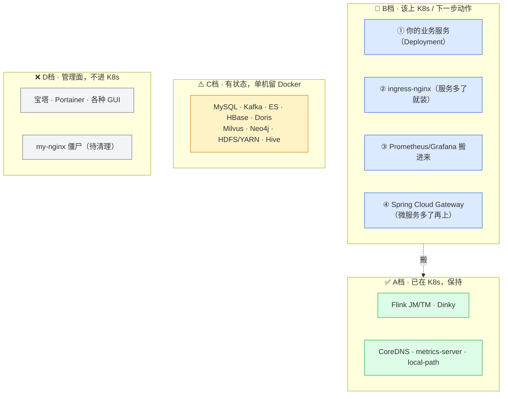
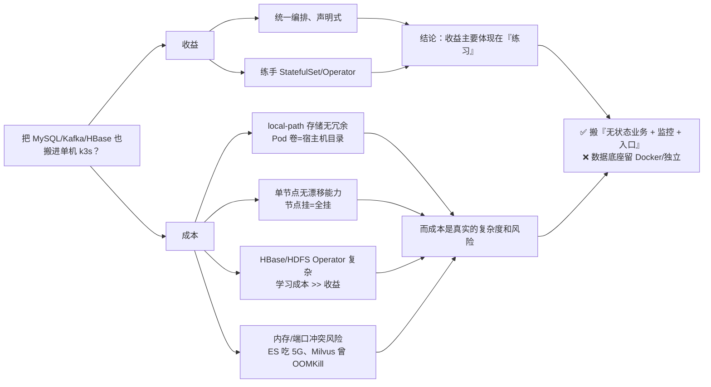
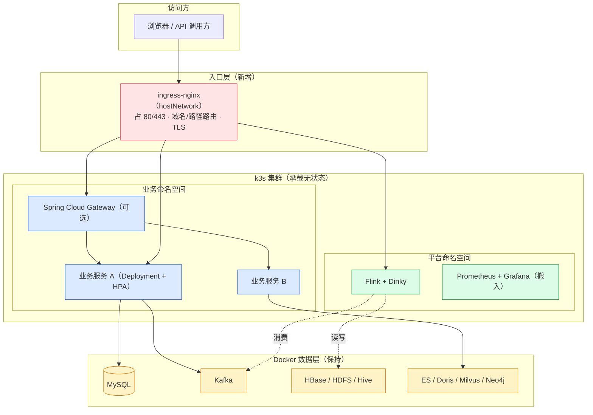
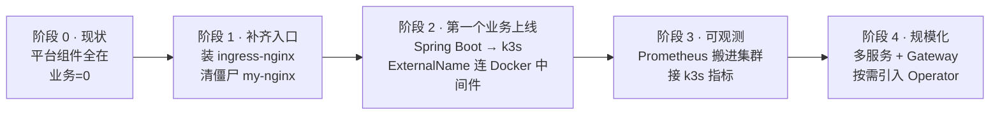
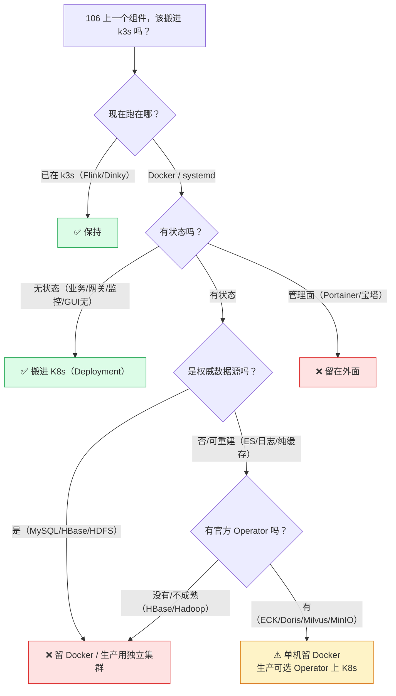

# 106 服务梳理与 K8s 迁移规划

> [!info] 本文定位
> 前三篇是"通用方法论"，这一篇是**落地到你这台机器**的清单：
> **106 上到底跑着什么？每个东西在哪一层？哪些该搬进 k3s、哪些搬了纯属折腾？先搬谁？**
> 数据来源：`服务器巡检-192.168.0.106/巡检报告.md`（2026-10-06）+ 2026-10-14 全端口实测扫描。

---

## 一、机器画像（一句话）

> **一台 6 核 48G 的单机大数据/数据平台服务器**：k3s 跑 Flink 实时计算 + Dinky 开发平台；Docker 里装着 ELK、监控、Kafka、HBase、Hadoop+Hue、Doris、Neo4j、Milvus、MySQL、Redis；另有宝塔面板（闲置）。**典型的"学习/实验型数据平台"，不是生产业务系统。**

| 项目 | 值 |
|---|---|
| IP / 主机名 | 192.168.0.106 / `vic-MS-7B23`（公网出口 124.90.135.191） |
| 硬件 | Intel i5-8400（6C6T）/ **48G** / INTEL NVMe 256G |
| 系统 | Ubuntu 26.04 LTS · 内核 7.0.0-14 · Docker 29.1.3 |
| 编排 | **k3s v1.36.2**（单节点 control-plane）· flannel vxlan · iptables 模式 · Pod CIDR `10.42.0.0/24` |
| 存储类 | k3s 自带 `local-path-provisioner`（本机目录，无冗余、不支持快照） |
| 安全 | UFW active，但 **Docker 发布端口绕过 UFW**（见第六节） |
| 定位 | 大数据学习/实验平台 —— **没有自己的业务服务** |

> [!note] 它和 103 的分工
> **106 = 数据/平台机**（重负载、中间件全家桶）；**103 = Web 应用机**（2C/11G 老笔记本，跑应用）。
> 这个分工很合理：**平台组件不要和应用挤在一台小机器上**。

---

## 二、全服务清单与「上不上 K8s」决策表（★ 核心）

> 判定口径：**无状态/计算层** → 上 K8s；**有状态** → 看 Operator 成熟度 + 是否权威数据源；**管理面** → 不进 K8s。
> 方法论见 [[4-状态型中间件上不上K8s]]。

### 2.1 A 档：已经在 K8s 里（现状正确，保持）

| 服务 | 现状 | 端口/入口 | 有状态 | 结论 |
|---|---|---|---|---|
| **Flink JobManager** | k3s `flink` ns | NodePort **30081** | 半（checkpoint 外置） | ✅ **留 K8s**，它就是计算层，最该在 K8s |
| **Flink TaskManager ×2** | k3s `flink` ns | 内部 | 无 | ✅ 留 K8s，随 JM 扩缩 |
| **Dinky**（Flink SQL 平台） | k3s `dinky` ns | NodePort **30888** | △ 元数据在 MySQL | ✅ 留 K8s（元数据外置即可） |
| **CoreDNS** | k3s `kube-system` | 内部 | — | ✅ 控制面自带，别动 |
| **local-path-provisioner** | k3s `kube-system` | — | — | ✅ 保持（单机够用） |
| **metrics-server** | k3s `kube-system` | — | — | ✅ 保持 |

### 2.2 B 档：无状态 / 可重建 —— 建议上 K8s（含"下一步该做什么"）

| 服务 | 现状 | 建议 | 理由 / 动作 |
|---|---|---|---|
| **你的第一个 Spring Boot 业务服务** | ❌ 不存在 | 🎯 **最该做的一件事** | K8s 的主场；从 0 到 1 走通 Deployment+Service+探针，参考 [[1-SpringBoot上K8s与入口证书管理]] |
| **Spring Cloud Gateway（业务网关）** | ❌ 不存在 | 🔸 有 3+ 微服务后再上 | 现在只有平台组件、没有业务，上网关是空转 |
| **ingress-nginx（Ingress Controller）** | ❌ 未安装（用 NodePort） | 🔸 **服务变多后立刻装** | hostNetwork 模式占 80/443；把 30081/30888 统一成域名入口 |
| **Prometheus + Grafana** | Docker（9093→9090 / 3100→3000） | 🔸 **建议搬进 K8s** | 监控天生为 K8s 设计（自动发现 Pod），现在**看不到 k3s 里的指标** |
| **ELK / Loki 日志栈** | Docker | 🔸 可选搬入（Loki 更轻） | 生产建议 DaemonSet 采集；学习阶段 Docker 也行 |
| **Redis（纯缓存用法）** | Docker 6379 | ⚠️ 可上可不上 | 若只当缓存（可回源重建）风险低；你目前是多组件共享，**留 Docker 更省事** |

### 2.3 C 档：有状态 —— 单机建议留在 Docker，生产换形态

| 服务 | 现状 | 端口 | Operator 成熟度 | 106 结论 | 生产建议 |
|---|---|---|---|---|---|
| **MySQL 8.0** | Docker | 3306 | 有但争议大 | ⚠️ **留 Docker** | 云 RDS / 独立主从 |
| **Kafka（bitnami 3.9）** | Docker | 9092 / 29092 | Strimzi（强） | ⚠️ **留 Docker** | 托管 MSK / Strimzi |
| **HBase 2.6.6**（内置 ZK） | Docker | 2181/16010/16000-16030 | 无生产级 Operator | ❌ **不要上 K8s** | 独立 Hadoop 集群 |
| **Hadoop HDFS/YARN 3.3.6** | Docker（`hadoop-net`） | 8020/9870/8088/19888 | 有但极复杂 | ❌ **不要上 K8s** | 独立集群 / 存算分离 |
| **Hue** | Docker | **8888** | 无 | ❌ 留 Docker | 随 Hadoop |
| **Hive Metastore** | Docker | 9083 | 无官方 | ⚠️ 留 Docker | 与应用环境同置 |
| **HiveServer2** | Docker | **10000**（Thrift）/ **10002**（Web UI） | — | ⚠️ 留 Docker | 独立 |
| **Elasticsearch 8.15** | Docker | 9200/9300 | **ECK（官方，成熟）** | ⚠️ 留 Docker（吃 5G 内存） | 托管 ES / ECK |
| **Doris（FE/BE）** | Docker | 18030(FE UI)/18040(BE) | **官方 Operator** | ⚠️ 留 Docker（多副本需求时再上） | Doris Operator 可上 K8s |
| **Milvus + etcd + MinIO** | Docker | 19530/9001 | **milvus-operator（官方）** | ⚠️ 留 Docker | Operator 上 K8s |
| **Neo4j 5-community** | Docker | 7474/7687 | 有 | ⚠️ 留 Docker | Aura / 独立（集群需企业版） |
| **MinIO**（Milvus 内置） | Docker | 9001 | minio-operator | ⚠️ 留 Docker | Operator |
| **ZooKeeper**（HBase 内置） | Docker | 2181 | 有 | ⚠️ 留 Docker | 独立；Kafka 可换 KRaft |

### 2.4 D 档：管理面 / 不适合进 K8s

| 服务 | 现状 | 端口 | 结论 |
|---|---|---|---|
| **宝塔面板（bt.service）** | systemd | **10591** | ❌ 不进 K8s；**且目前闲置**（无站点），可考虑卸载以减少攻击面 |
| **Portainer CE** | Docker | 9000 | ❌ 它就是管 Docker 的，进 K8s 没意义 |
| **Redis Insight** | Docker | 5540 | ❌ 桌面/GUI 工具，留 Docker |
| **Attu**（Milvus GUI） | Docker | 8000 | ❌ GUI，留 Docker |
| **kafka-ui** | Docker | 28080 | ❌ GUI，留 Docker |
| **registry:2**（私有仓库） | Docker **Exited 2 个月** | — | ⚠️ 已停；镜像已本地化，需要时再起 |
| **rustdesk** | systemd | — | ❌ 远程桌面，与 K8s 无关 |
| **my-nginx ×3（僵尸部署）** | k3s `default` ns | NodePort **31539** | ❌ **0/1 Unknown 已僵死 18 天** → 删掉或 rollout restart |

### 2.5 汇总（一图看清)



---

## 三、端口与访问入口对照表（实测）

> 2026-10-14 全端口扫描（1–65535，共 51 个开放端口）结果归位。

| 端口 | 服务 | 归属 | 入口/访问方式 |
|---|---|---|---|
| 22 | SSH | systemd | `ssh root@192.168.0.106` |
| 10591 | **宝塔面板** | systemd `bt.service` | `https://192.168.0.106:10591/<安全入口>`（**根路径 404 是正常的**，证书由宝塔自签） |
| 6444 | k3s API | systemd | **仅本机** |
| **30081** | **Flink Web UI** | k3s NodePort | `http://192.168.0.106:30081` |
| **30888** | **Dinky** | k3s NodePort | `http://192.168.0.106:30888` |
| **31539** | my-nginx（僵尸） | k3s NodePort | 默认欢迎页，**建议删除** |
| 32428 / 30355 / 30461 | K8s 相关（ingress/监控类 NodePort） | k3s | 待逐一确认 |
| **8888** | **Hue** | Docker | `http://192.168.0.106:8888`（admin） |
| 8020 / 9870 | HDFS RPC / NameNode UI | Docker(Hadoop) | `http://192.168.0.106:9870` |
| 8088 / 19888 | YARN RM / JobHistory | Docker(Hadoop) | `http://192.168.0.106:8088` |
| 9083 / 10000 / 10002 | Hive Metastore / HS2 Thrift / HS2 Web | Docker | `http://192.168.0.106:10002` |
| 18030 / 18040 | **Doris** FE UI / BE | Docker | `http://192.168.0.106:18030` |
| 9200 / 9300 / 5601 | ES / 集群通信 / Kibana | Docker(ELK) | `http://192.168.0.106:5601` |
| 5044 / 9600 | Logstash beats / 监控 API | Docker(ELK) | — |
| 9092 / 29092 | Kafka（内/外） | Docker | 客户端 `192.168.0.106:9092` |
| 28080 | Kafka UI | Docker | `http://192.168.0.106:28080` |
| 2181 / 8080 / 16000 / 16010 / 16020 / 16030 | HBase + 内置 ZK | Docker(HBase) | `http://192.168.0.106:16010`（Master UI） |
| 7474 / 7687 | Neo4j HTTP / Bolt | Docker | `http://192.168.0.106:7474` |
| 19530 / 9001 / 9002 | Milvus gRPC / MinIO Console / MinIO API | Docker | `http://192.168.0.106:9001` |
| 9093 / 3100 / 9100 | Prometheus / Grafana / node-exporter | Docker(监控) | `http://192.168.0.106:3100`（Grafana） |
| 3306 / 6379 | MySQL / Redis | Docker | 客户端直连 |
| 9000 / 5540 / 8000 | Portainer / RedisInsight / Attu | Docker | GUI |
| 80 / 443 | **无监听** | — | 空闲（装 ingress-nginx 正好用） |

> [!warning] 两个"看着奇怪但正常"的现象
> 1. **宝塔 10591 根路径返回 Nginx 404**：面板开了**安全入口**，必须带入口路径访问。查入口：机器上执行 `bt default` 或 `cat /www/server/panel/data/admin_path.pl`。
> 2. **8888 是 Hue 不是宝塔**：宝塔默认端口也是 8888，但 Hue（Hadoop 部署时）先占了。两者互不干扰，因为宝塔实际跑在 10591。

---

## 四、为什么"单机不要 all-in K8s"



**核心逻辑**：单机 k3s 的 `local-path` 存储**本质上就是"宿主机的目录"**，和有状态中间件直接 `docker -v` 挂目录**没有本质区别**——你多了一层编排复杂度，却没有获得多节点容灾。所以：

- **该搬**：无状态业务、计算作业（Flink 已在）、监控、入口 —— 这些能真正吃到 K8s 的编排红利。
- **不该搬**：重存储、重仲裁、是权威数据源的组件 —— 搬了只增加风险。

> [!tip] 一句话
> **K8s 擅长"让牲口跑来跑去"，不擅长"伺候宠物"。你的数据组件都是宠物，就让它们待在熟悉的 Docker 家里。**

---

## 五、目标架构（迁移完成后长什么样）



**关键变化**：
1. **多了一层入口**：NodePort → ingress-nginx，用域名区分 Flink/Dinky/业务。
2. **多了业务服务**：这是从"平台机"变成"能跑应用的平台"的标志。
3. **监控搬进集群**：能看到 K8s 内部指标。
4. **数据层原地不动**：仍然 Docker，业务通过网络（节点 IP / ExternalName）访问。

> [!note] 跨"K8s 内业务 ↔ Docker 中间件"怎么连（过渡期关键接法）
> 业务 Pod 在 k3s，MySQL/Kafka 还在 Docker 时：
> - Pod 内**不能用 `127.0.0.1`**（那是 Pod 自己的回环）。
> - 直接用**节点 IP**：`192.168.0.106:3306` / `:9092`。
> - 更规范：建一个 `ExternalName` Service（`mysql → 192.168.0.106`），业务里就写 `mysql:3306`，将来中间件真搬进 K8s 时**改一处即可**。
> ```yaml
> apiVersion: v1
> kind: Service
> metadata: { name: mysql, namespace: biz }
> spec:
>   type: ExternalName
>   externalName: 192.168.0.106    # 过渡期指向宿主机 Docker
> ```
> 注意 ExternalName 只能用于 DNS 名，指向 IP 时更推荐用 **无选择器的 Endpoints + ClusterIP**：

> ```yaml
> apiVersion: v1
> kind: Service
> metadata: { name: mysql, namespace: biz }
> spec:
>   ports: [{ port: 3306, targetPort: 3306 }]
> ---
> apiVersion: v1
> kind: Endpoints
> metadata: { name: mysql, namespace: biz }
> subsets:
>   - addresses: [{ ip: 192.168.0.106 }]
>     ports: [{ port: 3306 }]
> ```

---

## 六、分阶段迁移路线（建议照此推进）



| 阶段 | 目标 | 具体动作 | 验收标准 |
|---|---|---|---|
| **0 现状** | 认清家底 | 本文梳理完成 | ✅ 已达成 |
| **1 补齐入口** | 有统一入口 | ① 装 ingress-nginx（hostNetwork）② 删/修僵尸 `my-nginx` ③ 把 Flink/Dinky 用 Ingress 暴露成域名 | `flink.demo.local` / `dinky.demo.local` 可访问 |
| **2 第一个业务** | 跑通业务上 K8s | ① 写个最小 Spring Boot ② Dockerfile 构建 + 导入 k3s ③ Deployment+Service+探针 ④ 用 Endpoints 连 Docker 的 MySQL/Redis | 业务健康、能读写 MySQL/Redis |
| **3 可观测** | 看得见 | ① Prometheus/Grafana 搬进 K8s（或让 kube-prometheus-stack）② 加业务指标、告警 | Grafana 能看到 Pod 指标与业务 JVM 指标 |
| **4 规模化** | 微服务化 | ① 拆 3+ 服务 ② 上 Spring Cloud Gateway ③ 按需引入 Doris/Milvus/ES 的 Operator | 网关统一鉴权限流、灰度可用 |

> [!important] 推进原则
> - **一次只动一件事**，每阶段都能回滚。
> - **先无状态，后看需求**；数据底座"能不动就不动"。
> - **不要为了用 K8s 而把 HBase 搬进去**——那是给自己找活干。

---

## 七、待处理问题清单（来自巡检 + 本次复查）

| 优先级 | 问题 | 位置 | 建议动作 |
|---|---|---|---|
| **P1** | `my-nginx` 3 副本 **0/1 Unknown 已 18 天** | k3s `default` ns | `kubectl -n default delete deploy my-nginx`（不用）或 `rollout restart`（要用） |
| **P1** | **Docker 发布端口绕过 UFW**，ES/Kafka/Redis/MySQL/HBase **对局域网全开** | Docker | 用 `ufw-docker`，或把端口绑 `127.0.0.1`，或只对内网网段放行 |
| **P2** | Milvus 三件套曾 ExitCode 137 挂 9 天，**RestartPolicy=no** | Docker `/opt/milvus` | 已在 10-06 手动拉起；建议加开机自启或 compose `restart: unless-stopped` |
| **P2** | 宝塔面板**闲置**（无站点、项目目录空壳） | systemd 10591 | 不用则卸载，减少攻击面；要用则确认安全入口已设强口令 |
| **P3** | `registry:2` 退出 2 个月 | Docker | 需要推拉镜像时再启 |
| **P3** | UFW 放行清单里 20/21（FTP）是模板残留，本机无 vsftpd | UFW | 可删 |
| **P3** | 80/443 空闲但**无 Ingress**，各服务散落 NodePort | 入口层 | 阶段 1 统一到 ingress-nginx |

---

## 八、决策速查（贴在墙上的那种）



---

## 九、下一步（如果你要，我可以继续）

1. **写最小 Spring Boot 示例 + Dockerfile + K8s 全套 YAML**，直接能在 106 上跑通（阶段 2）。
2. **给 ingress-nginx 的裸机安装清单**（含国内镜像导入 k3s 的具体命令、hostNetwork 配置、自签证书）。
3. **清理僵尸 `my-nginx`** 并核对 32428/30355/30461 这三个未知 NodePort 到底是什么。
4. **写 `ufw-docker` 加固方案**，把 ES/Kafka/Redis/MySQL 从局域网暴露中收回。

---

## 十、延伸阅读

- 架构总论与分层心智模型：[[2-系统架构总览]]
- 入口层四角色边界与选型：[[3-入口层-Nginx-Ingress-Gateway]]
- 有状态组件逐项决策方法论：[[4-状态型中间件上不上K8s]]
- 限流/熔断/分布式事务落地：[[服务器巡检-192.168.0.106/限流熔断与分布式事务中间件方案]]
- 请求在集群内的包级流转（iptables/vxlan）：[[0-K8s网络请求全过程]]
- 部署实操（八步 + 证书）：[[1-SpringBoot上K8s与入口证书管理]]
- 机器现状与历史问题：[[服务器巡检-192.168.0.106/巡检报告]]
- 真实数据链路：`服务器巡检-192.168.0.106/Kafka入湖标准流程与方案选型.md`、`部署记录-Hadoop+Hue.md`

> [!summary] 一句话收束
> **106 是一台"中间件全家桶 + k3s 跑 Flink"的学习型数据平台。迁移的正确姿势是：先把无状态业务和入口、监控搬上 K8s（阶段 1–3），数据底座（MySQL/Kafka/HBase/HDFS/Doris/Milvus…）单机一律留 Docker，生产再谈托管或 Operator。不要 all-in，不要为了云原生而云原生。**
