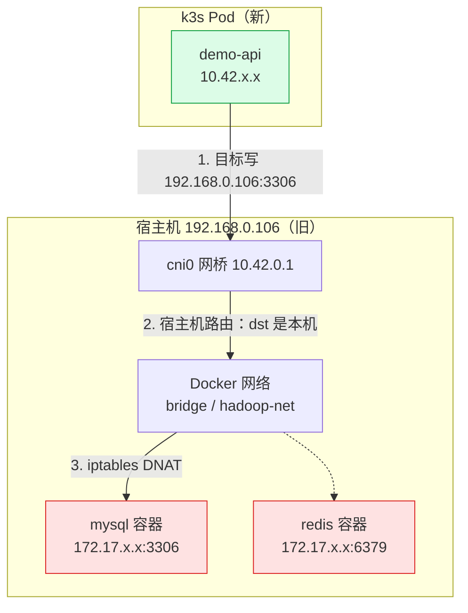
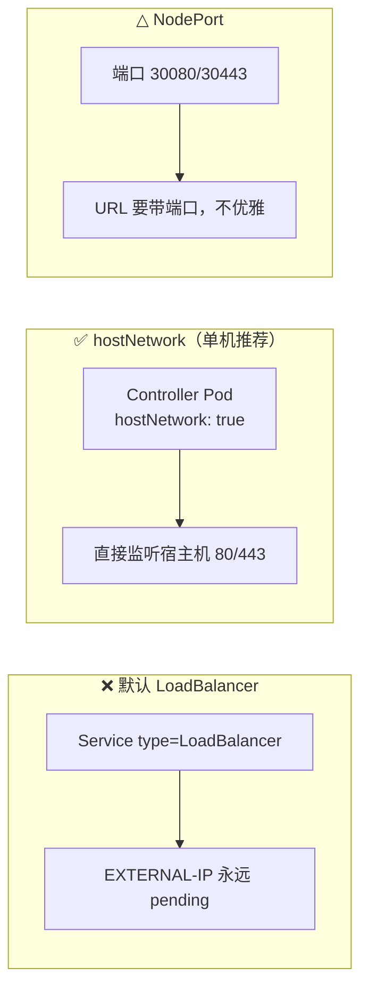
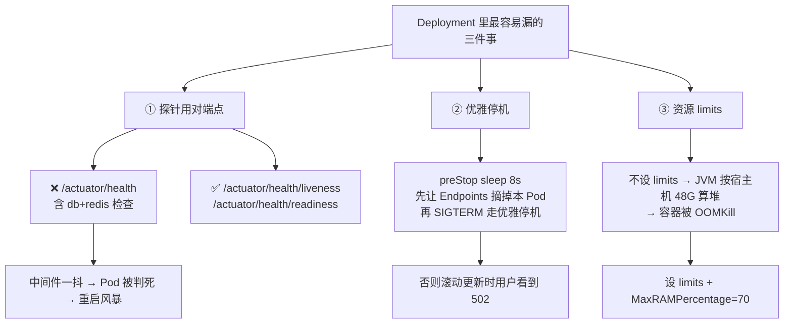
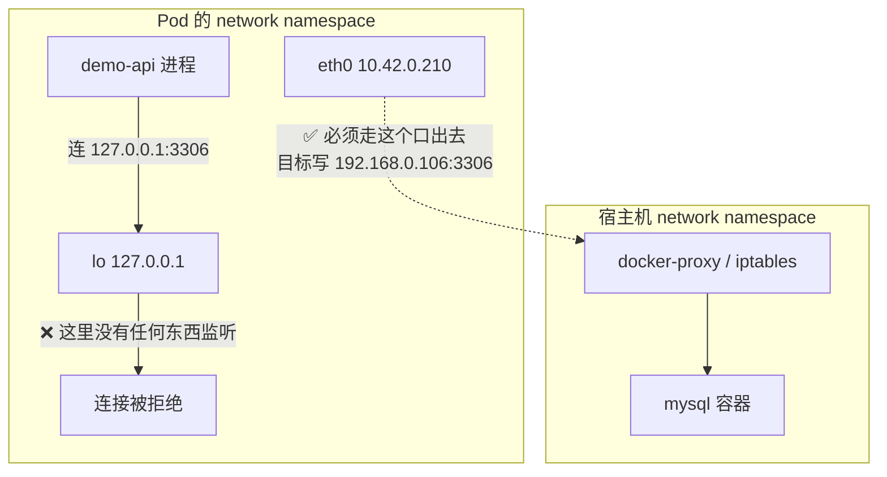
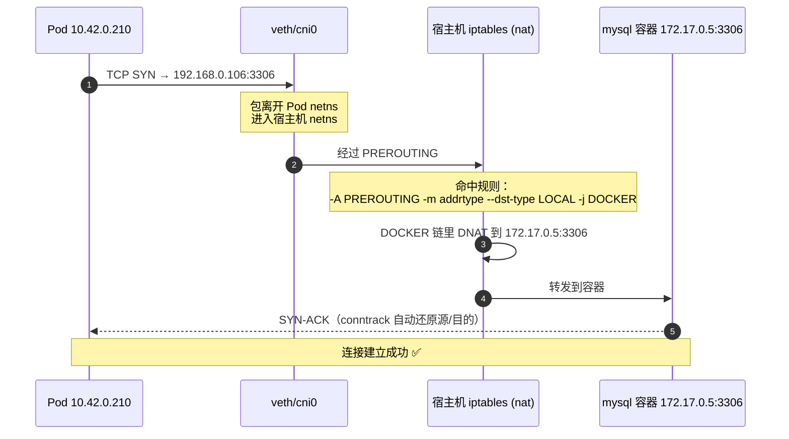
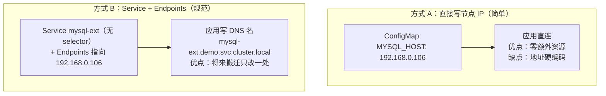
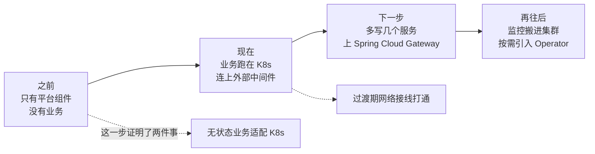

# 实战：把第一个业务服务搬上 k3s

> [!info] 本文要做的三件事（对应迁移路线的阶段 1–2）
> 1. **清场**：体检集群，清掉僵尸的 `my-nginx`（0/1 Unknown 已 18 天）。
> 2. **补入口**：装 ingress-nginx（裸机 + 国内镜像两个坑一起填）。
> 3. **上业务**：把最小 Spring Boot 部署上去，并**连上宿主机 Docker 里的 MySQL/Redis**。
>
> 完整可运行代码在 [[服务器巡检-192.168.0.106/deploy/k8s-demo/README|k8s-demo]]，本文讲**为什么这么做**和**卡住了怎么查**。
> 为什么"业务该上、中间件先别上"的道理在 [[4-状态型中间件上不上K8s]]。

---

## 〇、先看清这次要跨越的那道坎

你现在面对的是一个**过渡期架构**：计算在 K8s 里，数据在 K8s 外。



> [!warning] 三个最容易栽的坑
> 1. **在 Pod 里写 `127.0.0.1:3306`** → 那是 Pod 自己的回环，必然连不上。要用**节点 IP**。
> 2. **用 Docker 容器名**（如 `mysql`）→ K8s 的 DNS 不认识 Docker 的容器名，解析不了。
> 3. **以为 Pod 和宿主机共享网络** → Pod 有独立 netns，和宿主机是"两个主机"，要靠 IP 通信。

---

## 一、阶段 0：集群体检与清场

### 1.1 先体检（不改任何东西）

```bash
# k3s 二进制在你机器上装在 vic 家目录，root 下要用全路径
K=/home/vic/.local/bin/k3s

$K kubectl get nodes -o wide
$K kubectl get ns
$K kubectl get pods -A -o wide
$K kubectl get svc -A
$K kubectl get ingressclass
$K kubectl get storageclass

# 宿主机侧：端口占用、Docker、资源
ss -lntp | head -40
docker ps --format 'table {{.Names}}\t{{.Status}}\t{{.Ports}}'
free -h; df -h /
```

> [!tip] 关注三件事
> - `default` 命名空间里那 3 个 `my-nginx` 是不是 0/1 Unknown（僵尸）。
> - 80/443 是否空闲（装 Ingress 要用）。
> - 剩余内存（48G 里 ES 吃约 5G，还有多少余量给业务）。

### 1.2 清掉僵尸部署

```bash
# 先看它到底什么样
$K kubectl -n default describe deploy my-nginx | tail -30
$K kubectl -n default get pods -l app.kubernetes.io/name=my-nginx

# 不用就删（推荐，它只是当初验证用的示例）
$K kubectl -n default delete deploy my-nginx
$K kubectl -n default delete svc my-nginx 2>/dev/null || true

# 如果还想用它，就原地重启
# $K kubectl -n default rollout restart deploy my-nginx
```

清理后 `NodePort 31539` 应该释放。**这正是前面排查"106 上有没有 nginx"时看到的那个 31539 默认欢迎页**。

---

## 二、阶段 1：装 ingress-nginx（裸机 + 国内网络）

### 2.1 为什么必须用 hostNetwork

裸机 k3s 没有云厂商的 LoadBalancer，Ingress Controller 的 Service 会一直 `<pending>`。三种解法里，**单机最合适的是 hostNetwork**——直接让 Controller 占宿主机的 80/443：



| 方案 | URL | 适合 |
|---|---|---|
| **hostNetwork** | `http://demo.local`（干净） | ✅ 单机 |
| NodePort | `http://ip:30080` | 临时 |
| 外部 Nginx → NodePort | 干净 | 多机/已有边缘 Nginx |

### 2.2 执行

```bash
cd /opt/k8s-demo
bash scripts/install-ingress-nginx.sh
```

这个脚本干了 5 件事（**每一步都可单独手动做**）：

| 步骤 | 动作 | 关键点 |
|---|---|---|
| 1 | 下载官方 bare-metal 清单 | GitHub 可能被墙，脚本会给代理/离线方案 |
| 2 | 从清单里 `grep image:` 解析出所有镜像 | 版本变了也不用改脚本 |
| 3 | 逐个从国内镜像源拉 → `docker tag` 改回原名 → `docker save \| k3s ctr images import -` | **这是国内装 Ingress 最核心的一步** |
| 4 | `kubectl apply -f 清单` | |
| 5 | `kubectl patch` 打开 hostNetwork | 裸机关键 |

**第 3 步手动等价命令**（脚本失败时照这个来）：

```bash
VER=v1.11.3
curl -fsSL -o /tmp/ing.yaml \
  https://raw.githubusercontent.com/kubernetes/ingress-nginx/controller-${VER}/deploy/static/provider/baremetal/deploy.yaml

# 看需要哪些镜像
grep -oE 'image: +[^ ]+' /tmp/ing.yaml | awk '{print $2}' | sort -u

# 假设解析出 registry.k8s.io/ingress-nginx/controller:v1.11.3
IMG=registry.k8s.io/ingress-nginx/controller:v1.11.3
MIRROR=m.daocloud.io

docker pull ${MIRROR}/${IMG#registry.k8s.io/}
docker tag  ${MIRROR}/${IMG#registry.k8s.io/} ${IMG}
docker save ${IMG} | sudo /home/vic/.local/bin/k3s ctr images import -
```

### 2.3 验证

```bash
K=/home/vic/.local/bin/k3s
$K kubectl -n ingress-nginx get pods -o wide
$K kubectl -n ingress-nginx get svc
$K kubectl get ingressclass

# controller 应该已经在 0.0.0.0:80 和 :443 上监听
ss -lntp | grep -E ':(80|443)\s'
curl -I http://127.0.0.1        # 默认后端会返回 404，说明 controller 活着
```

> [!note] 为什么 404 反而是"正常"
> Ingress Controller 收到一个没有任何 Ingress 规则匹配的请求时，会交给 default backend 返回 404。
> **能返回 404 说明 controller 已经在正常工作**——这和你宝塔面板根路径 404 是同一类现象。

---

## 三、阶段 2：业务上 K8s

### 3.1 全流程


### 3.2 代码与清单

直接用 [[服务器巡检-192.168.0.106/deploy/k8s-demo/README|k8s-demo]]：

```bash
cd /opt/k8s-demo

# ★ 第一步永远是改密码
vi k8s/10-config.yaml

# 构建 + 导入 k3s（脚本内含 docker save | k3s ctr import 的完整流程）
bash scripts/build-image.sh

# 按顺序 apply
kubectl apply -f k8s/00-namespace.yaml
kubectl apply -f k8s/10-config.yaml
kubectl apply -f k8s/30-app.yaml
kubectl -n demo rollout status deploy/demo-api
```

### 3.3 三个"不能省"的设计（很多人栽在这）



> [!warning] 探针这个大坑值得单独强调
> Spring Boot Actuator 的 `/actuator/health` **默认包含 db、redis 健康指示器**。
> 如果你把 K8s 探针指向它，那么**宿主机 MySQL 一重启，你的所有 Pod 就会被判定为不健康**，
> 触发重启风暴——明明业务代码没任何问题。
>
> 正确做法：`management.endpoint.health.probes.enabled: true`，探针指向
> `/actuator/health/liveness` 和 `/actuator/health/readiness`（这两个默认只含 K8s 状态机，不含外部依赖），
> 依赖健康单独在 `/actuator/health` 里看。

---

## 四、★ 核心难点：业务 Pod 怎么连上宿主机 Docker 中间件

这是整个过渡期**最容易卡住**的地方，值得用一整节讲透。

### 4.1 为什么 `127.0.0.1` 一定不行



**Pod 是一个独立的主机**，它的 `127.0.0.1` 只指它自己。要访问宿主机上的 Docker 端口，必须用**宿主机的 IP**。

### 4.2 那 Pod 访问 `192.168.0.106:3306` 为什么能通？

因为 **Docker 在 iptables 的 `nat` 表 `PREROUTING` 链里挂了 DNAT 规则**，专门处理"目标是本机地址的发布端口"：



关键那条规则在你的巡检报告里也出现过：Docker 在 `nat` 表插入 `--dst-type LOCAL -j DOCKER`。**只要目标是宿主机自己的 IP + 已发布的端口，就会命中并 DNAT 到容器。**

> [!tip] 这也解释了巡检报告里那个安全问题
> 同一条规则也是**Docker 端口绕过 UFW 对局域网全开**的原因——`DOCKER` 链里有直接的 `ACCEPT`。
> 对 Pod 来说这是"便利"，对安全来说这是"隐患"，一体两面。

### 4.3 两种接线方式，怎么选



| 维度 | 方式 A：节点 IP | 方式 B：Service+Endpoints |
|---|---|---|
| 配置复杂度 | 最低（一行） | 多一个 YAML |
| 应用里写什么 | `192.168.0.106:3306` | `mysql-ext.demo.svc.cluster.local:3306` |
| 将来中间件搬进 K8s | **要改应用配置** | **只改 Endpoints，应用零改动** |
| 可观测性 | 看不出是外部依赖 | Service 列表里一眼可见 |
| 适用 | 一次性验证、快速跑通 | 长期演进（推荐） |
| 文件 | `k8s/10-config.yaml` | + `k8s/20-middleware-endpoints.yaml` |

> [!note] 建议路线
> **先用方式 A 跑通**（5 分钟），确认链路没问题；**再切到方式 B**（改两行配置）。
> 直接上 B 如果连不通，你会分不清是"Endpoints 写错了"还是"网络不通"。

### 4.4 方式 B 的原理与写法

```yaml
# Service 故意不写 selector —— 这样 K8s 不会自动管理它的后端
apiVersion: v1
kind: Service
metadata:
  name: mysql-ext
  namespace: demo
spec:
  type: ClusterIP
  ports:
    - port: 3306
      targetPort: 3306
---
# 手工指定"后端"就是宿主机的 IP:Port
apiVersion: v1
kind: Endpoints
metadata:
  name: mysql-ext        # ★ 必须与 Service 同名同 namespace
  namespace: demo
subsets:
  - addresses:
      - ip: 192.168.0.106
    ports:
      - port: 3306
```

这样 Pod 里 `mysql-ext.demo.svc.cluster.local:3306` 就会被 kube-proxy 转发到 `192.168.0.106:3306`，再被 Docker 的 DNAT 接住送到容器。

> [!warning] Endpoints 已被标记 deprecated
> 较新 K8s（1.33+）推荐用 **EndpointSlice**。你的 k3s v1.36.2 上 `Endpoints` 仍可用，
> 但若将来报 `no matches for kind "Endpoints"`，改用 EndpointSlice（`k8s/20-middleware-endpoints.yaml` 文件末尾有现成模板），
> 注意靠 `kubernetes.io/service-name: mysql-ext` 这个 label 关联 Service。

---

## 五、完整验证清单

```bash
K=/home/vic/.local/bin/k3s

# ── 1. 工作负载 ──
$K kubectl -n demo get deploy,pods -o wide
$K kubectl -n demo get svc,endpoints

# ── 2. Pod 内自测（三道题，答对说明全通）──
POD=$($K kubectl -n demo get pod -l app=demo-api -o jsonpath='{.items[0].metadata.name}')
$K kubectl -n demo exec $POD -- curl -s localhost:8080/api/health   # 业务活着
$K kubectl -n demo exec $POD -- curl -s localhost:8080/api/db       # MySQL 通了
$K kubectl -n demo exec $POD -- curl -s localhost:8080/api/redis    # Redis 通了

# ── 3. Service / DNS（走 kube-proxy，不是直连 Pod）──
$K kubectl -n demo exec $POD -- curl -s http://demo-api.demo.svc.cluster.local:8080/api/health

# ── 4. Ingress（外部入口）──
curl -s -H "Host: 192.168.0.106.nip.io" http://192.168.0.106/api/health

# ── 5. 负载均衡（多调几次看 pod 字段是否变化）──
for i in 1 2 3 4 5 6; do
  curl -s -H "Host: 192.168.0.106.nip.io" http://192.168.0.106/api/echo/$i | grep -o '"pod":"[^"]*"'
done

# ── 6. 一键体检脚本 ──
bash scripts/verify.sh
```

**预期结果**：

| 接口 | 期望 |
|---|---|
| `/api/health` | `{"status":"UP","pod":"demo-api-xxx-xxx",...}` |
| `/api/db` | `{"mysql":"OK","select1":1,"version":"8.0.xx",...}` |
| `/api/redis` | `{"redis":"OK","counter":N,...}` |
| `/api/echo/x` | `{"echo":"x","pod":"..."}`，多次调用 pod 会变 |

---

## 六、排错速查表

| 现象 | 原因 | 排查/修复 |
|---|---|---|
| `ImagePullBackOff` | k3s 里没有这个镜像 | `sudo $K ctr images ls \| grep demo-api`；重跑 `build-image.sh` |
| Pod `CrashLoopBackOff` | 启动就挂 | `kubectl -n demo logs <pod> --previous`；确认没把 DB 连接失败当致命错误（`initialization-fail-timeout: -1`） |
| Pod `Running` 但 `READY 0/1` | 就绪探针失败 | `kubectl -n demo describe pod <pod>`；确认探针路径是 `/actuator/health/readiness` |
| `/api/db` 返回 `FAIL` | 连不上 MySQL | ① 密码对不对 ② Pod 里 `nc -zv 192.168.0.106 3306` ③ 宿主机 `docker ps` 确认 MySQL 在跑 |
| `/api/db` 报 `Access denied` | 密码/账号错 | MySQL 8 默认不允许 root 远程登录，需建专用账号（见下） |
| `/api/db` 报 `Communications link failure` | 网络不通 | 走的是节点 IP 吗？不是就改 `10-config.yaml` |
| Ingress 404 | 规则没匹配 | `kubectl -n demo describe ingress`；确认 Host 头、`ingressClassName` |
| Ingress 连不上 | Controller 没起来 | `kubectl -n ingress-nginx get pods`；`ss -lntp \| grep :80` |
| `my-nginx` 一直 Unknown | 僵尸部署 | 见第一节，删掉 |
| `Endpoints` 报错找不到 kind | API 已移除 | 改用 EndpointSlice |

> [!warning] MySQL 8 的一个常见坑：root 不能远程登录
> 你的 MySQL 跑在 Docker 里，默认 `root@%` 可能不存在，只有 `root@localhost`。
> 从 Pod 连过去相当于**远程连接**，会被拒。建一个专用账号：
> ```sql
> CREATE USER 'demo'@'%' IDENTIFIED BY 'YourStrongPass';
> GRANT ALL PRIVILEGES ON demo.* TO 'demo'@'%';
> FLUSH PRIVILEGES;
> ```
> 然后把 `10-config.yaml` 里的 `MYSQL_USER/MYSQL_PASSWORD` 换成这个。
> 另外 JVM 侧记得 URL 带 `allowPublicKeyRetrieval=true&useSSL=false`（模板里已带）。

**Pod 里有没有工具用来排障？** 最小 JRE 镜像里没有 `nc`/`ping`。你可以：

```bash
# 用一个临时 Pod 做网络探测（busybox 镜像同样需要先导入或可达）
kubectl -n demo run nettest --rm -it --image=busybox:1.36 --restart=Never -- \
  sh -c "nc -zv 192.168.0.106 3306; nc -zv 192.168.0.106 6379"
```

---

## 七、回滚与清理

```bash
K=/home/vic/.local/bin/k3s

# 只回滚业务（保留命名空间和配置）
$K kubectl -n demo delete -f k8s/30-app.yaml
$K kubectl -n demo delete -f k8s/40-ingress.yaml

# 彻底清掉业务
$K kubectl delete ns demo

# 卸载 ingress-nginx（谨慎：会影响所有 Ingress）
# $K kubectl delete -f /tmp/ingress-nginx-v1.11.3.yaml

# 删除导入的镜像（可选）
# sudo $K ctr images rm docker.io/library/demo-api:1.0.0
```

---

## 八、命令速查

```bash
K=/home/vic/.local/bin/k3s

# 部署
$K kubectl apply -f k8s/
$K kubectl -n demo rollout status deploy/demo-api
$K kubectl -n demo rollout restart deploy/demo-api
$K kubectl -n demo rollout undo deploy/demo-api

# 查看
$K kubectl -n demo get all
$K kubectl -n demo get pods -o wide -w
$K kubectl -n demo describe pod <pod>
$K kubectl -n demo logs -f deploy/demo-api --tail=100

# 进容器
$K kubectl -n demo exec -it <pod> -- sh
$K kubectl -n demo port-forward svc/demo-api 8080:8080

# 资源占用
$K kubectl -n demo top pods
$K kubectl top nodes

# 事件（排错第一站）
$K kubectl -n demo get events --sort-by=.lastTimestamp

# 镜像
sudo $K ctr images ls | grep demo-api
```

---

## 九、做完这些，你就跨过了最关键的一道坎



**这一步验证了迁移路线最核心的两个假设**：
1. 无状态业务能顺利容器化、跑在 k3s 里、被 Ingress 暴露。
2. 过渡期"计算在内、数据在外"的网络链路可行——**你可以放心地慢慢搬，不用一次到位**。

之后再按 [[5-106服务梳理与K8s迁移规划#六、分阶段迁移路线（建议照此推进）|阶段 3–4]] 推进：监控搬进集群 → 多服务 + 网关 → 有需要再上 Operator。

---

## 十、延伸

- 完整可运行工程：[[服务器巡检-192.168.0.106/deploy/k8s-demo/README|k8s-demo]]
- 迁移规划与全服务决策：[[5-106服务梳理与K8s迁移规划]]
- 中间件为什么先别上 K8s：[[4-状态型中间件上不上K8s]]
- 入口层四角色边界：[[3-入口层-Nginx-Ingress-Gateway]]
- 部署八步与证书细节：[[1-SpringBoot上K8s与入口证书管理]]
- Pod 网络与 DNAT 原理：[[0-K8s网络请求全过程]]
- 机器现状：[[服务器巡检-192.168.0.106/巡检报告]]

> [!summary] 一句话收束
> **阶段 1 清僵尸 + 装 ingress-nginx（hostNetwork + 国内镜像导入 k3s）；阶段 2 用 `k8s-demo` 把业务跑起来，中间件地址写节点 IP（或包一层无 selector 的 Service + Endpoints）。三个必做细节：探针用 `/liveness`/`/readiness` 而非 `/actuator/health`、配 `preStop` 优雅停机、设 `limits` 让 JVM 按容器算堆。连不上 MySQL 时先查 root 是否允许远程登录。**
