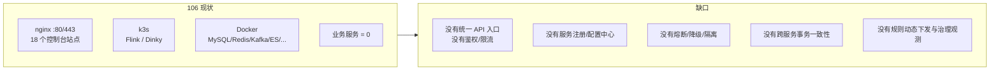
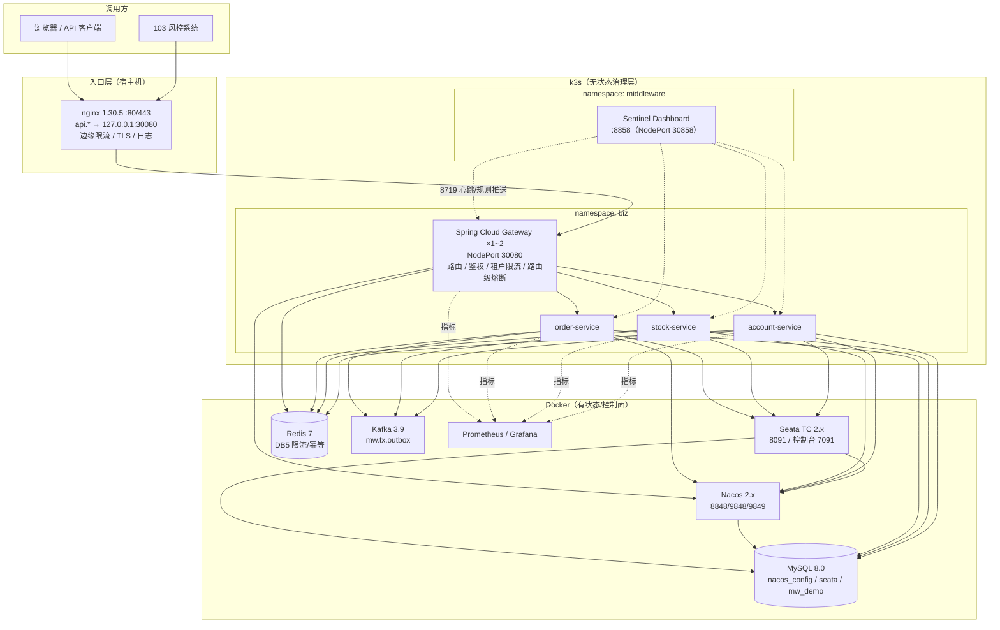
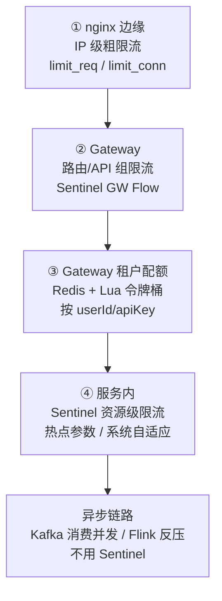
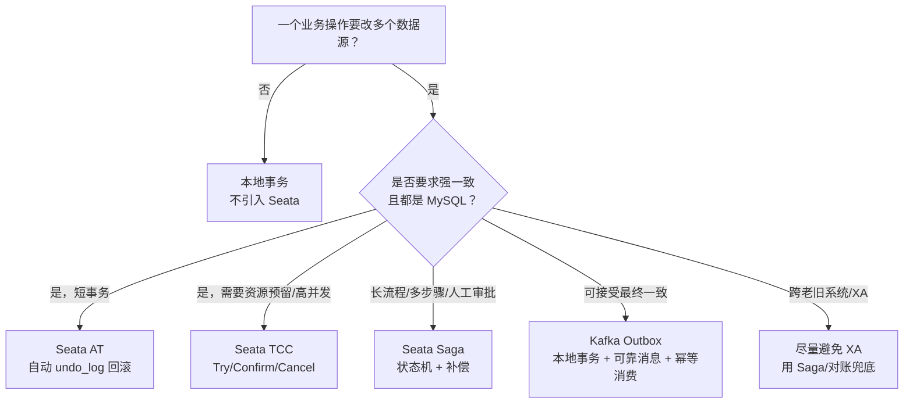
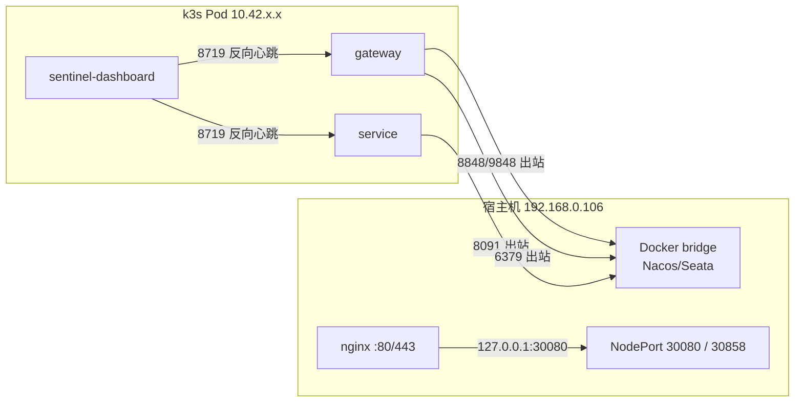
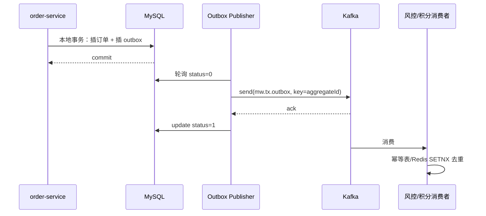
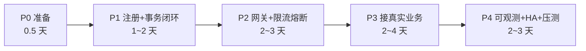

# 106 限流、熔断与分布式事务中间件建设方案

> [!summary] 结论先行
> **不新建一套“大而全”的微服务平台，而是在 106 现有 Docker + k3s 上补三件东西：**
> 1. **Nacos**：注册中心 + 配置中心，同时作为 Sentinel 规则、Seata 注册的事实源（Docker）。
> 2. **Sentinel**：限流、熔断、热点参数、系统自适应（Dashboard 放 k3s，和业务同网络）。
> 3. **Seata**：AT 为主、TCC 补强、Saga 处理长流程；异步一致性用 **Kafka Outbox**，不引入 RocketMQ（Docker）。
>
> **入口不抢 80/443**：现有 nginx 1.30.5 已经是统一入口，新增 `api.*` 站点反代到 k3s 里的 **Spring Cloud Gateway（NodePort 30080）**，不装 ingress-nginx。
>
> **定位要清醒**：106 是学习/实验平台，单机双副本不等于高可用。方案分“学习闭环”和“生产化建议”两层，先跑通再谈 HA。

---

## 一、现状与约束（方案的事实基础）

### 1.1 机器与服务

| 项目 | 现状 | 对方案的影响 |
|---|---|---|
| 硬件 | i5-8400 6C6T / 48G / NVMe 256G | 新增中间件约 **5G 内存**，余量足够，但要设 limit |
| 编排 | k3s v1.36.2 单节点 + Docker 全家桶 | 无状态进 k3s，有状态留 Docker（沿用 [[9-k8s/5-106服务梳理与K8s迁移规划]] 的结论） |
| 入口 | **nginx 1.30.5 已占 80/443**，18 个站点 | 不能再装 hostNetwork 的 ingress-nginx；新流量走 nginx → Gateway |
| 已有中间件 | MySQL 8.0:3306、Redis 7:6379、Kafka 3.9:9092、ES、HBase、HDFS、Doris、Milvus… | 直接复用，不重复造轮子 |
| 已有 k3s 服务 | Flink 30081、Dinky 30888 | 保持不动，新业务放独立 namespace |
| 业务服务 | 106 上没有业务服务；**103 是业务机（风控系统）** | 方案要能承接 103 的接入，而不是只做玩具 demo |
| 资源基线 | 2026-10-06 巡检：48G，已用 14G，可用 31G；磁盘剩余约 137G | 落地前必须用 `free -h`、`df -h` 复核 |
| 安全现状 | Docker 发布端口绕过 UFW，多个控制台无鉴权 | 新中间件必须默认开认证、限制来源网段 |

### 1.2 当前真正的缺口



> [!important] 关键判断
> 106 的瓶颈不是“缺中间件”，而是**缺一个真正跑在线上的业务链路**。所以本方案的第一验收目标不是“装完三个组件”，而是：
> **103 风控（或一套 order/stock/account demo）经 nginx → Gateway → 服务 → MySQL/Redis/Kafka 跑通，并能演练限流、熔断、回滚。**

---

## 二、目标架构



### 2.1 为什么这样分层

| 组件 | 放哪 | 理由 |
|---|---|---|
| nginx | 宿主机 systemd | 已在跑、已管 18 个站点、已有内部 CA；再装 ingress-nginx 会抢 80/443 |
| Spring Cloud Gateway | k3s | 无状态、要随业务扩缩、要贴紧服务 |
| Sentinel Dashboard | k3s | **必须和客户端同网络**：Dashboard 要反向访问客户端的 `8719` 端口做心跳和规则推送；放 Docker 会够不到 Pod IP |
| Nacos | Docker | 有状态、要持久化到 MySQL；学习阶段看得见配置和日志 |
| Seata TC | Docker | 有状态（事务日志）、要固定 IP 注册；放 Docker 最稳 |
| MySQL/Redis/Kafka | Docker | 现有权威数据源，不动 |
| 业务服务 | k3s | 无状态，K8s 的主场 |

---

## 三、选型与理由

### 3.1 限流：四层，不要指望一个组件包打天下



| 层 | 组件 | 管什么 | 典型阈值 | 备注 |
|---|---|---|---|---|
| 边缘 | nginx `limit_req` | 单 IP 请求速率、并发连接 | 50 r/s，burst 100 | 防刷、防 TLS 握手打满；返回 **429** 而不是默认 503 |
| 路由 | Sentinel Gateway Flow | 某路由 / API 组的总入口 | 100 QPS/实例 | 单机阈值，集群精确需开 cluster mode |
| 租户 | Redis + Lua | 按 API Key / 用户 / 租户的配额 | 1000 次/分钟 | 全局精确，适合计费/开放平台 |
| 服务 | Sentinel Flow | 核心方法、热点参数 | `createOrder` 100 QPS；同一 userId 10 QPS | 保护下游与自身线程池 |
| 系统 | Sentinel System Rule | 整机 load / CPU / 入口 RT | load1 > 6 触发 | 最后一道保险，别当常规手段 |

**为什么不用单一方案：**

| 方案 | 能做 | 不能做 | 结论 |
|---|---|---|---|
| nginx 限流 | 粗粒度、性能好 | 不懂业务、不懂租户、规则不动态 | 只做第一层 |
| Sentinel | 流控+熔断+热点+系统规则+控制台 | 单机规则默认不全局；集群模式要 Token Server | **主力** |
| Redis + Lua | 全局精确、易与业务配额结合 | 每次请求一次 Redis RTT；无熔断/隔离 | 只做租户配额 |
| Resilience4j | 轻量、函数式、Spring Boot 原生 | 无控制台、规则动态下发弱 | 网关路由级 / 三方依赖 |

### 3.2 熔断：Sentinel 管服务，Resilience4j 管网关与三方

| 位置 | 组件 | 规则 | 说明 |
|---|---|---|---|
| 服务间调用 | Sentinel `DegradeRule` | 慢调用比例、异常比例、异常数 | 与 SCA 一体，规则可存 Nacos |
| Gateway 路由 | Spring Cloud CircuitBreaker + Resilience4j | 超时、失败率、半开 | 路由级快速失败，fallback 返回统一 JSON |
| 三方数据源（103 风控） | Resilience4j CB + Bulkhead + TimeLimiter | 按供应商独立熔断/隔离 | 某家三方挂掉，只降级该数据源，不拖垮风控主流程 |
| 线程隔离 | Sentinel `maxConcurrency` / Resilience4j Bulkhead | 按依赖分舱 | 慢依赖不能占满 Tomcat 线程 |

**不选 Hystrix**：已停止维护，线程池模型在 Boot 3 上也不再是默认路径。
**不选 Istio**：单机 k3s 上引入 Sidecar、控制面、CRD 的成本远大于收益；等有 3 台以上节点再谈。

### 3.3 分布式事务：先分场景，再选模式



| 场景 | 推荐 | 原因 |
|---|---|---|
| order 扣库存 + 扣余额，3 秒内完成 | **AT** | 代码侵入小，MySQL 友好，学习成本最低 |
| 余额冻结/优惠券预占，资源必须预约 | **TCC** | AT 的全局锁在高竞争下会放大冲突；TCC 自己控制预留 |
| 跨多个系统、含人工审核、耗时分钟级 | **Saga** | 长事务不能占着全局锁；用补偿换吞吐 |
| 下单后发 Kafka 通知风控/积分 | **Outbox** | 强一致事务不该包含消息发送；Outbox 保证“本地提交必发” |
| 106 学习环境 | **AT + Outbox 先跑通，TCC 做一个样例** | 覆盖 80% 面试与实际场景，不贪多 |

> [!warning] 不引入 RocketMQ
> 106 已有 Kafka 3.9。事务消息不是非 RocketMQ 不可：**本地消息表/Outbox + Kafka + 消费幂等**同样能达成最终一致，还少一套中间件。除非明确要练 RocketMQ 事务消息，否则不加。

### 3.4 版本矩阵（先锁死，再动手）

以 **Spring Cloud Alibaba 2023.0.1.0** 为基线（官方适配 Boot 3.2.4 / SC 2023.0.1）：

| 组件 | 版本 | 说明 |
|---|---|---|
| JDK | **17** | 106 宿主机的 JDK 25 不要用来跑 Boot 3.2 |
| Spring Boot | **3.2.4** | 与 SCA 2023.0.1.0 对齐 |
| Spring Cloud | **2023.0.1** | |
| Spring Cloud Alibaba | **2023.0.1.0** | 由 BOM 统一管版本 |
| Sentinel | **1.8.6**（客户端 / Dashboard 同版本） | 不单独升级客户端，避免 Dashboard 协议不一致 |
| Nacos | **2.3.2**（客户端）；Server 2.3.2 或 2.4.x | 2.x 必须放行 **8848/9848/9849** |
| Seata | **2.0.0**（客户端 / Server 同版本） | 若坚持 2.1.0 Server，客户端也要升到 2.1.0 并做冒烟 |
| MySQL / Redis / Kafka | 现有 8.0 / 7 / 3.9 | 不升级 |

> [!caution] 版本坑
> - 不要混用 Boot 3.3 + SC 2024 + SCA 2023，自动配置会炸。
> - Nacos 2.x 的 gRPC 端口（9848/9849）不通，表现为“控制台能上、客户端注册不上”。
> - Seata 客户端与服务端主版本要一致；跨版本只在明确验证过时使用。
> - 官方矩阵见 [SCA 版本发布说明](https://sca.aliyun.com/docs/2023/overview/version-explain/)。

---

## 四、部署规划

### 4.1 端口分配（避开现有占用）

| 服务 | 端口 | 类型 | 冲突检查 |
|---|---|---|---|
| Nacos HTTP / 控制台 | **8848** | Docker 映射 | 空闲 |
| Nacos 客户端 gRPC | **9848** | Docker 映射 | 空闲，必须开 |
| Nacos 服务端 gRPC | **9849** | Docker 映射 | 空闲，必须开 |
| Seata TC | **8091** | Docker 映射 | 空闲 |
| Seata 控制台 | **7091** | Docker 映射 | 空闲 |
| Sentinel Dashboard | **8858** | k3s NodePort **30858** | **不要用 8080**（HBase Master UI 占用） |
| Sentinel 客户端心跳 | **8719** | Pod 内 | 每个 Pod 独立 IP，不占宿主机 |
| Sentinel 集群 Token Server | **18730** | k3s 内部 | 仅开启集群限流时用 |
| Gateway | **30080** | k3s NodePort | 30081/30888 已占用，30080 需 `kubectl get svc -A` 复核 |
| order/stock/account | 8081/8082/8083 | ClusterIP | 不映射宿主机，避免与现有端口冲突 |

> [!note] 端口选择的三条硬约束
> 1. **8080 已被 HBase Master UI 占用**，Sentinel Dashboard 默认 8080，必须改 8858。
> 2. **80/443 已被 nginx 占用**，不要再装 ingress-nginx 的 hostNetwork 模式。
> 3. 新端口一律先 `ss -lntp | grep <port>` + `kubectl get svc -A | grep <port>` 双重确认。

### 4.2 资源预算

| 组件 | requests | limits | 说明 |
|---|---|---|---|
| Nacos | 512Mi | 1Gi | `-Xms512m -Xmx512m` |
| Seata TC | 512Mi | 1Gi | `-Xms512m -Xmx512m` |
| Sentinel Dashboard | 256Mi | 512Mi | `-Xms256m -Xmx256m` |
| Gateway ×1 | 256Mi | 512Mi | 压测/HA 演练时临时 2 副本 |
| 3 个 demo 服务 | 各 256Mi | 各 512Mi | |
| **合计新增** | **约 2.5G** | **约 5G** | 31G 可用，留 8G 以上余量 |

### 4.3 数据与存储

| 资源 | 规划 | 注意 |
|---|---|---|
| MySQL | 新建 `nacos_config`、`seata`、`mw_demo` 三个库；独立账号 `nacos`/`seata`/`mw` | 不要用 root 跑业务；字符集 `utf8mb4` |
| Redis | 应用用 **DB5**，Key 前缀 `mw:`；现有组件多在 DB0 | **禁止 `FLUSHALL`**；限流 key 设 TTL |
| Kafka | 新建 `mw.tx.outbox`，3 分区，RF=1（单 broker 只能 1） | RF=1 没有真正副本，生产要 3 broker |
| 目录 | `/opt/mw/{nacos,seata,sentinel,sql,logs}` | 沿用 `/opt` 习惯；日志按 7 天轮转 |
| 镜像 | 走 `docker.m.daocloud.io` 前缀拉取后重新 tag | 106 直连 Docker Hub 会被 reset |

### 4.4 网络连通性（最容易翻车的部分）



四条必须记住的规则：

1. **Seata 注册 IP 必须是宿主机 IP**：`SEATA_IP=192.168.0.106`。容器内网 IP 注册出去，客户端永远连不上。
2. **Sentinel Dashboard 必须和客户端同集群**：Dashboard 要访问客户端的 `8719`。放 Docker、客户端在 k3s 时，Docker 网络到 Pod IP 10.42.x.x 通常不通。
3. **跨机不要直连 Pod IP**：103 访问 106 的服务，统一走 nginx → Gateway 30080；106 的 Pod 访问 103 的 LAN IP 没问题（flannel 会 SNAT）。
4. **Nacos 客户端在 Pod 里注册的是 Pod IP**：k3s 内部互调没问题；一旦有集群外消费者，必须走 Gateway，不能让外部直连 Pod IP。

---

## 五、关键设计

### 5.1 限流：配置与代码落点

**边缘层（nginx）**：`limit_req_zone` 必须放在 `http` 块（`/opt/nginx/conf/nginx.conf`），server 里引用：

```nginx
# /opt/nginx/conf/nginx.conf 的 http {} 内
limit_req_zone  $binary_remote_addr zone=api_edge:10m rate=50r/s;
limit_conn_zone $binary_remote_addr zone=api_conn:10m;

# /opt/nginx/conf/conf.d/30-gateway.conf
server {
    listen 80;
    server_name api.192.168.0.106.nip.io;

    limit_req  zone=api_edge burst=100 nodelay;
    limit_conn api_conn 50;
    limit_req_status  429;
    limit_conn_status 429;

    location / {
        proxy_pass http://127.0.0.1:30080;
        proxy_set_header Host              $host;
        proxy_set_header X-Real-IP         $remote_addr;
        proxy_set_header X-Forwarded-For   $proxy_add_x_forwarded_for;
        proxy_set_header X-Forwarded-Proto $scheme;
        proxy_connect_timeout 1s;
        proxy_read_timeout    60s;
        client_max_body_size  10m;
    }
    location = /healthz { return 200 "ok\n"; }
}
```

**网关层（Sentinel Gateway Adapter + Redis 租户配额）**：

```yaml
spring:
  cloud:
    gateway:
      routes:
        - id: order
          uri: lb://order-service
          predicates: [ Path=/api/order/** ]
          filters:
            - StripPrefix=1
            - name: CircuitBreaker
              args:
                name: orderCB
                fallbackUri: forward:/fallback/order
            - name: RequestRateLimiter
              args:
                redis-rate-limiter.replenishRate: 100
                redis-rate-limiter.burstCapacity: 200
                key-resolver: "#{@tenantKeyResolver}"
  data:
    redis:
      database: 5
```

```java
// 租户维度：优先 API Key，其次用户 ID，最后 IP
@Bean
KeyResolver tenantKeyResolver() {
    return exchange -> Mono.justOrEmpty(
            exchange.getRequest().getHeaders().getFirst("X-Api-Key"))
        .switchIfEmpty(Mono.justOrEmpty(
            exchange.getRequest().getQueryParams().getFirst("userId")))
        .switchIfEmpty(Mono.just(
            exchange.getRequest().getRemoteAddress().getAddress().getHostAddress()));
}
```

**服务层（Sentinel 注解 + fallback）**：

```java
@SentinelResource(
    value = "createOrder",
    blockHandler = "createOrderBlocked",
    fallback = "createOrderFallback",
    exceptionsToIgnore = BizValidationException.class)
public OrderVO createOrder(CreateOrderCmd cmd) { ... }

public OrderVO createOrderBlocked(CreateOrderCmd cmd, BlockException ex) {
    metrics.counter("sentinel_block_total", "resource", "createOrder").increment();
    throw new BizException(429, "当前下单人数过多，请稍后重试");
}
```

**规则示例（Nacos 中的 JSON）**：

```json
[
  {
    "resource": "createOrder",
    "limitApp": "default",
    "grade": 1,
    "count": 100,
    "strategy": 0,
    "controlBehavior": 0,
    "clusterMode": false
  }
]
```

> `grade`: 0=线程数，1=QPS；`controlBehavior`: 0=快速失败，1=Warm Up，2=排队等待，3=预热+排队。

**全局精确限流的两种做法：**

| 做法 | 适用 | 代价 |
|---|---|---|
| Sentinel 集群流控（Dashboard 内嵌 Token Server 18730） | 需要严格全局 QPS、规则统一 | 多一个 Token Server；客户端要引 `sentinel-cluster-client-default`；网络要通 |
| Redis + Lua 令牌桶 | 租户配额、开放平台计费 | 每请求一次 Redis RTT；要处理 Redis 故障降级 |

**建议**：二期先用“网关单机 Sentinel + Redis 租户配额”，三期确有全局精确需求再开 Sentinel 集群流控。不要一上来就上 Token Server。

### 5.2 熔断：规则怎么定

| 规则 | 参数 | 建议值 | 说明 |
|---|---|---|---|
| 慢调用比例 | `grade=0`，`count=500ms`，`slowRatioThreshold=0.5`，`minRequestAmount=20`，`statIntervalMs=10000`，`timeWindow=10` | 10s 内慢调用占比 >50% 且请求数 ≥20 → 熔断 10s | `count` 是最大允许 RT（毫秒） |
| 异常比例 | `grade=1`，`count=0.5`，`minRequestAmount=20`，`timeWindow=10` | 异常率 >50% → 熔断 10s | 业务异常要 `exceptionsToIgnore` 排除 |
| 异常数 | `grade=2`，`count=10`，`timeWindow=10` | 10s 内 10 次异常 → 熔断 | 低流量接口更稳 |
| 半开 | 框架自动 | 熔断结束后放 1 个探测请求 | 成功关闭，失败继续打开 |

```json
[
  {
    "resource": "queryRiskFromVendorA",
    "grade": 0,
    "count": 500,
    "slowRatioThreshold": 0.5,
    "minRequestAmount": 20,
    "statIntervalMs": 10000,
    "timeWindow": 10
  },
  {
    "resource": "queryRiskFromVendorA",
    "grade": 1,
    "count": 0.5,
    "minRequestAmount": 20,
    "statIntervalMs": 10000,
    "timeWindow": 10
  }
]
```

**网关路由级熔断**用 Resilience4j，不要和 Sentinel 的 degrade 重复配在同一路由：

```yaml
resilience4j:
  circuitbreaker:
    instances:
      orderCB:
        slidingWindowType: COUNT_BASED
        slidingWindowSize: 20
        failureRateThreshold: 50
        waitDurationInOpenState: 10s
        permittedNumberOfCallsInHalfOpenState: 3
  timelimiter:
    instances:
      orderCB:
        timeoutDuration: 3s
```

**三方依赖隔离**（103 风控的核心）：

```java
@CircuitBreaker(name = "vendorA", fallbackMethod = "vendorAFallback")
@Bulkhead(name = "vendorA", type = Bulkhead.Type.SEMAPHORE)
@TimeLimiter(name = "vendorA")
public CompletableFuture<RiskResult> queryVendorA(RiskReq req) { ... }

public CompletableFuture<RiskResult> vendorAFallback(RiskReq req, Throwable t) {
    // 降级到本地规则/缓存结果，而不是整个风控拒绝服务
    return CompletableFuture.completedFuture(ruleEngine.fallback(req));
}
```

> [!important] 熔断阈值要大于超时阈值
> 如果 `readTimeout=2s`，慢调用阈值却设 500ms，会把大量正常慢请求算成“慢调用”，熔断器频繁开合。
> 规则：**慢调用阈值 ≈ 下游 P99 × 1.5**，且 **< 上游读超时**。

### 5.3 分布式事务：AT 的边界与写法

**AT 能做什么**：业务库都是 MySQL、每个库有 `undo_log`、事务短（秒级）、能接受全局锁。
**AT 不能做什么**：长事务、跨非事务资源（Redis/三方 API）、高竞争热点行、批量大事务。

```java
@GlobalTransactional(name = "create-order", timeoutMills = 30000, rollbackFor = Exception.class)
public OrderVO createOrder(CreateOrderCmd cmd) {
    orderMapper.insert(...);          // 本地事务 1
    stockClient.deduct(cmd);          // 远程分支事务
    accountClient.debit(cmd);         // 远程分支事务
    return ...;
}
```

每个业务库都要有：

```sql
CREATE TABLE IF NOT EXISTS undo_log (
  branch_id     BIGINT       NOT NULL,
  xid           VARCHAR(128) NOT NULL,
  context       VARCHAR(128) NOT NULL,
  rollback_info LONGBLOB     NOT NULL,
  log_status    INT          NOT NULL,
  log_created   DATETIME(6)  NOT NULL,
  log_modified  DATETIME(6)  NOT NULL,
  UNIQUE KEY ux_undo_log (xid, branch_id)
) ENGINE=InnoDB DEFAULT CHARSET=utf8mb4;
```

**Seata Server 关键配置**（`/opt/mw/seata/application.yml`，要点不是完整文件）：

```yaml
server:
  port: 7091                      # 控制台
seata:
  registry:
    type: nacos
    nacos:
      application: seata-server
      server-addr: 192.168.0.106:8848
      group: SEATA_GROUP
      username: nacos
      password: ${NACOS_PASSWORD}
  config:
    type: nacos
    nacos:
      server-addr: 192.168.0.106:8848
      group: SEATA_GROUP
      data-id: seataServer.properties
  store:
    mode: db
    db:
      datasource: druid
      db-type: mysql
      driver-class-name: com.mysql.cj.jdbc.Driver
      url: jdbc:mysql://192.168.0.106:3306/seata?useUnicode=true&rewriteBatchedStatements=true
      user: seata
      password: ${SEATA_DB_PASSWORD}
      min-conn: 5
      max-conn: 30
  server:
    service-port: 8091
    max-commit-retry-timeout: 120000
    max-rollback-retry-timeout: 120000
  security:
    secretKey: ${SEATA_SECRET_KEY}
    tokenValidityInMilliseconds: 1800000
```

**客户端**：

```yaml
seata:
  enabled: true
  application-id: ${spring.application.name}
  tx-service-group: mw_tx_group
  service:
    vgroup-mapping:
      mw_tx_group: default
  registry:
    type: nacos
    nacos:
      server-addr: 192.168.0.106:8848
      group: SEATA_GROUP
      username: nacos
      password: ${NACOS_PASSWORD}
  config:
    type: nacos
    nacos:
      server-addr: 192.168.0.106:8848
      group: SEATA_GROUP
      data-id: seataClient.properties
  data-source-proxy-mode: AT
```

**TCC 样例（余额冻结）**：

```java
@LocalTCC
public interface AccountTccAction {
    @TwoPhaseBusinessAction(name = "accountTcc", commitMethod = "confirm", rollbackMethod = "cancel")
    boolean tryFreeze(BusinessActionContext ctx, @BusinessActionContextParameter("userId") Long userId,
                      @BusinessActionContextParameter("amount") BigDecimal amount);
    boolean confirm(BusinessActionContext ctx);
    boolean cancel(BusinessActionContext ctx);
}
```

> TCC 三件事必须做：**幂等**（confirm/cancel 可重复）、**防悬挂**（cancel 先到，try 后到要拒绝）、**补偿日志**（`tcc_fence` 或业务状态表）。

**异步一致性（Outbox）**：

```sql
CREATE TABLE tx_outbox (
  id            BIGINT       AUTO_INCREMENT PRIMARY KEY,
  aggregate_id  VARCHAR(64)  NOT NULL,
  event_type    VARCHAR(64)  NOT NULL,
  payload       JSON         NOT NULL,
  status        TINYINT      NOT NULL DEFAULT 0 COMMENT '0新建 1已发送 2失败',
  retry_count   INT          NOT NULL DEFAULT 0,
  next_retry_at DATETIME(3)  NULL,
  created_at    DATETIME(3)  NOT NULL DEFAULT CURRENT_TIMESTAMP(3),
  KEY idx_status_retry (status, next_retry_at)
) ENGINE=InnoDB DEFAULT CHARSET=utf8mb4;
```

流程：



**幂等三板斧**：

1. 客户端传 `X-Request-Id`，Redis `SET mw:idem:{id} 1 NX EX 600`。
2. 业务表唯一键：`UNIQUE KEY uk_request (request_id)`。
3. 消费端 `consumed_message(message_id)` 唯一键，重复消息直接丢弃。

### 5.4 规则持久化：Nacos 是唯一事实源

**不要**把规则只存在 Dashboard 内存里——重启即丢。推荐：

- 规则写 Nacos 配置（控制台/脚本/CI 均可），客户端监听；
- Dashboard 只做**观测**，不承担持久化；
- 开源 Dashboard 默认不落库，改源码接 Nacos 的成本高、升级痛，学习环境不值得。

```yaml
spring:
  cloud:
    sentinel:
      transport:
        dashboard: sentinel-dashboard.middleware.svc.cluster.local:8858
        port: 8719
      datasource:
        flow:
          nacos:
            server-addr: 192.168.0.106:8848
            data-id: ${spring.application.name}-flow-rules
            group-id: SENTINEL_GROUP
            rule-type: flow
        degrade:
          nacos:
            server-addr: 192.168.0.106:8848
            data-id: ${spring.application.name}-degrade-rules
            group-id: SENTINEL_GROUP
            rule-type: degrade
```

| 规则类型 | dataId 建议 | rule-type |
|---|---|---|
| 流控 | `${app}-flow-rules` | `flow` |
| 熔断 | `${app}-degrade-rules` | `degrade` |
| 热点 | `${app}-param-flow-rules` | `param-flow` |
| 系统 | `${app}-system-rules` | `system` |
| 网关流控 | `${app}-gw-flow-rules` | `gw-flow` |
| 网关 API 组 | `${app}-gw-api-group-rules` | `gw-api-group` |

### 5.5 超时与重试：比限流更基础的防雪崩

| 位置 | 参数 | 建议 |
|---|---|---|
| nginx → Gateway | `proxy_connect_timeout` / `proxy_read_timeout` | 1s / 60s（按接口调整） |
| Gateway → 服务 | `connect-timeout` / `response-timeout` | 500ms / 3s |
| 服务 → 服务 | OpenFeign `connectTimeout` / `readTimeout` | 500ms / 2000ms |
| 服务 → 三方 | 同上 + Resilience4j TimeLimiter | 1s / 3s |
| 重试 | 仅幂等 GET；最多 1 次；指数退避 + 抖动 | 禁止对 POST 无脑重试 |
| 熔断打开时 | 禁止重试 | 否则重试风暴会把下游打死 |

> [!danger] 重试风暴
> A 重试 3 次 → B 重试 3 次 → C 收到 9 倍流量。限流和熔断必须和“有限重试”一起配，否则越治越崩。

### 5.6 安全：新中间件不能重复“裸奔”

| 组件 | 必做 |
|---|---|
| Nacos | 开 `nacos.core.auth.enabled=true`；设置 `NACOS_AUTH_TOKEN`（≥32 字节，base64）、identity key/value；改默认密码 |
| Seata | 开控制台账号密码；开 `security.secretKey`；控制台只对内网 |
| Sentinel Dashboard | 开登录账号；NodePort 只对管理网段；不要暴露公网 |
| Gateway | JWT/OAuth2 鉴权、CORS 白名单、请求体大小限制、只信可信 `X-Forwarded-*` |
| UFW | 8848/9848/9849/8091 仅放行 `192.168.0.0/24`；7091/30858 仅管理机；**注意 Docker 发布端口绕过 UFW**，必要时用 `ufw-docker` 或绑 `127.0.0.1` |

---

## 六、实施路线（按阶段推进，每阶段可回滚）



### P0 准备（0.5 天）

- [ ] `free -h`、`df -h /`、`ss -lntp` 复核资源与端口。
- [ ] `kubectl get svc -A | grep -E '30080|30858'` 确认 NodePort 空闲。
- [ ] 建目录：`/opt/mw/{nacos,seata,sentinel,sql,logs}`。
- [ ] MySQL 建库建账号；导入 Nacos schema、Seata schema。
- [ ] 拉镜像（走 `docker.m.daocloud.io`），重新 tag。
- [ ] 备份现有 MySQL（至少 `mysqldump` 元数据），确认回滚路径。

```bash
# 示例：建库（容器名以 docker ps 为准）
docker exec -i mysql mysql -uroot -p"$MYSQL_ROOT_PASSWORD" <<'SQL'
CREATE DATABASE IF NOT EXISTS nacos_config DEFAULT CHARSET utf8mb4;
CREATE DATABASE IF NOT EXISTS seata        DEFAULT CHARSET utf8mb4;
CREATE DATABASE IF NOT EXISTS mw_demo      DEFAULT CHARSET utf8mb4;
CREATE USER IF NOT EXISTS 'nacos'@'%' IDENTIFIED BY 'change-me';
CREATE USER IF NOT EXISTS 'seata'@'%' IDENTIFIED BY 'change-me';
GRANT ALL ON nacos_config.* TO 'nacos'@'%';
GRANT ALL ON seata.*        TO 'seata'@'%';
FLUSH PRIVILEGES;
SQL
```

### P1 注册中心 + 事务闭环（1~2 天）

- [ ] `docker compose up -d` 起 Nacos + Seata。
- [ ] 浏览器登录 Nacos（`http://192.168.0.106:8848/nacos`），改默认密码。
- [ ] Seata 控制台（`http://192.168.0.106:7091`）能看到 `seata-server` 注册在 Nacos。
- [ ] 三个 demo 服务注册到 Nacos，服务列表出现 3 个实例。
- [ ] 跑通“下单成功”：order → stock → account 全提交。
- [ ] **故障注入**：account 抛异常 → 观察 order/stock 回滚、`undo_log` 写入后清理。
- [ ] **TC 重启**：事务进行中 `docker restart mw-seata` → 恢复后自动回滚/提交，无悬挂。

验收命令：

```bash
curl -s http://192.168.0.106:8848/nacos/v1/console/health/readiness
curl -s -o /dev/null -w '%{http_code}\n' http://192.168.0.106:7091
docker logs --tail=100 mw-seata | grep -i 'started\|register'
```

### P2 网关 + 限流熔断（2~3 天）

- [ ] 建 `middleware` / `biz` 两个 namespace。
- [ ] 部署 Sentinel Dashboard（Service 暴露 8858/8719/18730）。
- [ ] 部署 Gateway（NodePort 30080），路由到 demo 服务。
- [ ] nginx 新增 `api.192.168.0.106.nip.io` 站点，`nginx -t` 后 reload。
- [ ] 配 Nacos 规则源，验证“改规则 5 秒内生效，不用重启”。
- [ ] 配 Redis 租户限流，验证 429 响应体统一。
- [ ] 配路由级 Resilience4j 熔断 + fallback。

```bash
kubectl create ns middleware
kubectl create ns biz
kubectl -n middleware apply -f sentinel-dashboard.yaml
kubectl -n biz apply -f gateway.yaml
kubectl -n biz get pods,svc
/opt/nginx/sbin/nginx -t && sudo systemctl reload nginx
curl -s -H 'Host: api.192.168.0.106.nip.io' http://192.168.0.106/healthz
```

### P3 接真实业务（2~4 天）

- [ ] 103 风控经 nginx/Gateway 接入（不要直连 106 的 Pod IP）。
- [ ] 三方数据源逐个加 Resilience4j CB + Bulkhead + TimeLimiter。
- [ ] 下单/风控事件走 `mw.tx.outbox` → Kafka → 消费方幂等。
- [ ] 选一个跨库场景做 TCC 样例（余额冻结/优惠券预占）。
- [ ] 跨机验证：103 的实例注册到 106 Nacos，服务列表出现两个不同 IP。

### P4 可观测 + HA + 压测（2~3 天）

- [ ] Gateway/服务接 `/actuator/prometheus`，Prometheus 抓取。
- [ ] 配告警：429 比例、5xx、CB open、p99、TC/Nacos 不可用。
- [ ] 第二台 Seata TC（同机不同端口，仅做故障切换演练）。
- [ ] Gateway 临时 2 副本，验证滚动与限流一致性。
- [ ] 压测：`wrk`/`JMeter` 打 200 QPS，验证限流比例与 p99。
- [ ] 输出一页“故障处置 Runbook”。

---

## 七、验收与故障演练

| # | 能力 | 注入方式 | 期望结果 | 观测点 |
|---|---|---|---|---|
| 1 | 边缘限流 | `wrk -t4 -c100 -d30s` 打 200 QPS | 通过≈50/s，429 为主，无 5xx | nginx access log、429 比例 |
| 2 | 网关限流 | 路由阈值 100 QPS，打 200 QPS | 通过≈100/s，429 返回统一 JSON | Gateway 指标、Sentinel Dashboard |
| 3 | 租户配额 | 同一 API Key 1 分钟打 1200 次 | 超过 1000 次后 429 | Redis key、429 |
| 4 | 慢调用熔断 | stock 接口 `sleep 2s` | 10s 内打开，后续快速失败；恢复后 10s 半开成功 | Sentinel Dashboard、CB 状态 |
| 5 | 异常比例熔断 | 下游 60% 抛异常 | 异常率 >50% 后熔断 | 异常率曲线 |
| 6 | 舱壁隔离 | 三方接口超时/丢包 | 仅该依赖失败，下单主链路不受影响 | 线程池/信号量指标 |
| 7 | AT 回滚 | account 扣款抛异常 | order/stock 全部回滚，数据一致 | `undo_log`、业务表 |
| 8 | TC 重启 | 事务中 `docker restart mw-seata` | 恢复后自动完成回滚/提交，无悬挂 | Seata 控制台、`global_table` |
| 9 | 幂等 | 同一 `X-Request-Id` 提交两次 | 只成交一次，第二次返回幂等结果 | 唯一键、Redis |
| 10 | 跨机 | 103 调 106 下单 | 走 Gateway，不直连 Pod IP | nginx/Gateway 日志 |
| 11 | 规则热更新 | Nacos 改阈值 | 5s 内生效，无需重启 | 客户端日志、Dashboard |
| 12 | 降级 | 关闭推荐/风控三方 | 核心下单可用，返回降级标记 | 业务日志、指标 |

> [!tip] 演练原则
> **一次只注入一个故障**，先看指标再看日志；每次演练前记录基线（QPS、p99、错误率），否则“感觉恢复了”不算验收。

---

## 八、监控与告警

### 8.1 指标

| 层 | 指标 | 来源 |
|---|---|---|
| 入口 | `nginx_http_requests_total`、429 比例、`request_time` p99 | nginx log + exporter |
| 网关 | `spring_cloud_gateway_requests_seconds_count{status,route}`、429、5xx | Actuator/Micrometer |
| 熔断 | `resilience4j_circuitbreaker_state`、失败率、慢调用数 | Micrometer |
| Sentinel | 实时 QPS/拒绝数/RT | Dashboard |
| 业务 | `sentinel_block_total{resource}`（自定义 Counter） | Micrometer |
| Seata | 全局事务数、回滚率、TC 存活 | 控制台 / metrics exporter（按版本核对） |
| 依赖 | MySQL/Redis 连接池、Kafka lag | 现有 Prometheus |

### 8.2 告警阈值（建议起点）

| 告警 | 条件 | 级别 |
|---|---|---|
| 入口 429 过高 | 5 分钟 429 比例 > 10% | P2 |
| 网关 5xx | 5 分钟 5xx 比例 > 1% | P1 |
| 熔断打开 | 任一 CB open 持续 > 1 分钟 | P1 |
| 接口变慢 | p99 > 1s 持续 5 分钟 | P2 |
| Seata TC 不可用 | 连续 2 次探测失败 | P1 |
| 事务回滚率 | 回滚率 > 1% 持续 10 分钟 | P1 |
| Nacos 不可用 | readiness 失败 2 次 | P1 |
| Kafka 堆积 | lag > 10k 持续 10 分钟 | P2 |

---

## 九、风险与避坑清单

| # | 风险 | 现象 | 对策 |
|---|---|---|---|
| 1 | 版本不匹配 | 启动报 `NoSuchMethod`/自动配置失败 | 锁定 SCA 2023.0.1.0 BOM；Boot 3.2.4；JDK 17 |
| 2 | Nacos gRPC 端口没开 | 控制台正常、客户端注册失败 | 放行 9848/9849；检查 `serverAddr+1000` |
| 3 | Seata 注册容器 IP | 客户端连不上 TC | `SEATA_IP=192.168.0.106`，端口映射正确 |
| 4 | Sentinel Dashboard 够不到客户端 | Dashboard 看不到应用/规则推不下去 | Dashboard 放 k3s；检查 8719、NetworkPolicy |
| 5 | 8080 端口冲突 | Dashboard 起不来 | 改 8858，不要用 8080 |
| 6 | 与 nginx 抢 80/443 | nginx/ingress 冲突 | 不装 ingress-nginx；nginx 反代 30080 |
| 7 | 跨机直连 Pod IP | 103 调 106 超时 | 统一走 Gateway；不要让外部解析 Pod IP |
| 8 | 规则只存 Dashboard | 重启后限流全失效 | Nacos 作为唯一事实源 |
| 9 | 全局锁冲突 | AT 事务大量回滚、锁等待 | 缩短事务、按业务分库、热点改 TCC |
| 10 | `undo_log` 膨胀 | 磁盘上涨 | 定时清理 `log_status=1` 的历史记录 |
| 11 | 重试风暴 | 下游流量翻倍 | 只重试幂等请求、最多 1 次、退避+抖动 |
| 12 | 单机“假 HA” | 主机挂了两副本一起挂 | 明确学习定位；生产要跨机/跨可用区 |
| 13 | Redis 共享误操作 | 现有组件数据被清 | 独立 DB5 + 前缀；禁用 `FLUSHALL` |
| 14 | Docker 绕过 UFW | 中间件对局域网全开 | `ufw-docker` 或绑 `127.0.0.1`；控制台加认证 |
| 15 | 长事务拖垮 TC | 全局事务超时、锁表 | `timeoutMills` ≤ 30s；禁止在事务里调三方 |

---

## 十、待确认问题（落地前拍板）

1. **103 风控的技术栈**：Boot 2.7/JDK8 还是 Boot 3/JDK17？决定能否直接复用 SCA 2023.0.1.0。
2. **目标量级**：日常 QPS、峰值 QPS、租户数？决定是否需要 Sentinel 集群流控。
3. **一致性清单**：哪些场景必须强一致（AT/TCC），哪些可以最终一致（Outbox）？
4. **是否接受“规则只写 Nacos、Dashboard 只观测”**？如果坚持 Dashboard 写规则，需要改源码，维护成本高。
5. **80/443 是否继续由现有 nginx 统一入口**？本方案默认“是”，不再引入 ingress-nginx。
6. **是否允许 106 短暂重启/重载**？Seata/Nacos 首次部署需要停机窗口。
7. **是否需要真实 HA**？如果只是学习，单 TC + 单 Dashboard 足够；要真 HA 得加机器。

---

## 十一、关联笔记

- 机器家底与迁移决策：[[9-k8s/5-106服务梳理与K8s迁移规划]]
- 已有 Nacos/Seata 学习环境方案：[[服务器巡检-192.168.0.106/Nacos-Seata学习环境建设方案]]
- 统一入口与证书：[[12-nginx/0-106服务统一入口配置手册]]
- 限流熔断理论：[[7-分布式/7-限流熔断降级]]
- 分布式事务理论：[[7-分布式/2-分布式事务]]
- 微服务与注册配置中心：[[7-分布式/8-微服务架构与注册配置中心]]

> [!summary] 一句话收束
> **用 106 现有的 nginx 做入口、k3s 跑 Gateway 与 Sentinel Dashboard、Docker 跑 Nacos 与 Seata，复用 MySQL/Redis/Kafka/监控；先跑通“限流 + 熔断 + AT 回滚 + Outbox”四件事，再谈集群流控、TCC/Saga 和真 HA。**
